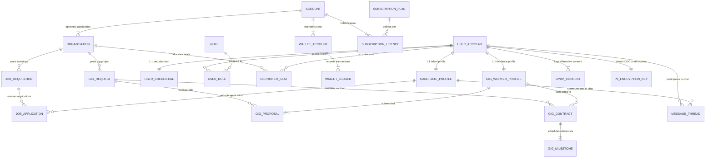
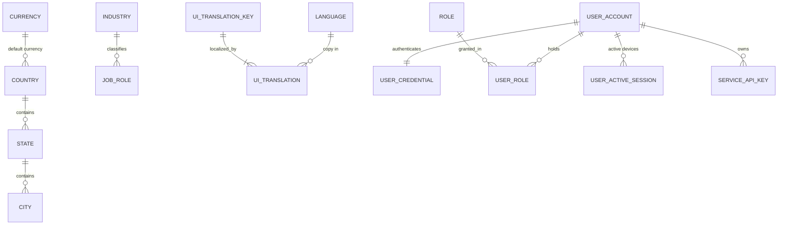
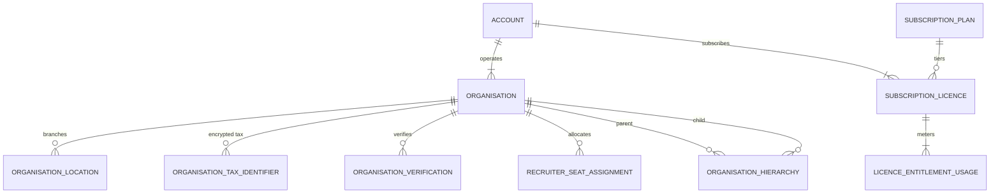
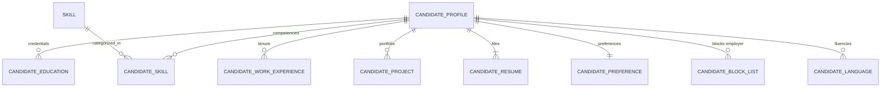
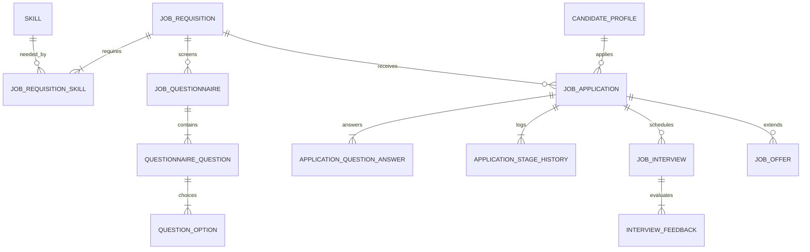
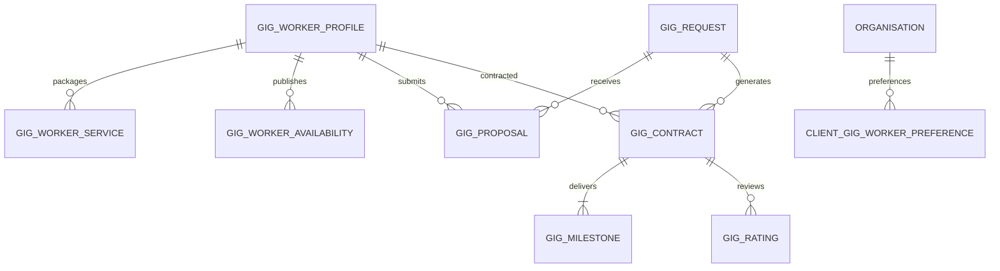
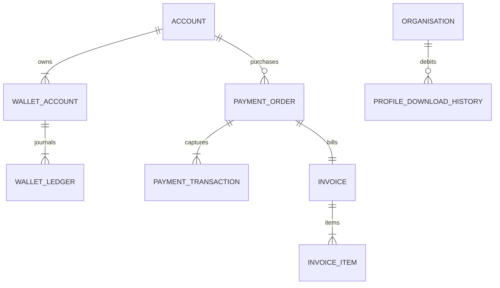

# Deliverable Step 09: Logical Database Design Document (ER Model v0)

**Platform:** Talentra Enterprise Workforce & Talent Demand Management Platform  
**Document Reference:** Deliverable 09 — Logical Database, Tables & Relational Architecture Docket  
**Design Version:** ER Model v0 (Baseline for Physical DDL, Migrations & ORM Mapping)  
**Preceding Discovery Baselines:** Step 06 Entity Discovery (90 Entities), Step 07 Attribute Discovery, Step 08 Entity Lifecycles  
**Standards Alignment:** 3rd Normal Form (3NF) Relational Architecture & Kimball Dimensional Star Schema  

---

## 1. Introduction and Scope

This document establishes the comprehensive **Logical Database Design (ER Model v0)** for the **Talentra Enterprise Workforce Platform**. Building upon the business entity boundaries validated in **Step 06**, the attribute typing and domain constraints defined in **Step 07**, and the 20 state machines discovered in **Step 08**, this deliverable translates abstract conceptual business requirements into an exhaustive, normalized relational data model.

### Key Engineering Objectives:
1. **Complete Relational Transformation:** Map all 90 discovered business entities into concrete logical database tables with verified primary and foreign keys.
2. **Strict 3NF Normalization:** Eliminate repeating groups, partial key dependencies, and transitive functional dependencies while preserving transactional performance.
3. **Exhaustive Relational Cardinality:** Document bidirectional minimum and maximum participation (`0..1`, `1..1`, `0..N`, `1..N`) for every relationship without ambiguous abstractions.
4. **Junction Table Architecture:** Explicitly resolve all many-to-many associations with dedicated junction entities carrying relationship attributes and composite uniqueness constraints.
5. **Defensive Referential Integrity:** Establish robust deletion policies (`ON DELETE RESTRICT` vs `ON DELETE CASCADE`) to protect legal audit trails and prevent orphaned child records.
6. **Logical ER Diagramming:** Provide an end-to-end system overview ER diagram and modular domain-wise ER diagrams conforming strictly to Mermaid `erDiagram` syntax.

---

## 2. Source Documents and Design Assumptions

The logical database design is derived directly from the project discovery deliverables:
* **Phase 1 Baseline:** Business Requirements (`REQ-01` to `REQ-29`), Competitive Capabilities (`COMP-DISC-01` to `COMP-DISC-04`), and Canonical Personas (`P-01` to `P-12`).
* **Step 06 (Entity Discovery Docket):** Deliverable F1 cataloguing 90 normalized entities across 13 domain schemas.
* **Step 07 (Attribute Discovery Document):** Physical data domains, length precisions, example values, nullability justifications, and confidentiality tagging.
* **Step 08 (Lifecycle & State Machine Document):** 20 stateful Finite State Machines, transition invariants, and concurrency locking requirements.

### Architectural Design Assumptions:
1. **Target Engine Capability:** The logical design assumes a modern ACID-compliant relational storage engine (specifically **PostgreSQL 16**) capable of enforcing check constraints, foreign key referential actions, row-level locking, and generalized search trees (`GiST` temporal non-overlapping ranges).
2. **Scale & Volumetrics:** The logical structure is optimized to handle **10,000,000 candidate profiles**, **1,000,000 job requirements**, and **100,000,000 application events** with low-latency indexed queries.
3. **Zero Financial Drift:** Monetary figures use fixed-precision decimal arithmetic (`NUMERIC(12,2)` / `NUMERIC(14,2)`) paired with ISO 4217 sovereign currency codes.

---

## 3. Entity-to-Table Mapping (All 90 Discovered Entities)

Every business entity discovered in Step 06 maps to a logical database table categorized by architectural archetype:

| Business Entity | Database Table | Table Type | Purpose | Justification |
| :--- | :--- | :--- | :--- | :--- |
| `master_data.country` | `master_data.country` | **Lookup / Reference Table** | Sovereign national jurisdictions conforming to ISO 3166-1. | Standardized international country codes and calling prefixes. |
| `master_data.state` | `master_data.state` | **Dependent Reference Table** | First-level administrative subdivisions. | Normalizes regional state hierarchy under sovereign countries. |
| `master_data.city` | `master_data.city` | **Dependent Reference Table** | Metropolitan localities with GIS coordinates. | Powers low-latency radial distance talent searches. |
| `master_data.currency` | `master_data.currency` | **Lookup / Reference Table** | ISO 4217 sovereign currencies and decimal precision. | Guarantees zero floating-point financial arithmetic. |
| `master_data.language` | `master_data.language` | **Lookup / Reference Table** | ISO 639-1 language codes. | Supports UI localization and candidate linguistic tagging. |
| `master_data.industry` | `master_data.industry` | **Lookup / Reference Table** | Economic sectors and industry verticals. | Categorizes employer business models and candidate experience. |
| `master_data.job_role` | `master_data.job_role` | **Dependent Reference Table** | Standardized occupational job roles within industries. | Enables normalized job matching across diverse job titles. |
| `master_data.skill` | `master_data.skill` | **Lookup / Reference Table** | Technical and functional competencies. | GIN trigram indexed search hub for profile and requisition matching. |
| `master_data.qualification` | `master_data.qualification` | **Lookup / Reference Table** | Standardized academic degrees and certifications. | Enables strict minimum educational threshold filtering. |
| `master_data.ui_translation_key` | `master_data.ui_translation_key` | **Lookup / Reference Table** | Programmatic UI string descriptors. | Decouples frontend interface labels from localized copy. |
| `master_data.ui_translation` | `master_data.ui_translation` | **Dependent Child Table** | Localized text copy per language. | Delivers sub-millisecond multilingual display with English fallback. |
| `identity.user_account` | `identity.user_account` | **Standalone Core Table** | Authentication principals across all platform personas. | Central root of identity, RBAC authorization, and account state. |
| `identity.user_credential` | `identity.user_credential` | **Dependent Child Table** | Argon2id cryptographic password digests. | Strict 1:1 security separation isolating password hashes from profile data. |
| `identity.role` | `identity.role` | **Lookup / Reference Table** | Platform security roles across the 11 modules. | Defines discrete permission boundaries and operational scopes. |
| `identity.user_role` | `identity.user_role` | **Junction / Association Table** | M:N assignment of security roles to users. | Supports multi-role personas (e.g. Candidate + Gig Worker). |
| `identity.user_active_session` | `identity.user_active_session` | **Dependent Child Table** | Active login sessions and hardware fingerprints. | Enforces subscription concurrent device limits (max_devices <= 2). |
| `identity.service_api_key` | `identity.service_api_key` | **Dependent Child Table** | Machine-to-machine developer API tokens. | Provides scoped programmatic access for ATS integrations with rate limiting. |
| `organisation.account` | `organisation.account` | **Standalone Core Table** | Commercial billing boundary grouping legal entities. | Top-level tenant boundary for subscription licenses and enterprise billing. |
| `organisation.organisation` | `organisation.organisation` | **Dependent Child Table** | Operating corporate legal entity or subsidiary. | Owns job requisitions, recruiter mappings, and tax profiles. |
| `organisation.organisation_location` | `organisation.organisation_location` | **Dependent Child Table** | Physical corporate branches and interview hubs. | 1:N multi-location support with geocoding for on-site hiring. |
| `organisation.organisation_tax_identifier` | `organisation.organisation_tax_identifier` | **Dependent Child Table** | AES-256 encrypted tax IDs with blind index. | Protects confidential corporate tax numbers while enabling exact lookups. |
| `organisation.organisation_verification` | `organisation.organisation_verification` | **Audit / History Table** | External compliance bureau verification logs. | Immutable proof of corporate legitimacy and anti-fraud checks. |
| `organisation.recruiter_seat_assignment` | `organisation.recruiter_seat_assignment` | **Junction / Association Table** | Assigns recruiters to corporate organizations. | Binds recruiter permissions and enforces subscription seat caps. |
| `organisation.organisation_hierarchy` | `organisation.organisation_hierarchy` | **Junction / Association Table** | Self-referencing parent-child corporate hierarchy. | Models multi-tier conglomerates and operating branch networks. |
| `candidate.candidate_profile` | `candidate.candidate_profile` | **Standalone Core Table** | 3NF unified professional candidate talent profile. | Single source of truth for candidate attributes, compensation, and privacy. |
| `candidate.candidate_education` | `candidate.candidate_education` | **Dependent Child Table** | Chronological academic history and GPA. | 1:N normalization of educational credentials. |
| `candidate.candidate_work_experience` | `candidate.candidate_work_experience` | **Dependent Child Table** | Chronological employment history and corporate tenure. | 1:N normalization of professional background. |
| `candidate.candidate_skill` | `candidate.candidate_skill` | **Junction / Association Table** | M:N mapping of candidates to master skills. | Stores proficiency ratings and verified years of experience. |
| `candidate.candidate_project` | `candidate.candidate_project` | **Dependent Child Table** | Portfolio projects, open-source work, and patents. | 1:N normalization of technical portfolio samples. |
| `candidate.candidate_resume` | `candidate.candidate_resume` | **Dependent Child Table** | Versioned resume artifacts and tsvector search index. | 1:N management of CV files and full-text keyword indexing. |
| `candidate.candidate_preference` | `candidate.candidate_preference` | **Dependent Child Table** | Workplace preferences, relocation, and remote mode. | 1:1 profile extension for candidate job-matching algorithms. |
| `candidate.candidate_block_list` | `candidate.candidate_block_list` | **Junction / Association Table** | Anti-join privacy shield blocking specific employers. | Guarantees candidates remain completely invisible to blocked companies. |
| `candidate.candidate_language` | `candidate.candidate_language` | **Junction / Association Table** | M:N mapping of candidate linguistic proficiencies. | Records reading, writing, and speaking competencies. |
| `recruitment.job_requisition` | `recruitment.job_requisition` | **Standalone Core Table** | Job requirement postings with salary bands and quotas. | Central demand artifact governing hiring lifecycle and search indexing. |
| `recruitment.job_requisition_skill` | `recruitment.job_requisition_skill` | **Junction / Association Table** | M:N mapping of required skills to job postings. | Specifies mandatory vs preferred skills and minimum experience. |
| `recruitment.job_questionnaire` | `recruitment.job_questionnaire` | **Dependent Child Table** | Screening questionnaire header and passing thresholds. | 1:1 pre-screening assessment specification per requisition. |
| `recruitment.questionnaire_question` | `recruitment.questionnaire_question` | **Dependent Child Table** | Screening questions with point weights and knockout flags. | 1:N structured question tree with disqualifying criteria. |
| `recruitment.question_option` | `recruitment.question_option` | **Dependent Child Table** | Pre-configured multiple choice answers with score values. | 1:N selectable answers enabling automated scoring. |
| `application.job_application` | `application.job_application` | **Standalone Core Table** | Candidate job application tracking across 13-stage FSM. | Core hiring pipeline transaction binding candidate, resume, and job. |
| `application.application_question_answer` | `application.application_question_answer` | **Dependent Child Table** | Candidate responses to screening questionnaire. | 1:N candidate answer submissions preserving audit evidence. |
| `application.application_stage_history` | `application.application_stage_history` | **Audit / History Table** | Immutable ledger of stage movements across hiring funnel. | Append-only state machine log calculating time-to-hire velocity. |
| `application.job_interview` | `application.job_interview` | **Dependent Child Table** | Scheduled interview rounds and meeting assignments. | 1:N evaluation rounds with calendar slots and meeting links. |
| `application.interview_feedback` | `application.interview_feedback` | **Dependent Child Table** | Structured scorecard and quantitative interview ratings. | 1:N qualitative reviews evaluating candidate fit (1.0 - 5.0). |
| `application.job_offer` | `application.job_offer` | **Dependent Child Table** | Formal employment offer letters, salary terms, and validity. | 1:1 binding corporate offer issued to accepted application. |
| `sourcing.consultant_authorization` | `sourcing.consultant_authorization` | **Junction / Association Table** | Agreements authorizing agencies to source for requisitions. | Binds external staffing consultants, commission rates, and deadlines. |
| `sourcing.candidate_nomination` | `sourcing.candidate_nomination` | **Dependent Child Table** | Candidates submitted by staffing agencies for review. | Tracks agency ownership and prevents duplicate submissions. |
| `sourcing.outreach_campaign` | `sourcing.outreach_campaign` | **Dependent Child Table** | Bulk candidate outreach batches across email and SMS. | Tracks campaign budgets and quota credit deductions. |
| `sourcing.outreach_recipient` | `sourcing.outreach_recipient` | **Dependent Child Table** | Granular transmission status and open/click tracking. | 1:N candidate delivery events tracking sourcing conversion. |
| `gig.gig_worker_profile` | `gig.gig_worker_profile` | **Standalone Core Table** | Freelance contractor profile with rates and review ratings. | Distinct marketplace profile separated from permanent candidate profiles. |
| `gig.gig_worker_service` | `gig.gig_worker_service` | **Dependent Child Table** | Packaged consulting and freelance service catalog. | 1:N fixed-price or rate-based offerings published by worker. |
| `gig.gig_worker_availability` | `gig.gig_worker_availability` | **Dependent Child Table** | Calendar availability slots for consultations. | 1:N schedule slots supporting freelance booking. |
| `gig.gig_request` | `gig.gig_request` | **Standalone Core Table** | Project-based contingent work demands. | Short-duration requisition carrying start/end windows and pricing. |
| `gig.gig_proposal` | `gig.gig_proposal` | **Dependent Child Table** | Unidirectional bid proposal submitted by gig worker. | 1:N applications from freelance contractors to open gig requests. |
| `gig.gig_contract` | `gig.gig_contract` | **Standalone Core Table** | Binding engagement with GiST temporal non-overlap locking. | Enforces exclusive calendar bookings via PostgreSQL GiST exclusion. |
| `gig.gig_milestone` | `gig.gig_milestone` | **Dependent Child Table** | Progress deliverables tied to wallet escrow disbursements. | 1:N deliverable schedules governing staged escrow release. |
| `gig.gig_rating` | `gig.gig_rating` | **Dependent Child Table** | Bilateral review ratings and performance feedback. | 1:N post-contract quality ratings updating aggregate reputation. |
| `gig.client_gig_worker_preference` | `gig.client_gig_worker_preference` | **Junction / Association Table** | Employer favorite and blacklist registers for contractors. | M:N contractor preference registry for client organizations. |
| `licensing.subscription_plan` | `licensing.subscription_plan` | **Lookup / Reference Table** | Commercial subscription tiers defining seats and quotas. | Defines base prices, recruiter seat caps, and device login rules. |
| `licensing.subscription_licence` | `licensing.subscription_licence` | **Standalone Core Table** | Active commercial license granted to an enterprise account. | Enforces non-overlapping validity windows and recruiter seat caps. |
| `licensing.licence_entitlement_usage` | `licensing.licence_entitlement_usage` | **Dependent Child Table** | Monthly consumption tracking against contract quotas. | 1:N periodic metering tracking profile unlocks and postings. |
| `billing.wallet_account` | `billing.wallet_account` | **Standalone Core Table** | Cash balance repository maintaining available and escrow funds. | Holds liquid and reserved balances per commercial account and currency. |
| `billing.wallet_ledger` | `billing.wallet_ledger` | **Audit / History Table** | Double-entry transaction journal with paired debits/credits. | Append-only financial book of record enforcing $0.00 net variance. |
| `billing.payment_order` | `billing.payment_order` | **Standalone Core Table** | Commercial checkout orders for plans and wallet top-ups. | Tracks customer purchasing transactions and PSP gateway references. |
| `billing.payment_transaction` | `billing.payment_transaction` | **Dependent Child Table** | Gateway charge attempts, authorization codes, and methods. | 1:N payment capture attempts per commercial checkout order. |
| `billing.payment_gateway_event` | `billing.payment_gateway_event` | **Audit / History Table** | Inbound PSP webhook event buffer with payload JSON. | Guarantees idempotent exactly-once processing of payment webhooks. |
| `billing.invoice` | `billing.invoice` | **Standalone Core Table** | Statutory corporate tax invoices with sequential numbering. | Official tax document fulfilling legal GST/VAT accounting mandates. |
| `billing.invoice_item` | `billing.invoice_item` | **Dependent Child Table** | Itemized line items detailing individual charges and taxes. | 1:N charge breakdown establishing subtotal and tax amounts. |
| `billing.profile_download_history` | `billing.profile_download_history` | **Audit / History Table** | Append-only metering receipt for unmasked candidate views. | Tracks recruiter talent sourcing velocity and quota consumption. |
| `engagement.candidate_saved_search` | `engagement.candidate_saved_search` | **Dependent Child Table** | Saved recruiter search criteria presets. | Stores JSON faceted search filters for repeat candidate sourcing. |
| `engagement.job_alert_subscription` | `engagement.job_alert_subscription` | **Dependent Child Table** | Automated notifications matching candidate job preferences. | Asynchronously evaluated by matching daemons upon job publication. |
| `engagement.notification_delivery` | `engagement.notification_delivery` | **Dependent Child Table** | Multi-channel message dispatch status (Email, SMS, In-App). | Tracks delivery states, gateway message IDs, and read receipts. |
| `engagement.message_thread` | `engagement.message_thread` | **Standalone Core Table** | Direct messaging channel between recruiter and unlocked candidate. | Bound to paid contact unlock receipt; governed by DPDP consent. |
| `engagement.thread_message` | `engagement.thread_message` | **Dependent Child Table** | Encrypted message payloads exchanged within a thread. | 1:N messages encrypted at rest using candidate Data Encryption Key. |
| `engagement.candidate_referral_link` | `engagement.candidate_referral_link` | **Dependent Child Table** | Unique cryptographic referral tokens. | Generates tracked links for candidate referral drives. |
| `engagement.referral_attribution_event` | `engagement.referral_attribution_event` | **Audit / History Table** | Milestone conversion events rewarding referrers. | Append-only attribution ledger awarding recruitment credits. |
| `engagement.campus_placement_cohort` | `engagement.campus_placement_cohort` | **Standalone Core Table** | University placement drive batches managed by TPOs. | Groups graduating class student talent by university and degree. |
| `engagement.campus_student_member` | `engagement.campus_student_member` | **Junction / Association Table** | Enrolls students into campus placement cohorts. | Tracks matriculation roll numbers, GPAs, and placement outcomes. |
| `governance.dpdp_consent_record` | `governance.dpdp_consent_record` | **Audit / History Table** | Affirmative consent register under India's DPDP Act 2023. | Immutable proof of purpose-bound consent and statutory revocations. |
| `governance.pii_encryption_key` | `governance.pii_encryption_key` | **Dependent Child Table** | Per-user Data Encryption Keys (DEKs) wrapped by master HSM. | Zeroing DEK executes sub-second Right-to-be-Forgotten PII shredding. |
| `governance.system_audit_event` | `governance.system_audit_event` | **Audit / History Table** | Tamper-evident audit trail secured by SHA-256 hash chains. | Immutable chronological security log for statutory non-repudiation. |
| `governance.data_retention_policy` | `governance.data_retention_policy` | **Lookup / Reference Table** | Statutory data retention schedules. | Automates scheduled archival and purging of expired records. |
| `analytics.dim_date` | `analytics.dim_date` | **Kimball Conformed Dimension** | Standardized date dimension in YYYYMMDD format. | Provides calendar attributes for time-slice aggregations. |
| `analytics.dim_candidate` | `analytics.dim_candidate` | **Kimball Conformed Dimension** | Slowly Changing Dimension (Type 2) tracking candidate profiles. | Captures point-in-time candidate demographics and experience. |
| `analytics.dim_organisation` | `analytics.dim_organisation` | **Kimball Conformed Dimension** | Slowly Changing Dimension (Type 2) tracking corporate employers. | Captures point-in-time employer industry and headcount tiers. |
| `analytics.dim_job_requisition` | `analytics.dim_job_requisition` | **Kimball Conformed Dimension** | Slowly Changing Dimension (Type 2) tracking job postings. | Captures point-in-time compensation bands and occupational roles. |
| `analytics.dim_pipeline_stage` | `analytics.dim_pipeline_stage` | **Kimball Conformed Dimension** | Discrete milestones in the 13-stage hiring funnel. | Enables funnel bottleneck and conversion rate analysis. |
| `analytics.fact_application_event` | `analytics.fact_application_event` | **Kimball Accumulating Fact** | Candidate progression velocity between pipeline stages. | Measures precise time-to-hire and stage duration latency in hours. |
| `analytics.fact_profile_download` | `analytics.fact_profile_download` | **Kimball Transactional Fact** | Recruiter talent searches, profile unlocks, and quota credits. | Calculates recruiter talent acquisition throughput and monetization. |
| `analytics.fact_gig_contract` | `analytics.fact_gig_contract` | **Kimball Transactional Fact** | Contingent project spend, delivery days, and review ratings. | Calculates contractor earnings benchmarks and enterprise gig spend. |
| `analytics.fact_wallet_transaction` | `analytics.fact_wallet_transaction` | **Kimball Financial Fact** | Daily financial summaries verified against double-entry ledger. | Validates mathematical $0.00 net variance across financial marts. |

---

## 4. Detailed Logical Table Definitions (90 Tables Across 13 Modules)

This section documents the complete logical schema for all 90 database tables. For every column, the logical specification defines: `Column Name`, `Data Type`, `Primary Key`, `Foreign Key`, `Nullable`, `Unique`, `Default`, and `Description`.

### Module 1: Master Reference & Localization (`master_data`)

#### 4.1 Table: `master_data.country`
**Description:** Sovereign national jurisdictions conforming to ISO 3166-1 alpha-2 and alpha-3 standards.  
**Column Count:** 10 logical columns.

| Column Name | Data Type | Primary Key | Foreign Key | Nullable | Unique | Default | Description |
| :--- | :--- | :---: | :--- | :---: | :---: | :--- | :--- |
| `id` | `UUID` | **Yes** | None | No | No | `gen_random_uuid()` | Surrogate primary key identifying the country record. |
| `iso_alpha2_code` | `CHAR(2)` | **No** | None | No | Yes | None | Two-letter ISO 3166-1 country code used for standardized mapping. |
| `iso_alpha3_code` | `CHAR(3)` | **No** | None | No | Yes | None | Three-letter ISO 3166-1 country code for customs and reporting. |
| `country_name` | `VARCHAR(100)` | **No** | None | No | No | None | Official English name of the sovereign nation. |
| `phone_dialing_code` | `VARCHAR(10)` | **No** | None | No | No | None | International E.164 telecommunication prefix. |
| `currency_code` | `CHAR(3)` | **No** | `master_data.currency(currency_code)` | No | No | None | Default sovereign currency code matching ISO 4217. |
| `is_active` | `BOOLEAN` | **No** | None | No | No | `TRUE` | Operational flag indicating whether the country is active for business. |
| `sort_order` | `INTEGER` | **No** | None | No | No | `100` | Display sort order for UI dropdown rendering. |
| `created_at` | `TIMESTAMPTZ` | **No** | None | No | No | `CURRENT_TIMESTAMP` | Timestamp at which the record was created. |
| `updated_at` | `TIMESTAMPTZ` | **No** | None | No | No | `CURRENT_TIMESTAMP` | Timestamp of most recent record update. |

#### 4.2 Table: `master_data.state`
**Description:** First-level administrative subdivision (state, province, territory) within a sovereign country.  
**Column Count:** 8 logical columns.

| Column Name | Data Type | Primary Key | Foreign Key | Nullable | Unique | Default | Description |
| :--- | :--- | :---: | :--- | :---: | :---: | :--- | :--- |
| `id` | `UUID` | **Yes** | None | No | No | `gen_random_uuid()` | Surrogate primary key identifying the administrative state. |
| `country_id` | `UUID` | **No** | `master_data.country(id)` | No | No | None | Foreign key identifying the parent sovereign country. |
| `state_code` | `VARCHAR(10)` | **No** | None | No | No | None | Standardized administrative state or province abbreviation. |
| `state_name` | `VARCHAR(100)` | **No** | None | No | No | None | Full official name of the state or province. |
| `is_active` | `BOOLEAN` | **No** | None | No | No | `TRUE` | Operational availability flag. |
| `sort_order` | `INTEGER` | **No** | None | No | No | `100` | Administrative sort order within country. |
| `created_at` | `TIMESTAMPTZ` | **No** | None | No | No | `CURRENT_TIMESTAMP` | Timestamp at which the state was recorded. |
| `updated_at` | `TIMESTAMPTZ` | **No** | None | No | No | `CURRENT_TIMESTAMP` | Timestamp of most recent update. |

#### 4.3 Table: `master_data.city`
**Description:** Metropolitan or municipal locality supporting radial distance searches and location faceting.  
**Column Count:** 9 logical columns.

| Column Name | Data Type | Primary Key | Foreign Key | Nullable | Unique | Default | Description |
| :--- | :--- | :---: | :--- | :---: | :---: | :--- | :--- |
| `id` | `UUID` | **Yes** | None | No | No | `gen_random_uuid()` | Surrogate primary key identifying the city or municipality. |
| `country_id` | `UUID` | **No** | `master_data.country(id)` | No | No | None | Foreign key identifying sovereign national territory. |
| `state_id` | `UUID` | **No** | `master_data.state(id)` | No | No | None | Foreign key identifying administrative parent state. |
| `city_name` | `VARCHAR(100)` | **No** | None | No | No | None | Standardized English name of the city or municipality. |
| `latitude` | `NUMERIC(9,6)` | **No** | None | Yes | No | `NULL` | Geographic latitude coordinate for radial GIS lookups. |
| `longitude` | `NUMERIC(9,6)` | **No** | None | Yes | No | `NULL` | Geographic longitude coordinate for radial GIS lookups. |
| `is_active` | `BOOLEAN` | **No** | None | No | No | `TRUE` | Operational availability flag for search index faceting. |
| `created_at` | `TIMESTAMPTZ` | **No** | None | No | No | `CURRENT_TIMESTAMP` | Creation audit timestamp in UTC. |
| `updated_at` | `TIMESTAMPTZ` | **No** | None | No | No | `CURRENT_TIMESTAMP` | Last update timestamp. |

#### 4.4 Table: `master_data.currency`
**Description:** ISO 4217 sovereign currency codes defining monetary symbols and physical decimal arithmetic precision.  
**Column Count:** 8 logical columns.

| Column Name | Data Type | Primary Key | Foreign Key | Nullable | Unique | Default | Description |
| :--- | :--- | :---: | :--- | :---: | :---: | :--- | :--- |
| `currency_code` | `CHAR(3)` | **Yes** | None | No | No | None | Three-letter ISO 4217 currency identifier used as primary key. |
| `currency_name` | `VARCHAR(50)` | **No** | None | No | No | None | Full official English currency name. |
| `currency_symbol` | `VARCHAR(5)` | **No** | None | No | No | None | Display currency symbol for localized client presentation. |
| `decimal_precision` | `SMALLINT` | **No** | None | No | No | `2` | Number of fractional decimal places supported (e.g. 2 for USD, 0 for JPY). |
| `iso_numeric_code` | `CHAR(3)` | **No** | None | No | Yes | None | ISO 4217 numeric currency code for banking exchanges. |
| `is_active` | `BOOLEAN` | **No** | None | No | No | `TRUE` | Indicates whether the currency is selectable for transactions. |
| `created_at` | `TIMESTAMPTZ` | **No** | None | No | No | `CURRENT_TIMESTAMP` | Creation timestamp in UTC. |
| `updated_at` | `TIMESTAMPTZ` | **No** | None | No | No | `CURRENT_TIMESTAMP` | Last update timestamp. |

#### 4.5 Table: `master_data.language`
**Description:** Standardized human languages conforming to ISO 639-1 supporting multilingual UI and resume tagging.  
**Column Count:** 7 logical columns.

| Column Name | Data Type | Primary Key | Foreign Key | Nullable | Unique | Default | Description |
| :--- | :--- | :---: | :--- | :---: | :---: | :--- | :--- |
| `language_code` | `CHAR(2)` | **Yes** | None | No | No | None | Two-letter ISO 639-1 code used as primary key. |
| `language_name` | `VARCHAR(50)` | **No** | None | No | No | None | Standard English name of the language. |
| `native_name` | `VARCHAR(100)` | **No** | None | No | No | None | Endonym name rendered in native typography. |
| `is_rtl` | `BOOLEAN` | **No** | None | No | No | `FALSE` | Flag indicating right-to-left layout rendering (e.g. Arabic, Hebrew). |
| `is_active` | `BOOLEAN` | **No** | None | No | No | `TRUE` | Active availability flag for UI translation and profiling. |
| `created_at` | `TIMESTAMPTZ` | **No** | None | No | No | `CURRENT_TIMESTAMP` | Record creation timestamp. |
| `updated_at` | `TIMESTAMPTZ` | **No** | None | No | No | `CURRENT_TIMESTAMP` | Record last update timestamp. |

#### 4.6 Table: `master_data.industry`
**Description:** Standardized economic sectors and industry classifications (e.g. IT, Healthcare, Finance).  
**Column Count:** 8 logical columns.

| Column Name | Data Type | Primary Key | Foreign Key | Nullable | Unique | Default | Description |
| :--- | :--- | :---: | :--- | :---: | :---: | :--- | :--- |
| `id` | `UUID` | **Yes** | None | No | No | `gen_random_uuid()` | Surrogate primary key identifying the industry sector. |
| `industry_code` | `VARCHAR(30)` | **No** | None | No | Yes | None | Unique programmatic identifier for the industry. |
| `industry_name` | `VARCHAR(100)` | **No** | None | No | No | None | Human-readable industry name. |
| `description` | `VARCHAR(500)` | **No** | None | Yes | No | `NULL` | Contextual scope of the industrial sector. |
| `is_active` | `BOOLEAN` | **No** | None | No | No | `TRUE` | Flag indicating whether the sector is active. |
| `sort_order` | `INTEGER` | **No** | None | No | No | `100` | UI dropdown presentation priority. |
| `created_at` | `TIMESTAMPTZ` | **No** | None | No | No | `CURRENT_TIMESTAMP` | Record creation timestamp in UTC. |
| `updated_at` | `TIMESTAMPTZ` | **No** | None | No | No | `CURRENT_TIMESTAMP` | Last update timestamp. |

#### 4.7 Table: `master_data.job_role`
**Description:** Standardized occupational roles and functional job titles linked to industrial sectors.  
**Column Count:** 9 logical columns.

| Column Name | Data Type | Primary Key | Foreign Key | Nullable | Unique | Default | Description |
| :--- | :--- | :---: | :--- | :---: | :---: | :--- | :--- |
| `id` | `UUID` | **Yes** | None | No | No | `gen_random_uuid()` | Surrogate primary key identifying the occupational role. |
| `industry_id` | `UUID` | **No** | `master_data.industry(id)` | No | No | None | Foreign key identifying the parent industry sector. |
| `role_code` | `VARCHAR(50)` | **No** | None | No | Yes | None | Programmatic code for normalized job matching. |
| `role_title` | `VARCHAR(100)` | **No** | None | No | No | None | Standard display title of the occupational job role. |
| `description` | `VARCHAR(500)` | **No** | None | Yes | No | `NULL` | Role definition and responsibility boundary. |
| `is_active` | `BOOLEAN` | **No** | None | No | No | `TRUE` | Active status flag for requisition posting. |
| `sort_order` | `INTEGER` | **No** | None | No | No | `100` | Display ordering within industry hierarchy. |
| `created_at` | `TIMESTAMPTZ` | **No** | None | No | No | `CURRENT_TIMESTAMP` | Creation timestamp in UTC. |
| `updated_at` | `TIMESTAMPTZ` | **No** | None | No | No | `CURRENT_TIMESTAMP` | Last update timestamp. |

#### 4.8 Table: `master_data.skill`
**Description:** Standardized technical, functional, and domain competencies used for resume matching and job requirements.  
**Column Count:** 8 logical columns.

| Column Name | Data Type | Primary Key | Foreign Key | Nullable | Unique | Default | Description |
| :--- | :--- | :---: | :--- | :---: | :---: | :--- | :--- |
| `id` | `UUID` | **Yes** | None | No | No | `gen_random_uuid()` | Surrogate primary key identifying the skill competency. |
| `skill_code` | `VARCHAR(50)` | **No** | None | No | Yes | None | Unique normalized uppercase identifier. |
| `skill_name` | `VARCHAR(100)` | **No** | None | No | No | None | Display name of the skill competency. |
| `category` | `VARCHAR(50)` | **No** | None | No | No | None | Competency classification category (e.g. LANGUAGE, FRAMEWORK, DATABASE). |
| `is_verified` | `BOOLEAN` | **No** | None | No | No | `TRUE` | Indicates whether the skill is platform-verified vs user-suggested. |
| `is_active` | `BOOLEAN` | **No** | None | No | No | `TRUE` | Operational availability flag. |
| `created_at` | `TIMESTAMPTZ` | **No** | None | No | No | `CURRENT_TIMESTAMP` | Creation audit timestamp. |
| `updated_at` | `TIMESTAMPTZ` | **No** | None | No | No | `CURRENT_TIMESTAMP` | Last update timestamp. |

#### 4.9 Table: `master_data.qualification`
**Description:** Standardized academic degrees, diplomas, and certifications conforming to national education frameworks.  
**Column Count:** 9 logical columns.

| Column Name | Data Type | Primary Key | Foreign Key | Nullable | Unique | Default | Description |
| :--- | :--- | :---: | :--- | :---: | :---: | :--- | :--- |
| `id` | `UUID` | **Yes** | None | No | No | `gen_random_uuid()` | Surrogate primary key identifying the qualification level. |
| `qualification_code` | `VARCHAR(50)` | **No** | None | No | Yes | None | Unique programmatic code for the qualification. |
| `qualification_name` | `VARCHAR(150)` | **No** | None | No | No | None | Full academic degree or certification title. |
| `qualification_level` | `VARCHAR(30)` | **No** | None | No | No | None | Academic tier hierarchy. |
| `field_of_study` | `VARCHAR(100)` | **No** | None | No | No | None | Specialization or major branch of study. |
| `is_active` | `BOOLEAN` | **No** | None | No | No | `TRUE` | Operational active flag. |
| `sort_order` | `INTEGER` | **No** | None | No | No | `100` | Dropdown sorting priority. |
| `created_at` | `TIMESTAMPTZ` | **No** | None | No | No | `CURRENT_TIMESTAMP` | Creation audit timestamp in UTC. |
| `updated_at` | `TIMESTAMPTZ` | **No** | None | No | No | `CURRENT_TIMESTAMP` | Last update timestamp. |

#### 4.10 Table: `master_data.ui_translation_key`
**Description:** Immutable programmatic string keys decoupling user interface labels from localized copy.  
**Column Count:** 6 logical columns.

| Column Name | Data Type | Primary Key | Foreign Key | Nullable | Unique | Default | Description |
| :--- | :--- | :---: | :--- | :---: | :---: | :--- | :--- |
| `id` | `UUID` | **Yes** | None | No | No | `gen_random_uuid()` | Surrogate primary key for the translation key descriptor. |
| `translation_key` | `VARCHAR(150)` | **No** | None | No | Yes | None | Programmatic translation key referenced by frontends. |
| `category` | `VARCHAR(50)` | **No** | None | No | No | None | UI screen or feature category module. |
| `description` | `VARCHAR(500)` | **No** | None | Yes | No | `NULL` | Translator guidance describing context of string. |
| `created_at` | `TIMESTAMPTZ` | **No** | None | No | No | `CURRENT_TIMESTAMP` | Creation timestamp in UTC. |
| `updated_at` | `TIMESTAMPTZ` | **No** | None | No | No | `CURRENT_TIMESTAMP` | Last update timestamp. |

#### 4.11 Table: `master_data.ui_translation`
**Description:** Localized text copy mapping programmatic UI translation keys to sovereign languages with English fallback.  
**Column Count:** 7 logical columns.

| Column Name | Data Type | Primary Key | Foreign Key | Nullable | Unique | Default | Description |
| :--- | :--- | :---: | :--- | :---: | :---: | :--- | :--- |
| `id` | `UUID` | **Yes** | None | No | No | `gen_random_uuid()` | Surrogate primary key for the localized translation entry. |
| `key_id` | `UUID` | **No** | `master_data.ui_translation_key(id)` | No | No | None | Foreign key identifying the parent translation key. |
| `language_code` | `CHAR(2)` | **No** | `master_data.language(language_code)` | No | No | None | Foreign key identifying the target human language. |
| `translated_text` | `TEXT` | **No** | None | No | No | None | Localized string copy rendered to end users. |
| `is_reviewed` | `BOOLEAN` | **No** | None | No | No | `FALSE` | Indicates if translation was verified by professional linguist. |
| `created_at` | `TIMESTAMPTZ` | **No** | None | No | No | `CURRENT_TIMESTAMP` | Creation audit timestamp in UTC. |
| `updated_at` | `TIMESTAMPTZ` | **No** | None | No | No | `CURRENT_TIMESTAMP` | Last update timestamp. |

### Module 2: Identity & Access Management (`identity`)

#### 4.12 Table: `identity.user_account`
**Description:** Core identity principal representing individual human actors across all tenant domains.  
**Column Count:** 17 logical columns.

| Column Name | Data Type | Primary Key | Foreign Key | Nullable | Unique | Default | Description |
| :--- | :--- | :---: | :--- | :---: | :---: | :--- | :--- |
| `id` | `UUID` | **Yes** | None | No | No | `gen_random_uuid()` | Surrogate primary key identifying the user principal. |
| `email` | `VARCHAR(254)` | **No** | None | No | Yes | None | Normalized lowercase email address serving as login username. |
| `phone_country_code` | `VARCHAR(5)` | **No** | None | No | No | None | Sovereign telecommunication country prefix. |
| `phone_number` | `VARCHAR(20)` | **No** | None | No | Yes | None | Standardized E.164 contact telephone number. |
| `user_type` | `VARCHAR(30)` | **No** | None | No | No | None | Primary persona classification for login routing. |
| `account_status` | `VARCHAR(20)` | **No** | None | No | No | `'PENDING_VERIFICATION'` | Operational lifecycle state of user account. |
| `is_email_verified` | `BOOLEAN` | **No** | None | No | No | `FALSE` | Cryptographic verification status of email address. |
| `is_phone_verified` | `BOOLEAN` | **No** | None | No | No | `FALSE` | Cryptographic OTP verification status of phone. |
| `two_factor_enabled` | `BOOLEAN` | **No** | None | No | No | `FALSE` | Indicates whether multi-factor authentication is active. |
| `failed_login_attempts` | `SMALLINT` | **No** | None | No | No | `0` | Consecutive failed password attempts counter. |
| `locked_until` | `TIMESTAMPTZ` | **No** | None | Yes | No | `NULL` | Timestamp until which account is locked after brute force. |
| `last_login_at` | `TIMESTAMPTZ` | **No** | None | Yes | No | `NULL` | Timestamp of most recent successful user authentication. |
| `created_at` | `TIMESTAMPTZ` | **No** | None | No | No | `CURRENT_TIMESTAMP` | Timestamp of account registration. |
| `created_by` | `UUID` | **No** | None | Yes | No | `NULL` | Actor ID who initiated account creation. |
| `updated_at` | `TIMESTAMPTZ` | **No** | None | No | No | `CURRENT_TIMESTAMP` | Timestamp of latest account profile update. |
| `updated_by` | `UUID` | **No** | `identity.user_account(id)` | Yes | No | `NULL` | Actor ID of updater. |
| `deleted_at` | `TIMESTAMPTZ` | **No** | None | Yes | No | `NULL` | Soft deletion timestamp for regulatory compliance. |

#### 4.13 Table: `identity.user_credential`
**Description:** Cryptographically secure password credentials hashed with Argon2id to resist GPU cracking.  
**Column Count:** 9 logical columns.

| Column Name | Data Type | Primary Key | Foreign Key | Nullable | Unique | Default | Description |
| :--- | :--- | :---: | :--- | :---: | :---: | :--- | :--- |
| `id` | `UUID` | **Yes** | None | No | No | `gen_random_uuid()` | Surrogate primary key identifying the credential record. |
| `user_id` | `UUID` | **No** | `identity.user_account(id)` | No | Yes | None | Foreign key identifying owning user account. |
| `password_hash` | `VARCHAR(255)` | **No** | None | No | No | None | Argon2id cryptographic digest string. |
| `password_salt` | `VARCHAR(64)` | **No** | None | No | No | None | Cryptographically secure random per-user salt. |
| `hash_algorithm` | `VARCHAR(30)` | **No** | None | No | No | `'ARGON2ID'` | Cryptographic hashing algorithm designation. |
| `password_changed_at` | `TIMESTAMPTZ` | **No** | None | No | No | `CURRENT_TIMESTAMP` | Timestamp when current password was set. |
| `must_change_password` | `BOOLEAN` | **No** | None | No | No | `FALSE` | Flag forcing password change on next login (e.g. temporary credentials). |
| `created_at` | `TIMESTAMPTZ` | **No** | None | No | No | `CURRENT_TIMESTAMP` | Creation timestamp in UTC. |
| `updated_at` | `TIMESTAMPTZ` | **No** | None | No | No | `CURRENT_TIMESTAMP` | Last update timestamp. |

#### 4.14 Table: `identity.role`
**Description:** Standardized platform security roles defining permission sets across the 11 architecture modules.  
**Column Count:** 9 logical columns.

| Column Name | Data Type | Primary Key | Foreign Key | Nullable | Unique | Default | Description |
| :--- | :--- | :---: | :--- | :---: | :---: | :--- | :--- |
| `id` | `UUID` | **Yes** | None | No | No | `gen_random_uuid()` | Surrogate primary key identifying the role entity. |
| `role_code` | `VARCHAR(50)` | **No** | None | No | Yes | None | Unique programmatic code representing the security role. |
| `role_name` | `VARCHAR(100)` | **No** | None | No | No | None | Human-readable role designation. |
| `role_scope` | `VARCHAR(30)` | **No** | None | No | No | None | Scope boundary of the role authority. |
| `description` | `VARCHAR(500)` | **No** | None | Yes | No | `NULL` | Functional responsibility boundaries of role. |
| `is_system_role` | `BOOLEAN` | **No** | None | No | No | `TRUE` | Flag preventing administrative deletion of core platform roles. |
| `is_active` | `BOOLEAN` | **No** | None | No | No | `TRUE` | Operational availability flag. |
| `created_at` | `TIMESTAMPTZ` | **No** | None | No | No | `CURRENT_TIMESTAMP` | Creation audit timestamp in UTC. |
| `updated_at` | `TIMESTAMPTZ` | **No** | None | No | No | `CURRENT_TIMESTAMP` | Last update timestamp. |

#### 4.15 Table: `identity.user_role`
**Description:** Associative mapping table assigning granular security roles to authenticated user principals.  
**Column Count:** 7 logical columns.

| Column Name | Data Type | Primary Key | Foreign Key | Nullable | Unique | Default | Description |
| :--- | :--- | :---: | :--- | :---: | :---: | :--- | :--- |
| `id` | `UUID` | **Yes** | None | No | No | `gen_random_uuid()` | Surrogate primary key identifying the role grant. |
| `user_id` | `UUID` | **No** | `identity.user_account(id)` | No | No | None | Foreign key identifying the assigned user account. |
| `role_id` | `UUID` | **No** | `identity.role(id)` | No | No | None | Foreign key identifying the granted security role. |
| `granted_by` | `UUID` | **No** | `identity.user_account(id)` | No | No | None | User ID of administrator who authorized the role assignment. |
| `granted_at` | `TIMESTAMPTZ` | **No** | None | No | No | `CURRENT_TIMESTAMP` | Timestamp when role became effective. |
| `expires_at` | `TIMESTAMPTZ` | **No** | None | Yes | No | `NULL` | Optional expiration timestamp for temporary or break-glass access. |
| `is_active` | `BOOLEAN` | **No** | None | No | No | `TRUE` | Flag indicating whether role grant is actively enforced. |

#### 4.16 Table: `identity.user_active_session`
**Description:** Enforces strict concurrent device login limits per user account based on subscription licensing rules.  
**Column Count:** 12 logical columns.

| Column Name | Data Type | Primary Key | Foreign Key | Nullable | Unique | Default | Description |
| :--- | :--- | :---: | :--- | :---: | :---: | :--- | :--- |
| `id` | `UUID` | **Yes** | None | No | No | `gen_random_uuid()` | Surrogate primary key identifying the active login session. |
| `user_id` | `UUID` | **No** | `identity.user_account(id)` | No | No | None | Foreign key identifying the authenticated user. |
| `session_token_hash` | `CHAR(64)` | **No** | None | No | Yes | None | SHA-256 hash of issued Bearer JWT session token. |
| `device_id` | `VARCHAR(100)` | **No** | None | No | No | None | Client hardware/browser fingerprint identifier. |
| `device_type` | `VARCHAR(30)` | **No** | None | No | No | None | Client form factor categorization. |
| `client_ip` | `INET` | **No** | None | No | No | None | IPv4 or IPv6 network address of authenticating client. |
| `user_agent` | `VARCHAR(500)` | **No** | None | Yes | No | `NULL` | Client HTTP browser user-agent header string. |
| `started_at` | `TIMESTAMPTZ` | **No** | None | No | No | `CURRENT_TIMESTAMP` | Timestamp when session was initiated. |
| `last_activity_at` | `TIMESTAMPTZ` | **No** | None | No | No | `CURRENT_TIMESTAMP` | Timestamp of most recent authorized API request. |
| `expires_at` | `TIMESTAMPTZ` | **No** | None | No | No | None | Session expiration time enforcing hard timeout. |
| `revoked_at` | `TIMESTAMPTZ` | **No** | None | Yes | No | `NULL` | Timestamp of explicit session termination or eviction. |
| `revocation_reason` | `VARCHAR(100)` | **No** | None | Yes | No | `NULL` | Audit explanation for session revocation. |

#### 4.17 Table: `identity.service_api_key`
**Description:** Programmatic API access credentials for machine-to-machine integrations and ATS partners.  
**Column Count:** 12 logical columns.

| Column Name | Data Type | Primary Key | Foreign Key | Nullable | Unique | Default | Description |
| :--- | :--- | :---: | :--- | :---: | :---: | :--- | :--- |
| `id` | `UUID` | **Yes** | None | No | No | `gen_random_uuid()` | Surrogate primary key identifying the API key. |
| `user_id` | `UUID` | **No** | `identity.user_account(id)` | No | No | None | Foreign key identifying owning developer or service account. |
| `key_prefix` | `VARCHAR(16)` | **No** | None | No | Yes | None | Public non-sensitive prefix for key identification and routing. |
| `key_hash` | `CHAR(64)` | **No** | None | No | Yes | None | SHA-256 cryptographic digest of complete API secret. |
| `key_name` | `VARCHAR(100)` | **No** | None | No | No | None | Human-readable label identifying integration purpose. |
| `scopes` | `TEXT` | **No** | None | No | No | `'["read:requisitions","write:applications"]'` | JSON array of authorized RBAC permission scopes. |
| `rate_limit_per_minute` | `INTEGER` | **No** | None | No | No | `600` | Maximum permitted API invocations per 60-second window. |
| `last_used_at` | `TIMESTAMPTZ` | **No** | None | Yes | No | `NULL` | Timestamp of most recent API request using this key. |
| `expires_at` | `TIMESTAMPTZ` | **No** | None | Yes | No | `NULL` | Hard cryptographic expiration timestamp. |
| `is_active` | `BOOLEAN` | **No** | None | No | No | `TRUE` | Operational availability flag. |
| `created_at` | `TIMESTAMPTZ` | **No** | None | No | No | `CURRENT_TIMESTAMP` | Creation audit timestamp in UTC. |
| `revoked_at` | `TIMESTAMPTZ` | **No** | None | Yes | No | `NULL` | Timestamp when key was explicitly invalidated. |

### Module 3: Multi-Tenant Organisation & Accounts (`organisation`)

#### 4.18 Table: `organisation.account`
**Description:** Top-level commercial tenant billing boundary grouping one or more legal business entities.  
**Column Count:** 10 logical columns.

| Column Name | Data Type | Primary Key | Foreign Key | Nullable | Unique | Default | Description |
| :--- | :--- | :---: | :--- | :---: | :---: | :--- | :--- |
| `id` | `UUID` | **Yes** | None | No | No | `gen_random_uuid()` | Surrogate primary key identifying the commercial account. |
| `account_name` | `VARCHAR(150)` | **No** | None | No | No | None | Commercial or enterprise business account name. |
| `account_type` | `VARCHAR(30)` | **No** | None | No | No | None | Commercial scale category. |
| `account_status` | `VARCHAR(20)` | **No** | None | No | No | `'ACTIVE'` | Operational subscription billing status. |
| `billing_currency_code` | `CHAR(3)` | **No** | `master_data.currency(currency_code)` | No | No | `'USD'` | Default invoice currency code conforming to ISO 4217. |
| `created_at` | `TIMESTAMPTZ` | **No** | None | No | No | `CURRENT_TIMESTAMP` | Account provisioning timestamp. |
| `created_by` | `UUID` | **No** | `identity.user_account(id)` | No | No | None | Administrator user account initiating onboarding. |
| `updated_at` | `TIMESTAMPTZ` | **No** | None | No | No | `CURRENT_TIMESTAMP` | Last update timestamp. |
| `updated_by` | `UUID` | **No** | `identity.user_account(id)` | Yes | No | `NULL` | Administrator performing last modification. |
| `deleted_at` | `TIMESTAMPTZ` | **No** | None | Yes | No | `NULL` | Soft delete timestamp for enterprise offboarding. |

#### 4.19 Table: `organisation.organisation`
**Description:** Specific operating legal entity, subsidiary, or regional division within an enterprise account.  
**Column Count:** 15 logical columns.

| Column Name | Data Type | Primary Key | Foreign Key | Nullable | Unique | Default | Description |
| :--- | :--- | :---: | :--- | :---: | :---: | :--- | :--- |
| `id` | `UUID` | **Yes** | None | No | No | `gen_random_uuid()` | Surrogate primary key identifying the organization entity. |
| `account_id` | `UUID` | **No** | `organisation.account(id)` | No | No | None | Foreign key identifying parent commercial billing account. |
| `legal_name` | `VARCHAR(200)` | **No** | None | No | No | None | Full statutory registered corporate name. |
| `trade_name` | `VARCHAR(150)` | **No** | None | Yes | No | `NULL` | Public brand name or DBA (Doing Business As) name. |
| `company_registration_number` | `VARCHAR(100)` | **No** | None | No | Yes | None | Official statutory registration/CIN number. |
| `website_url` | `VARCHAR(255)` | **No** | None | Yes | No | `NULL` | Official corporate website address. |
| `industry_id` | `UUID` | **No** | `master_data.industry(id)` | No | No | None | Foreign key identifying primary industrial sector. |
| `company_size_tier` | `VARCHAR(30)` | **No** | None | No | No | None | Employee headcount bracket. |
| `verification_status` | `VARCHAR(30)` | **No** | None | No | No | `'UNVERIFIED'` | Corporate background and tax verification status. |
| `logo_url` | `VARCHAR(255)` | **No** | None | Yes | No | `NULL` | CDN URL to corporate emblem graphic. |
| `created_at` | `TIMESTAMPTZ` | **No** | None | No | No | `CURRENT_TIMESTAMP` | Creation audit timestamp in UTC. |
| `created_by` | `UUID` | **No** | `identity.user_account(id)` | No | No | None | Administrator user account creating company record. |
| `updated_at` | `TIMESTAMPTZ` | **No** | None | No | No | `CURRENT_TIMESTAMP` | Last update timestamp. |
| `updated_by` | `UUID` | **No** | `identity.user_account(id)` | Yes | No | `NULL` | User modifying organization details. |
| `deleted_at` | `TIMESTAMPTZ` | **No** | None | Yes | No | `NULL` | Soft delete timestamp. |

#### 4.20 Table: `organisation.organisation_location`
**Description:** Physical corporate work sites, branches, headquarters, and interview centers.  
**Column Count:** 13 logical columns.

| Column Name | Data Type | Primary Key | Foreign Key | Nullable | Unique | Default | Description |
| :--- | :--- | :---: | :--- | :---: | :---: | :--- | :--- |
| `id` | `UUID` | **Yes** | None | No | No | `gen_random_uuid()` | Surrogate primary key identifying the location. |
| `organisation_id` | `UUID` | **No** | `organisation.organisation(id)` | No | No | None | Foreign key identifying owning organization. |
| `location_type` | `VARCHAR(30)` | **No** | None | No | No | None | Site classification category. |
| `address_line1` | `VARCHAR(255)` | **No** | None | No | No | None | Physical street address line 1. |
| `address_line2` | `VARCHAR(255)` | **No** | None | Yes | No | `NULL` | Physical street address line 2 / Suite number. |
| `city_id` | `UUID` | **No** | `master_data.city(id)` | No | No | None | Foreign key identifying the municipality or city. |
| `state_id` | `UUID` | **No** | `master_data.state(id)` | No | No | None | Foreign key identifying administrative state. |
| `country_id` | `UUID` | **No** | `master_data.country(id)` | No | No | None | Foreign key identifying sovereign national territory. |
| `postal_code` | `VARCHAR(20)` | **No** | None | No | No | None | National postal or ZIP code. |
| `is_primary` | `BOOLEAN` | **No** | None | No | No | `FALSE` | Indicates primary registered headquarters location. |
| `created_at` | `TIMESTAMPTZ` | **No** | None | No | No | `CURRENT_TIMESTAMP` | Creation audit timestamp in UTC. |
| `updated_at` | `TIMESTAMPTZ` | **No** | None | No | No | `CURRENT_TIMESTAMP` | Last update timestamp. |
| `deleted_at` | `TIMESTAMPTZ` | **No** | None | Yes | No | `NULL` | Soft delete timestamp. |

#### 4.21 Table: `organisation.organisation_tax_identifier`
**Description:** Statutory corporate tax identifiers (GSTIN, EIN, VAT) stored with AES-256 encryption and HMAC blind indexing.  
**Column Count:** 10 logical columns.

| Column Name | Data Type | Primary Key | Foreign Key | Nullable | Unique | Default | Description |
| :--- | :--- | :---: | :--- | :---: | :---: | :--- | :--- |
| `id` | `UUID` | **Yes** | None | No | No | `gen_random_uuid()` | Surrogate primary key identifying the tax identifier record. |
| `organisation_id` | `UUID` | **No** | `organisation.organisation(id)` | No | No | None | Foreign key identifying owning organization. |
| `country_id` | `UUID` | **No** | `master_data.country(id)` | No | No | None | Foreign key identifying sovereign jurisdiction. |
| `tax_id_type` | `VARCHAR(30)` | **No** | None | No | No | None | Statutory tax category designation. |
| `encrypted_tax_id` | `TEXT` | **No** | None | No | No | None | AES-256-GCM cipher payload of confidential tax identifier. |
| `tax_id_blind_index` | `CHAR(64)` | **No** | None | No | Yes | None | HMAC-SHA256 deterministic hash supporting exact-match queries. |
| `verification_status` | `VARCHAR(30)` | **No** | None | No | No | `'PENDING'` | Government registry cross-validation status. |
| `verified_at` | `TIMESTAMPTZ` | **No** | None | Yes | No | `NULL` | Timestamp when validation API confirmed legitimacy. |
| `created_at` | `TIMESTAMPTZ` | **No** | None | No | No | `CURRENT_TIMESTAMP` | Creation audit timestamp in UTC. |
| `updated_at` | `TIMESTAMPTZ` | **No** | None | No | No | `CURRENT_TIMESTAMP` | Last update timestamp. |

#### 4.22 Table: `organisation.organisation_verification`
**Description:** Integration exchange log documenting external identity bureau cross-checks for employer legitimacy.  
**Column Count:** 10 logical columns.

| Column Name | Data Type | Primary Key | Foreign Key | Nullable | Unique | Default | Description |
| :--- | :--- | :---: | :--- | :---: | :---: | :--- | :--- |
| `id` | `UUID` | **Yes** | None | No | No | `gen_random_uuid()` | Surrogate primary key identifying the verification transaction. |
| `organisation_id` | `UUID` | **No** | `organisation.organisation(id)` | No | No | None | Foreign key identifying inspected organization. |
| `verification_provider` | `VARCHAR(50)` | **No** | None | No | No | None | External compliance verification gateway identifier. |
| `reference_number` | `VARCHAR(100)` | **No** | None | No | Yes | None | External transaction confirmation reference code. |
| `verification_outcome` | `VARCHAR(30)` | **No** | None | No | No | None | Compliance decision outcome. |
| `rejection_reason` | `VARCHAR(500)` | **No** | None | Yes | No | `NULL` | Explanation if background check failed. |
| `raw_payload_hash` | `CHAR(64)` | **No** | None | No | No | None | SHA-256 hash of external gateway JSON verification response. |
| `verified_by` | `UUID` | **No** | `identity.user_account(id)` | Yes | No | `NULL` | Compliance officer who reviewed verification manually. |
| `verified_at` | `TIMESTAMPTZ` | **No** | None | No | No | `CURRENT_TIMESTAMP` | Completion timestamp of check. |
| `created_at` | `TIMESTAMPTZ` | **No** | None | No | No | `CURRENT_TIMESTAMP` | Creation audit timestamp in UTC. |

#### 4.23 Table: `organisation.recruiter_seat_assignment`
**Description:** Binds internal talent acquisition recruiters to specific employer organizations under subscription quotas.  
**Column Count:** 8 logical columns.

| Column Name | Data Type | Primary Key | Foreign Key | Nullable | Unique | Default | Description |
| :--- | :--- | :---: | :--- | :---: | :---: | :--- | :--- |
| `id` | `UUID` | **Yes** | None | No | No | `gen_random_uuid()` | Surrogate primary key identifying recruiter seat allocation. |
| `organisation_id` | `UUID` | **No** | `organisation.organisation(id)` | No | No | None | Foreign key identifying employer organization. |
| `user_id` | `UUID` | **No** | `identity.user_account(id)` | No | No | None | Foreign key identifying recruiter user account. |
| `seat_status` | `VARCHAR(20)` | **No** | None | No | No | `'ACTIVE'` | Operational status of recruiter seat. |
| `assigned_at` | `TIMESTAMPTZ` | **No** | None | No | No | `CURRENT_TIMESTAMP` | Timestamp when seat was allocated. |
| `revoked_at` | `TIMESTAMPTZ` | **No** | None | Yes | No | `NULL` | Timestamp when recruiter access was revoked. |
| `created_by` | `UUID` | **No** | `identity.user_account(id)` | No | No | None | Administrator who assigned the recruiter seat. |
| `updated_at` | `TIMESTAMPTZ` | **No** | None | No | No | `CURRENT_TIMESTAMP` | Last update timestamp. |

#### 4.24 Table: `organisation.organisation_hierarchy`
**Description:** Models complex corporate parent-child ownership structures, operating subsidiaries, and business units.  
**Column Count:** 6 logical columns.

| Column Name | Data Type | Primary Key | Foreign Key | Nullable | Unique | Default | Description |
| :--- | :--- | :---: | :--- | :---: | :---: | :--- | :--- |
| `id` | `UUID` | **Yes** | None | No | No | `gen_random_uuid()` | Surrogate primary key identifying the corporate relation. |
| `parent_organisation_id` | `UUID` | **No** | `organisation.organisation(id)` | No | No | None | Foreign key identifying parent holding company. |
| `child_organisation_id` | `UUID` | **No** | `organisation.organisation(id)` | No | No | None | Foreign key identifying subsidiary organization. |
| `relationship_type` | `VARCHAR(30)` | **No** | None | No | No | None | Corporate legal relationship category. |
| `effective_date` | `DATE` | **No** | None | No | No | `CURRENT_DATE` | Calendar date when corporate ownership became legally effective. |
| `created_at` | `TIMESTAMPTZ` | **No** | None | No | No | `CURRENT_TIMESTAMP` | Creation audit timestamp in UTC. |

### Module 4: Candidate Talent Profiles & Privacy (`candidate`)

#### 4.25 Table: `candidate.candidate_profile`
**Description:** Comprehensive professional candidate talent profile consolidated in 3NF.  
**Column Count:** 23 logical columns.

| Column Name | Data Type | Primary Key | Foreign Key | Nullable | Unique | Default | Description |
| :--- | :--- | :---: | :--- | :---: | :---: | :--- | :--- |
| `id` | `UUID` | **Yes** | None | No | No | `gen_random_uuid()` | Surrogate primary key identifying candidate profile. |
| `user_id` | `UUID` | **No** | `identity.user_account(id)` | No | Yes | None | Foreign key identifying authenticated user principal. |
| `first_name` | `VARCHAR(75)` | **No** | None | No | No | None | Legal given or personal name. |
| `middle_name` | `VARCHAR(75)` | **No** | None | Yes | No | `NULL` | Secondary or middle name. |
| `last_name` | `VARCHAR(75)` | **No** | None | No | No | None | Legal family name or surname. |
| `display_name` | `VARCHAR(150)` | **No** | None | No | No | None | Professional public display name. |
| `date_of_birth` | `DATE` | **No** | None | Yes | No | `NULL` | Candidate date of birth for statutory age verification. |
| `gender` | `VARCHAR(20)` | **No** | None | Yes | No | `NULL` | Voluntary diversity reporting category. |
| `headline` | `VARCHAR(200)` | **No** | None | No | No | None | Professional resume summary headline. |
| `summary` | `TEXT` | **No** | None | Yes | No | `NULL` | Unbounded biographical career overview. |
| `current_city_id` | `UUID` | **No** | `master_data.city(id)` | No | No | None | Foreign key identifying primary residence municipality. |
| `total_experience_months` | `INTEGER` | **No** | None | No | No | `0` | Total verified professional work experience in months. |
| `current_salary_amount` | `NUMERIC(12,2)` | **No** | None | Yes | No | `NULL` | Verified current annual compensation figure. |
| `expected_salary_amount` | `NUMERIC(12,2)` | **No** | None | Yes | No | `NULL` | Target expected annual compensation figure. |
| `salary_currency_code` | `CHAR(3)` | **No** | `master_data.currency(currency_code)` | No | No | `'USD'` | Companion ISO 4217 currency code for compensation figures. |
| `notice_period_days` | `INTEGER` | **No** | None | No | No | `30` | Contractual employment availability lead time in days. |
| `profile_completion_percentage` | `NUMERIC(5,2)` | **No** | None | No | No | `0.00` | Dynamic profile completeness score. |
| `is_profile_searchable` | `BOOLEAN` | **No** | None | No | No | `TRUE` | Global visibility toggle allowing discovery in recruiter talent search. |
| `created_at` | `TIMESTAMPTZ` | **No** | None | No | No | `CURRENT_TIMESTAMP` | Timestamp of profile creation. |
| `created_by` | `UUID` | **No** | `identity.user_account(id)` | No | No | None | User principal who initiated creation. |
| `updated_at` | `TIMESTAMPTZ` | **No** | None | No | No | `CURRENT_TIMESTAMP` | Timestamp of latest profile modification. |
| `updated_by` | `UUID` | **No** | `identity.user_account(id)` | Yes | No | `NULL` | User principal who updated record. |
| `deleted_at` | `TIMESTAMPTZ` | **No** | None | Yes | No | `NULL` | Soft deletion timestamp for regulatory right-to-be-forgotten. |

#### 4.26 Table: `candidate.candidate_education`
**Description:** Chronological academic history, degrees earned, and grading performance.  
**Column Count:** 12 logical columns.

| Column Name | Data Type | Primary Key | Foreign Key | Nullable | Unique | Default | Description |
| :--- | :--- | :---: | :--- | :---: | :---: | :--- | :--- |
| `id` | `UUID` | **Yes** | None | No | No | `gen_random_uuid()` | Surrogate primary key identifying education credential. |
| `candidate_id` | `UUID` | **No** | `candidate.candidate_profile(id)` | No | No | None | Foreign key identifying owning candidate profile. |
| `qualification_id` | `UUID` | **No** | `master_data.qualification(id)` | No | No | None | Foreign key identifying standardized degree taxonomy. |
| `institution_name` | `VARCHAR(200)` | **No** | None | No | No | None | Full registered title of college or university. |
| `field_of_study` | `VARCHAR(150)` | **No** | None | No | No | None | Academic major or department. |
| `start_date` | `DATE` | **No** | None | No | No | None | Academic program enrollment commencement date. |
| `end_date` | `DATE` | **No** | None | Yes | No | `NULL` | Graduation or departure date. |
| `grade_or_gpa` | `VARCHAR(20)` | **No** | None | Yes | No | `NULL` | Final cumulative GPA or percentage achieved. |
| `grade_system` | `VARCHAR(30)` | **No** | None | Yes | No | `NULL` | Grading taxonomy standard. |
| `is_completed` | `BOOLEAN` | **No** | None | No | No | `TRUE` | Indicates whether graduation was successfully conferred. |
| `created_at` | `TIMESTAMPTZ` | **No** | None | No | No | `CURRENT_TIMESTAMP` | Record creation timestamp. |
| `updated_at` | `TIMESTAMPTZ` | **No** | None | No | No | `CURRENT_TIMESTAMP` | Record update timestamp. |

#### 4.27 Table: `candidate.candidate_work_experience`
**Description:** Chronological employment history, corporate positions held, and functional achievements.  
**Column Count:** 12 logical columns.

| Column Name | Data Type | Primary Key | Foreign Key | Nullable | Unique | Default | Description |
| :--- | :--- | :---: | :--- | :---: | :---: | :--- | :--- |
| `id` | `UUID` | **Yes** | None | No | No | `gen_random_uuid()` | Surrogate primary key identifying employment tenure. |
| `candidate_id` | `UUID` | **No** | `candidate.candidate_profile(id)` | No | No | None | Foreign key identifying owning candidate profile. |
| `company_name` | `VARCHAR(150)` | **No** | None | No | No | None | Full corporate or organization employer name. |
| `job_title` | `VARCHAR(100)` | **No** | None | No | No | None | Actual corporate title held during tenure. |
| `job_role_id` | `UUID` | **No** | `master_data.job_role(id)` | No | No | None | Foreign key identifying standardized occupational role. |
| `industry_id` | `UUID` | **No** | `master_data.industry(id)` | No | No | None | Foreign key identifying industry sector. |
| `start_date` | `DATE` | **No** | None | No | No | None | Employment commencement date. |
| `end_date` | `DATE` | **No** | None | Yes | No | `NULL` | Employment termination or resignation date. |
| `is_current_job` | `BOOLEAN` | **No** | None | No | No | `FALSE` | Indicates if candidate actively works here. |
| `description` | `TEXT` | **No** | None | Yes | No | `NULL` | Key achievements and responsibilities. |
| `created_at` | `TIMESTAMPTZ` | **No** | None | No | No | `CURRENT_TIMESTAMP` | Creation timestamp in UTC. |
| `updated_at` | `TIMESTAMPTZ` | **No** | None | No | No | `CURRENT_TIMESTAMP` | Last update timestamp. |

#### 4.28 Table: `candidate.candidate_skill`
**Description:** Associative entity linking candidates to verified competencies with proficiency ratings.  
**Column Count:** 9 logical columns.

| Column Name | Data Type | Primary Key | Foreign Key | Nullable | Unique | Default | Description |
| :--- | :--- | :---: | :--- | :---: | :---: | :--- | :--- |
| `id` | `UUID` | **Yes** | None | No | No | `gen_random_uuid()` | Surrogate primary key identifying candidate skill mapping. |
| `candidate_id` | `UUID` | **No** | `candidate.candidate_profile(id)` | No | No | None | Foreign key identifying owning candidate. |
| `skill_id` | `UUID` | **No** | `master_data.skill(id)` | No | No | None | Foreign key identifying master skill taxonomy. |
| `proficiency_level` | `VARCHAR(20)` | **No** | None | No | No | `'INTERMEDIATE'` | Self-assessed or tested competency rating. |
| `years_of_experience` | `NUMERIC(3,1)` | **No** | None | No | No | `1.0` | Cumulative hands-on experience using skill. |
| `is_primary` | `BOOLEAN` | **No** | None | No | No | `FALSE` | Flag highlighting core primary skills on search cards. |
| `last_used_year` | `SMALLINT` | **No** | None | No | No | `EXTRACT(YEAR FROM CURRENT_DATE)` | Most recent calendar year skill was actively used. |
| `created_at` | `TIMESTAMPTZ` | **No** | None | No | No | `CURRENT_TIMESTAMP` | Record creation timestamp. |
| `updated_at` | `TIMESTAMPTZ` | **No** | None | No | No | `CURRENT_TIMESTAMP` | Record update timestamp. |

#### 4.29 Table: `candidate.candidate_project`
**Description:** Portfolio work samples, technical projects, patents, and open-source contributions.  
**Column Count:** 11 logical columns.

| Column Name | Data Type | Primary Key | Foreign Key | Nullable | Unique | Default | Description |
| :--- | :--- | :---: | :--- | :---: | :---: | :--- | :--- |
| `id` | `UUID` | **Yes** | None | No | No | `gen_random_uuid()` | Surrogate primary key identifying portfolio project. |
| `candidate_id` | `UUID` | **No** | `candidate.candidate_profile(id)` | No | No | None | Foreign key identifying owning candidate profile. |
| `project_title` | `VARCHAR(150)` | **No** | None | No | No | None | Title of technical initiative or portfolio work. |
| `project_role` | `VARCHAR(100)` | **No** | None | No | No | None | Specific functional role played in project delivery. |
| `start_date` | `DATE` | **No** | None | No | No | None | Project inception date. |
| `end_date` | `DATE` | **No** | None | Yes | No | `NULL` | Project completion or release date. |
| `description` | `TEXT` | **No** | None | No | No | None | Technical architecture overview and impact. |
| `project_url` | `VARCHAR(255)` | **No** | None | Yes | No | `NULL` | Public link to code repository or live demo. |
| `outcome` | `VARCHAR(255)` | **No** | None | Yes | No | `NULL` | Quantified business or technical outcome. |
| `created_at` | `TIMESTAMPTZ` | **No** | None | No | No | `CURRENT_TIMESTAMP` | Record creation timestamp. |
| `updated_at` | `TIMESTAMPTZ` | **No** | None | No | No | `CURRENT_TIMESTAMP` | Last update timestamp. |

#### 4.30 Table: `candidate.candidate_resume`
**Description:** Versioned CV/resume documents stored as object blobs with parsed tsvector search indexes.  
**Column Count:** 12 logical columns.

| Column Name | Data Type | Primary Key | Foreign Key | Nullable | Unique | Default | Description |
| :--- | :--- | :---: | :--- | :---: | :---: | :--- | :--- |
| `id` | `UUID` | **Yes** | None | No | No | `gen_random_uuid()` | Surrogate primary key identifying resume file record. |
| `candidate_id` | `UUID` | **No** | `candidate.candidate_profile(id)` | No | No | None | Foreign key identifying candidate profile. |
| `resume_title` | `VARCHAR(150)` | **No** | None | No | No | None | Display filename of resume artifact. |
| `storage_path` | `VARCHAR(500)` | **No** | None | No | No | None | Encrypted object storage URI. |
| `file_format` | `VARCHAR(20)` | **No** | None | No | No | None | Document MIME/file extension type. |
| `file_size_bytes` | `INTEGER` | **No** | None | No | No | None | Physical binary size in bytes. |
| `parsed_text_search` | `TEXT` | **No** | None | Yes | No | `NULL` | Extracted plaintext tokenized into tsvector for fast keyword search. |
| `is_primary` | `BOOLEAN` | **No** | None | No | No | `TRUE` | Flag indicating the default resume used for 1-click apply. |
| `version_number` | `SMALLINT` | **No** | None | No | No | `1` | Incremental revision number. |
| `created_at` | `TIMESTAMPTZ` | **No** | None | No | No | `CURRENT_TIMESTAMP` | Upload timestamp in UTC. |
| `updated_at` | `TIMESTAMPTZ` | **No** | None | No | No | `CURRENT_TIMESTAMP` | Last update timestamp. |
| `deleted_at` | `TIMESTAMPTZ` | **No** | None | Yes | No | `NULL` | Soft deletion timestamp upon candidate replacement or purge. |

#### 4.31 Table: `candidate.candidate_preference`
**Description:** Employment preferences, remote working arrangements, and geographic relocation criteria.  
**Column Count:** 8 logical columns.

| Column Name | Data Type | Primary Key | Foreign Key | Nullable | Unique | Default | Description |
| :--- | :--- | :---: | :--- | :---: | :---: | :--- | :--- |
| `id` | `UUID` | **Yes** | None | No | No | `gen_random_uuid()` | Surrogate primary key identifying preference settings. |
| `candidate_id` | `UUID` | **No** | `candidate.candidate_profile(id)` | No | Yes | None | Foreign key identifying owning candidate. |
| `preferred_job_type` | `VARCHAR(30)` | **No** | None | No | No | `'PERMANENT_FULL_TIME'` | Preferred contractual engagement type. |
| `preferred_work_mode` | `VARCHAR(30)` | **No** | None | No | No | `'HYBRID'` | Physical workplace arrangement preference. |
| `willing_to_relocate` | `BOOLEAN` | **No** | None | No | No | `FALSE` | Indicates willingness to relocate geographically for work. |
| `preferred_locations_json` | `TEXT` | **No** | None | No | No | `'[]'` | JSON array of preferred target employment cities. |
| `created_at` | `TIMESTAMPTZ` | **No** | None | No | No | `CURRENT_TIMESTAMP` | Record creation timestamp in UTC. |
| `updated_at` | `TIMESTAMPTZ` | **No** | None | No | No | `CURRENT_TIMESTAMP` | Last modification timestamp. |

#### 4.32 Table: `candidate.candidate_block_list`
**Description:** Anti-join privacy shield preventing blocked employers and recruiters from discovering candidate records.  
**Column Count:** 6 logical columns.

| Column Name | Data Type | Primary Key | Foreign Key | Nullable | Unique | Default | Description |
| :--- | :--- | :---: | :--- | :---: | :---: | :--- | :--- |
| `id` | `UUID` | **Yes** | None | No | No | `gen_random_uuid()` | Surrogate primary key identifying the block rule. |
| `candidate_id` | `UUID` | **No** | `candidate.candidate_profile(id)` | No | No | None | Foreign key identifying the candidate establishing the shield. |
| `blocked_organisation_id` | `UUID` | **No** | `organisation.organisation(id)` | Yes | No | `NULL` | Foreign key identifying blocked employer company. |
| `blocked_recruiter_user_id` | `UUID` | **No** | `identity.user_account(id)` | Yes | No | `NULL` | Foreign key identifying blocked individual recruiter. |
| `block_reason` | `VARCHAR(255)` | **No** | None | Yes | No | `NULL` | Candidate privacy note explaining block rationale. |
| `created_at` | `TIMESTAMPTZ` | **No** | None | No | No | `CURRENT_TIMESTAMP` | Shield establishment timestamp. |

#### 4.33 Table: `candidate.candidate_language`
**Description:** Linguistic proficiencies and communication competencies possessed by candidate.  
**Column Count:** 9 logical columns.

| Column Name | Data Type | Primary Key | Foreign Key | Nullable | Unique | Default | Description |
| :--- | :--- | :---: | :--- | :---: | :---: | :--- | :--- |
| `id` | `UUID` | **Yes** | None | No | No | `gen_random_uuid()` | Surrogate primary key identifying linguistic skill. |
| `candidate_id` | `UUID` | **No** | `candidate.candidate_profile(id)` | No | No | None | Foreign key identifying candidate profile. |
| `language_code` | `CHAR(2)` | **No** | `master_data.language(language_code)` | No | No | None | Foreign key identifying sovereign language from master data. |
| `proficiency_level` | `VARCHAR(20)` | **No** | None | No | No | `'PROFICIENT'` | CEFR standard competency tier. |
| `can_read` | `BOOLEAN` | **No** | None | No | No | `TRUE` | Reading literacy competency. |
| `can_write` | `BOOLEAN` | **No** | None | No | No | `TRUE` | Written literacy competency. |
| `can_speak` | `BOOLEAN` | **No** | None | No | No | `TRUE` | Verbal articulation competency. |
| `created_at` | `TIMESTAMPTZ` | **No** | None | No | No | `CURRENT_TIMESTAMP` | Creation audit timestamp in UTC. |
| `updated_at` | `TIMESTAMPTZ` | **No** | None | No | No | `CURRENT_TIMESTAMP` | Last update timestamp. |

### Module 5: Job Requisition & Screening Management (`recruitment`)

#### 4.34 Table: `recruitment.job_requisition`
**Description:** Core job requirement posting defining open headcount, salary boundaries, and qualifications.  
**Column Count:** 26 logical columns.

| Column Name | Data Type | Primary Key | Foreign Key | Nullable | Unique | Default | Description |
| :--- | :--- | :---: | :--- | :---: | :---: | :--- | :--- |
| `id` | `UUID` | **Yes** | None | No | No | `gen_random_uuid()` | Surrogate primary key identifying the job requisition. |
| `organisation_id` | `UUID` | **No** | `organisation.organisation(id)` | No | No | None | Foreign key identifying employer corporate entity. |
| `posted_by_user_id` | `UUID` | **No** | `identity.user_account(id)` | No | No | None | Foreign key identifying recruiter author. |
| `job_role_id` | `UUID` | **No** | `master_data.job_role(id)` | No | No | None | Foreign key identifying master occupational role. |
| `job_title` | `VARCHAR(150)` | **No** | None | No | No | None | Public title of the employment opening. |
| `job_category` | `VARCHAR(40)` | **No** | None | No | No | None | Business category bracket mandated by brief. |
| `job_type` | `VARCHAR(30)` | **No** | None | No | No | `'FULL_TIME'` | Employment arrangement type. |
| `work_mode` | `VARCHAR(30)` | **No** | None | No | No | `'HYBRID'` | Workplace operational policy. |
| `vacancies_count` | `INTEGER` | **No** | None | No | No | `1` | Number of authorized positions to fill. |
| `city_id` | `UUID` | **No** | `master_data.city(id)` | No | No | None | Foreign key identifying target office location. |
| `min_experience_months` | `INTEGER` | **No** | None | No | No | `0` | Minimum required professional tenure. |
| `max_experience_months` | `INTEGER` | **No** | None | No | No | `0` | Maximum relevant experience bracket. |
| `min_salary_amount` | `NUMERIC(12,2)` | **No** | None | No | No | None | Minimum fixed annual compensation band. |
| `max_salary_amount` | `NUMERIC(12,2)` | **No** | None | No | No | None | Maximum fixed annual compensation band. |
| `salary_currency_code` | `CHAR(3)` | **No** | `master_data.currency(currency_code)` | No | No | `'USD'` | Companion ISO 4217 currency code. |
| `is_salary_negotiable` | `BOOLEAN` | **No** | None | No | No | `FALSE` | Indicates if employer accommodates salary negotiations. |
| `job_description` | `TEXT` | **No** | None | No | No | None | Unbounded markdown job description. |
| `publish_status` | `VARCHAR(20)` | **No** | None | No | No | `'DRAFT'` | Lifecycle publication state. |
| `open_to_consultants` | `BOOLEAN` | **No** | None | No | No | `FALSE` | Authorizes external staffing consultants to source candidates. |
| `application_deadline` | `DATE` | **No** | None | Yes | No | `NULL` | Hard closing cutoff date for submissions. |
| `published_at` | `TIMESTAMPTZ` | **No** | None | Yes | No | `NULL` | Timestamp when posting went live. |
| `created_at` | `TIMESTAMPTZ` | **No** | None | No | No | `CURRENT_TIMESTAMP` | Creation audit timestamp in UTC. |
| `created_by` | `UUID` | **No** | `identity.user_account(id)` | No | No | None | User creating requisition record. |
| `updated_at` | `TIMESTAMPTZ` | **No** | None | No | No | `CURRENT_TIMESTAMP` | Last update timestamp. |
| `updated_by` | `UUID` | **No** | `identity.user_account(id)` | Yes | No | `NULL` | User updating requisition. |
| `deleted_at` | `TIMESTAMPTZ` | **No** | None | Yes | No | `NULL` | Soft delete timestamp. |

#### 4.35 Table: `recruitment.job_requisition_skill`
**Description:** Associative entity defining mandatory vs preferred skill competencies for a job requisition.  
**Column Count:** 6 logical columns.

| Column Name | Data Type | Primary Key | Foreign Key | Nullable | Unique | Default | Description |
| :--- | :--- | :---: | :--- | :---: | :---: | :--- | :--- |
| `id` | `UUID` | **Yes** | None | No | No | `gen_random_uuid()` | Surrogate primary key identifying skill requirement. |
| `requisition_id` | `UUID` | **No** | `recruitment.job_requisition(id)` | No | No | None | Foreign key identifying job opening. |
| `skill_id` | `UUID` | **No** | `master_data.skill(id)` | No | No | None | Foreign key identifying master skill competency. |
| `requirement_type` | `VARCHAR(20)` | **No** | None | No | No | `'MANDATORY'` | Competency criticality level. |
| `min_experience_months` | `INTEGER` | **No** | None | No | No | `0` | Minimum hands-on tenure required in this skill. |
| `created_at` | `TIMESTAMPTZ` | **No** | None | No | No | `CURRENT_TIMESTAMP` | Creation timestamp in UTC. |

#### 4.36 Table: `recruitment.job_questionnaire`
**Description:** Screening assessment header configured per requisition with passing score threshold.  
**Column Count:** 8 logical columns.

| Column Name | Data Type | Primary Key | Foreign Key | Nullable | Unique | Default | Description |
| :--- | :--- | :---: | :--- | :---: | :---: | :--- | :--- |
| `id` | `UUID` | **Yes** | None | No | No | `gen_random_uuid()` | Surrogate primary key identifying questionnaire. |
| `requisition_id` | `UUID` | **No** | `recruitment.job_requisition(id)` | No | Yes | None | Foreign key identifying target job opening. |
| `questionnaire_title` | `VARCHAR(150)` | **No** | None | No | No | None | Title of candidate pre-qualification form. |
| `passing_score_percentage` | `NUMERIC(5,2)` | **No** | None | No | No | `70.00` | Minimum score required to automatically clear screening. |
| `is_mandatory` | `BOOLEAN` | **No** | None | No | No | `TRUE` | Blocks application submission until completed. |
| `version_number` | `SMALLINT` | **No** | None | No | No | `1` | Questionnaire version tracking updates. |
| `created_at` | `TIMESTAMPTZ` | **No** | None | No | No | `CURRENT_TIMESTAMP` | Creation audit timestamp in UTC. |
| `updated_at` | `TIMESTAMPTZ` | **No** | None | No | No | `CURRENT_TIMESTAMP` | Last update timestamp. |

#### 4.37 Table: `recruitment.questionnaire_question`
**Description:** Individual screening questions with weighted point scoring and knockout rules.  
**Column Count:** 8 logical columns.

| Column Name | Data Type | Primary Key | Foreign Key | Nullable | Unique | Default | Description |
| :--- | :--- | :---: | :--- | :---: | :---: | :--- | :--- |
| `id` | `UUID` | **Yes** | None | No | No | `gen_random_uuid()` | Surrogate primary key identifying screening question. |
| `questionnaire_id` | `UUID` | **No** | `recruitment.job_questionnaire(id)` | No | No | None | Foreign key identifying parent questionnaire. |
| `question_text` | `VARCHAR(500)` | **No** | None | No | No | None | Text prompt presented to candidate. |
| `question_type` | `VARCHAR(30)` | **No** | None | No | No | None | Interactive input control category. |
| `weight_points` | `INTEGER` | **No** | None | No | No | `10` | Point weight awarded for fully correct response. |
| `is_disqualifying` | `BOOLEAN` | **No** | None | No | No | `FALSE` | Knockout flag: incorrect answer triggers automatic disqualification. |
| `sort_order` | `INTEGER` | **No** | None | No | No | `1` | Sequential display position in screening form. |
| `created_at` | `TIMESTAMPTZ` | **No** | None | No | No | `CURRENT_TIMESTAMP` | Creation audit timestamp in UTC. |

#### 4.38 Table: `recruitment.question_option`
**Description:** Pre-configured multiple-choice answers with associated score values.  
**Column Count:** 7 logical columns.

| Column Name | Data Type | Primary Key | Foreign Key | Nullable | Unique | Default | Description |
| :--- | :--- | :---: | :--- | :---: | :---: | :--- | :--- |
| `id` | `UUID` | **Yes** | None | No | No | `gen_random_uuid()` | Surrogate primary key identifying option choice. |
| `question_id` | `UUID` | **No** | `recruitment.questionnaire_question(id)` | No | No | None | Foreign key identifying parent question. |
| `option_text` | `VARCHAR(255)` | **No** | None | No | No | None | Selectable choice label. |
| `is_correct` | `BOOLEAN` | **No** | None | No | No | `FALSE` | Designates standard correct response. |
| `score_value` | `INTEGER` | **No** | None | No | No | `0` | Points awarded if selected by candidate. |
| `sort_order` | `INTEGER` | **No** | None | No | No | `1` | Display ordering of options. |
| `created_at` | `TIMESTAMPTZ` | **No** | None | No | No | `CURRENT_TIMESTAMP` | Creation audit timestamp in UTC. |

### Module 6: Application Pipeline & Hiring State Machine (`application`)

#### 4.39 Table: `application.job_application`
**Description:** Core job application record governed by 13-stage finite state machine.  
**Column Count:** 15 logical columns.

| Column Name | Data Type | Primary Key | Foreign Key | Nullable | Unique | Default | Description |
| :--- | :--- | :---: | :--- | :---: | :---: | :--- | :--- |
| `id` | `UUID` | **Yes** | None | No | No | `gen_random_uuid()` | Surrogate primary key identifying the job application. |
| `requisition_id` | `UUID` | **No** | `recruitment.job_requisition(id)` | No | No | None | Foreign key identifying applied job requisition. |
| `candidate_id` | `UUID` | **No** | `candidate.candidate_profile(id)` | No | No | None | Foreign key identifying applicant candidate. |
| `resume_id` | `UUID` | **No** | `candidate.candidate_resume(id)` | No | No | None | Foreign key identifying resume version submitted. |
| `application_status` | `VARCHAR(30)` | **No** | None | No | No | `'SUBMITTED'` | 13-stage pipeline state machine milestone. |
| `screening_score` | `NUMERIC(5,2)` | **No** | None | Yes | No | `NULL` | Calculated score from screening questionnaire. |
| `is_passed_screening` | `BOOLEAN` | **No** | None | Yes | No | `NULL` | Automated pre-qualification result. |
| `source_type` | `VARCHAR(30)` | **No** | None | No | No | `'DIRECT_APPLY'` | Channel or attribution origin of application. |
| `consultant_id` | `UUID` | **No** | `identity.user_account(id)` | Yes | No | `NULL` | Agency consultant who submitted application. |
| `applied_at` | `TIMESTAMPTZ` | **No** | None | No | No | `CURRENT_TIMESTAMP` | Formal submission timestamp in UTC. |
| `withdrawn_at` | `TIMESTAMPTZ` | **No** | None | Yes | No | `NULL` | Timestamp if withdrawn by candidate. |
| `rejection_reason` | `VARCHAR(255)` | **No** | None | Yes | No | `NULL` | Standardized explanation if application rejected. |
| `created_at` | `TIMESTAMPTZ` | **No** | None | No | No | `CURRENT_TIMESTAMP` | Creation audit timestamp in UTC. |
| `updated_at` | `TIMESTAMPTZ` | **No** | None | No | No | `CURRENT_TIMESTAMP` | Last update timestamp. |
| `deleted_at` | `TIMESTAMPTZ` | **No** | None | Yes | No | `NULL` | Soft delete timestamp. |

#### 4.40 Table: `application.application_question_answer`
**Description:** Persisted candidate screening questionnaire submissions with automated scores.  
**Column Count:** 7 logical columns.

| Column Name | Data Type | Primary Key | Foreign Key | Nullable | Unique | Default | Description |
| :--- | :--- | :---: | :--- | :---: | :---: | :--- | :--- |
| `id` | `UUID` | **Yes** | None | No | No | `gen_random_uuid()` | Surrogate primary key identifying answer response. |
| `application_id` | `UUID` | **No** | `application.job_application(id)` | No | No | None | Foreign key identifying parent application. |
| `question_id` | `UUID` | **No** | `recruitment.questionnaire_question(id)` | No | No | None | Foreign key identifying answered question. |
| `selected_option_id` | `UUID` | **No** | `recruitment.question_option(id)` | Yes | No | `NULL` | Foreign key identifying chosen option. |
| `free_text_answer` | `TEXT` | **No** | None | Yes | No | `NULL` | Text input for open-ended questions. |
| `score_awarded` | `INTEGER` | **No** | None | No | No | `0` | Computed point score awarded for this answer. |
| `created_at` | `TIMESTAMPTZ` | **No** | None | No | No | `CURRENT_TIMESTAMP` | Answer submission timestamp in UTC. |

#### 4.41 Table: `application.application_stage_history`
**Description:** Immutable state transition ledger documenting every stage movement across the hiring funnel.  
**Column Count:** 7 logical columns.

| Column Name | Data Type | Primary Key | Foreign Key | Nullable | Unique | Default | Description |
| :--- | :--- | :---: | :--- | :---: | :---: | :--- | :--- |
| `id` | `UUID` | **Yes** | None | No | No | `gen_random_uuid()` | Surrogate primary key identifying funnel transition. |
| `application_id` | `UUID` | **No** | `application.job_application(id)` | No | No | None | Foreign key identifying transitioned application. |
| `from_stage` | `VARCHAR(30)` | **No** | None | No | No | None | Source pipeline stage prior to move. |
| `to_stage` | `VARCHAR(30)` | **No** | None | No | No | None | Destination pipeline stage. |
| `changed_by_user_id` | `UUID` | **No** | `identity.user_account(id)` | No | No | None | Recruiter or automated system triggering stage move. |
| `stage_notes` | `VARCHAR(500)` | **No** | None | Yes | No | `NULL` | Contextual justification notes. |
| `transition_timestamp` | `TIMESTAMPTZ` | **No** | None | No | No | `CURRENT_TIMESTAMP` | Exact chronological timestamp of state transition. |

#### 4.42 Table: `application.job_interview`
**Description:** Scheduled interview rounds, calendar invitations, video conference links, and interview assignments.  
**Column Count:** 11 logical columns.

| Column Name | Data Type | Primary Key | Foreign Key | Nullable | Unique | Default | Description |
| :--- | :--- | :---: | :--- | :---: | :---: | :--- | :--- |
| `id` | `UUID` | **Yes** | None | No | No | `gen_random_uuid()` | Surrogate primary key identifying interview session. |
| `application_id` | `UUID` | **No** | `application.job_application(id)` | No | No | None | Foreign key identifying job application. |
| `interview_round` | `SMALLINT` | **No** | None | No | No | `1` | Sequential interview stage sequence (e.g. Round 1, Round 2). |
| `interview_format` | `VARCHAR(30)` | **No** | None | No | No | None | Evaluation setting. |
| `scheduled_start_time` | `TIMESTAMPTZ` | **No** | None | No | No | None | Calendar start timestamp. |
| `scheduled_end_time` | `TIMESTAMPTZ` | **No** | None | No | No | None | Calendar conclusion timestamp. |
| `meeting_link` | `VARCHAR(255)` | **No** | None | Yes | No | `NULL` | Virtual video conference URL. |
| `interviewer_user_id` | `UUID` | **No** | `identity.user_account(id)` | No | No | None | Lead corporate interviewer user account. |
| `interview_status` | `VARCHAR(30)` | **No** | None | No | No | `'SCHEDULED'` | Lifecycle status of interview appointment. |
| `created_at` | `TIMESTAMPTZ` | **No** | None | No | No | `CURRENT_TIMESTAMP` | Creation audit timestamp in UTC. |
| `updated_at` | `TIMESTAMPTZ` | **No** | None | No | No | `CURRENT_TIMESTAMP` | Last update timestamp. |

#### 4.43 Table: `application.interview_feedback`
**Description:** Structured quantitative evaluation and qualitative scorecard submitted by interviewer.  
**Column Count:** 11 logical columns.

| Column Name | Data Type | Primary Key | Foreign Key | Nullable | Unique | Default | Description |
| :--- | :--- | :---: | :--- | :---: | :---: | :--- | :--- |
| `id` | `UUID` | **Yes** | None | No | No | `gen_random_uuid()` | Surrogate primary key identifying evaluation scorecard. |
| `interview_id` | `UUID` | **No** | `application.job_interview(id)` | No | No | None | Foreign key identifying completed interview. |
| `interviewer_user_id` | `UUID` | **No** | `identity.user_account(id)` | No | No | None | Foreign key identifying evaluating interviewer. |
| `technical_score` | `NUMERIC(3,1)` | **No** | None | No | No | None | Quantitative rating of domain technical competency (1.0 - 5.0). |
| `cultural_score` | `NUMERIC(3,1)` | **No** | None | No | No | None | Quantitative rating of organizational culture and communication fit. |
| `overall_score` | `NUMERIC(3,1)` | **No** | None | No | No | None | Composite summary performance score. |
| `recommendation` | `VARCHAR(30)` | **No** | None | No | No | None | Definitive hiring recommendation verdict. |
| `strengths` | `TEXT` | **No** | None | Yes | No | `NULL` | Specific technical and behavioral advantages. |
| `weaknesses` | `TEXT` | **No** | None | Yes | No | `NULL` | Identified development areas. |
| `feedback_notes` | `TEXT` | **No** | None | Yes | No | `NULL` | Comprehensive qualitative review notes. |
| `submitted_at` | `TIMESTAMPTZ` | **No** | None | No | No | `CURRENT_TIMESTAMP` | Submission timestamp. |

#### 4.44 Table: `application.job_offer`
**Description:** Formal corporate employment offer extended to candidate with salary terms and joining commitments.  
**Column Count:** 12 logical columns.

| Column Name | Data Type | Primary Key | Foreign Key | Nullable | Unique | Default | Description |
| :--- | :--- | :---: | :--- | :---: | :---: | :--- | :--- |
| `id` | `UUID` | **Yes** | None | No | No | `gen_random_uuid()` | Surrogate primary key identifying the job offer. |
| `application_id` | `UUID` | **No** | `application.job_application(id)` | No | Yes | None | Foreign key identifying accepted job application. |
| `offered_salary_amount` | `NUMERIC(12,2)` | **No** | None | No | No | None | Offered fixed base annual compensation. |
| `salary_currency_code` | `CHAR(3)` | **No** | `master_data.currency(currency_code)` | No | No | `'USD'` | Companion ISO 4217 currency code. |
| `joining_date` | `DATE` | **No** | None | No | No | None | Agreed start date of corporate employment. |
| `offer_validity_date` | `DATE` | **No** | None | No | No | None | Deadline by which candidate must accept or decline offer. |
| `offer_letter_storage_path` | `VARCHAR(500)` | **No** | None | No | No | None | Encrypted S3 bucket path to generated offer letter PDF. |
| `offer_status` | `VARCHAR(30)` | **No** | None | No | No | `'EXTENDED'` | Lifecycle status of employment offer. |
| `responded_at` | `TIMESTAMPTZ` | **No** | None | Yes | No | `NULL` | Timestamp when candidate accepted or rejected offer. |
| `created_by` | `UUID` | **No** | `identity.user_account(id)` | No | No | None | Hiring manager or recruiter issuing offer. |
| `created_at` | `TIMESTAMPTZ` | **No** | None | No | No | `CURRENT_TIMESTAMP` | Creation audit timestamp in UTC. |
| `updated_at` | `TIMESTAMPTZ` | **No** | None | No | No | `CURRENT_TIMESTAMP` | Last update timestamp. |

### Module 7: Talent Sourcing & Agency Marketplace (`sourcing`)

#### 4.45 Table: `sourcing.consultant_authorization`
**Description:** Contracts granting third-party staffing agencies authorization to submit candidates for job openings.  
**Column Count:** 10 logical columns.

| Column Name | Data Type | Primary Key | Foreign Key | Nullable | Unique | Default | Description |
| :--- | :--- | :---: | :--- | :---: | :---: | :--- | :--- |
| `id` | `UUID` | **Yes** | None | No | No | `gen_random_uuid()` | Surrogate primary key identifying the authorization. |
| `requisition_id` | `UUID` | **No** | `recruitment.job_requisition(id)` | No | No | None | Foreign key identifying open job requisition. |
| `consultant_user_id` | `UUID` | **No** | `identity.user_account(id)` | No | No | None | Foreign key identifying external staffing consultant. |
| `commission_rate_percentage` | `NUMERIC(5,2)` | **No** | None | No | No | `8.33` | Agreed placement agency commission percentage upon hire. |
| `authorization_status` | `VARCHAR(20)` | **No** | None | No | No | `'PENDING'` | Lifecycle status of consultant partnership. |
| `authorized_by_user_id` | `UUID` | **No** | `identity.user_account(id)` | Yes | No | `NULL` | Employer hiring manager who granted permission. |
| `authorized_at` | `TIMESTAMPTZ` | **No** | None | Yes | No | `NULL` | Timestamp when permission became active. |
| `expires_at` | `TIMESTAMPTZ` | **No** | None | Yes | No | `NULL` | Cutoff date for candidate sourcing authorization. |
| `created_at` | `TIMESTAMPTZ` | **No** | None | No | No | `CURRENT_TIMESTAMP` | Creation audit timestamp in UTC. |
| `updated_at` | `TIMESTAMPTZ` | **No** | None | No | No | `CURRENT_TIMESTAMP` | Last update timestamp. |

#### 4.46 Table: `sourcing.candidate_nomination`
**Description:** Candidate profiles formally submitted by authorized staffing consultants for corporate review.  
**Column Count:** 9 logical columns.

| Column Name | Data Type | Primary Key | Foreign Key | Nullable | Unique | Default | Description |
| :--- | :--- | :---: | :--- | :---: | :---: | :--- | :--- |
| `id` | `UUID` | **Yes** | None | No | No | `gen_random_uuid()` | Surrogate primary key identifying the candidate nomination. |
| `authorization_id` | `UUID` | **No** | `sourcing.consultant_authorization(id)` | No | No | None | Foreign key identifying active consultant sourcing agreement. |
| `candidate_id` | `UUID` | **No** | `candidate.candidate_profile(id)` | No | No | None | Foreign key identifying submitted candidate profile. |
| `nomination_status` | `VARCHAR(30)` | **No** | None | No | No | `'NOMINATED'` | Corporate review decision on consultant submission. |
| `review_notes` | `VARCHAR(500)` | **No** | None | Yes | No | `NULL` | Employer feedback on nomination quality. |
| `nominated_at` | `TIMESTAMPTZ` | **No** | None | No | No | `CURRENT_TIMESTAMP` | Timestamp when consultant submitted candidate. |
| `reviewed_at` | `TIMESTAMPTZ` | **No** | None | Yes | No | `NULL` | Timestamp when corporate recruiter took action. |
| `created_at` | `TIMESTAMPTZ` | **No** | None | No | No | `CURRENT_TIMESTAMP` | Creation audit timestamp in UTC. |
| `updated_at` | `TIMESTAMPTZ` | **No** | None | No | No | `CURRENT_TIMESTAMP` | Last update timestamp. |

#### 4.47 Table: `sourcing.outreach_campaign`
**Description:** Bulk candidate messaging batches across email, SMS, and WhatsApp consuming subscription credits.  
**Column Count:** 10 logical columns.

| Column Name | Data Type | Primary Key | Foreign Key | Nullable | Unique | Default | Description |
| :--- | :--- | :---: | :--- | :---: | :---: | :--- | :--- |
| `id` | `UUID` | **Yes** | None | No | No | `gen_random_uuid()` | Surrogate primary key identifying the outreach campaign. |
| `organisation_id` | `UUID` | **No** | `organisation.organisation(id)` | No | No | None | Foreign key identifying employer running outreach. |
| `created_by_user_id` | `UUID` | **No** | `identity.user_account(id)` | No | No | None | Recruiter executing campaign. |
| `campaign_name` | `VARCHAR(150)` | **No** | None | No | No | None | Descriptive title of talent sourcing campaign. |
| `channel_type` | `VARCHAR(20)` | **No** | None | No | No | None | Communication dispatch channel. |
| `message_template` | `TEXT` | **No** | None | No | No | None | Parameterized message template body. |
| `total_recipients_count` | `INTEGER` | **No** | None | No | No | `0` | Number of candidates targeted in campaign. |
| `credits_deducted` | `INTEGER` | **No** | None | No | No | `0` | Outreach credits deducted from subscription balance. |
| `created_at` | `TIMESTAMPTZ` | **No** | None | No | No | `CURRENT_TIMESTAMP` | Creation audit timestamp in UTC. |
| `updated_at` | `TIMESTAMPTZ` | **No** | None | No | No | `CURRENT_TIMESTAMP` | Last update timestamp. |

#### 4.48 Table: `sourcing.outreach_recipient`
**Description:** Granular recipient delivery status tracking open rates, link clicks, and candidate responses.  
**Column Count:** 10 logical columns.

| Column Name | Data Type | Primary Key | Foreign Key | Nullable | Unique | Default | Description |
| :--- | :--- | :---: | :--- | :---: | :---: | :--- | :--- |
| `id` | `UUID` | **Yes** | None | No | No | `gen_random_uuid()` | Surrogate primary key identifying campaign recipient. |
| `campaign_id` | `UUID` | **No** | `sourcing.outreach_campaign(id)` | No | No | None | Foreign key identifying parent outreach campaign. |
| `candidate_id` | `UUID` | **No** | `candidate.candidate_profile(id)` | No | No | None | Foreign key identifying targeted candidate. |
| `delivery_status` | `VARCHAR(20)` | **No** | None | No | No | `'QUEUED'` | Message transmission status. |
| `sent_at` | `TIMESTAMPTZ` | **No** | None | Yes | No | `NULL` | Timestamp when gateway accepted transmission. |
| `opened_at` | `TIMESTAMPTZ` | **No** | None | Yes | No | `NULL` | Timestamp candidate opened message. |
| `clicked_at` | `TIMESTAMPTZ` | **No** | None | Yes | No | `NULL` | Timestamp candidate clicked job requisition link. |
| `responded_at` | `TIMESTAMPTZ` | **No** | None | Yes | No | `NULL` | Timestamp candidate sent reply or applied. |
| `error_message` | `VARCHAR(255)` | **No** | None | Yes | No | `NULL` | Failure explanation if delivery bounced. |
| `created_at` | `TIMESTAMPTZ` | **No** | None | No | No | `CURRENT_TIMESTAMP` | Record creation timestamp. |

### Module 8: Contingent Gig Marketplace & Milestone Escrow (`gig`)

#### 4.49 Table: `gig.gig_worker_profile`
**Description:** Distinct freelance contractor profile tracking availability, day rates, and aggregate review ratings.  
**Column Count:** 14 logical columns.

| Column Name | Data Type | Primary Key | Foreign Key | Nullable | Unique | Default | Description |
| :--- | :--- | :---: | :--- | :---: | :---: | :--- | :--- |
| `id` | `UUID` | **Yes** | None | No | No | `gen_random_uuid()` | Surrogate primary key identifying the gig worker profile. |
| `user_id` | `UUID` | **No** | `identity.user_account(id)` | No | Yes | None | Foreign key identifying authenticated user account. |
| `professional_title` | `VARCHAR(150)` | **No** | None | No | No | None | Public marketplace title for freelance services. |
| `bio_summary` | `TEXT` | **No** | None | No | No | None | Detailed contractor biography. |
| `hourly_rate_amount` | `NUMERIC(10,2)` | **No** | None | No | No | None | Standard hourly billing rate. |
| `daily_rate_amount` | `NUMERIC(10,2)` | **No** | None | Yes | No | `NULL` | Discounted full-day engagement billing rate. |
| `rate_currency_code` | `CHAR(3)` | **No** | `master_data.currency(currency_code)` | No | No | `'USD'` | Companion ISO 4217 currency code. |
| `total_completed_gigs` | `INTEGER` | **No** | None | No | No | `0` | Total verified completed project milestones on platform. |
| `average_rating_score` | `NUMERIC(3,2)` | **No** | None | No | No | `5.00` | Cumulative employer review rating average (1.00 - 5.00). |
| `availability_status` | `VARCHAR(20)` | **No** | None | No | No | `'AVAILABLE'` | Current commercial booking availability. |
| `portfolio_url` | `VARCHAR(255)` | **No** | None | Yes | No | `NULL` | External portfolio or verified code showcase. |
| `created_at` | `TIMESTAMPTZ` | **No** | None | No | No | `CURRENT_TIMESTAMP` | Profile creation timestamp. |
| `updated_at` | `TIMESTAMPTZ` | **No** | None | No | No | `CURRENT_TIMESTAMP` | Last profile update timestamp. |
| `deleted_at` | `TIMESTAMPTZ` | **No** | None | Yes | No | `NULL` | Soft deletion timestamp. |

#### 4.50 Table: `gig.gig_worker_service`
**Description:** Discrete fixed-price or rate-based service offerings packaged by gig workers.  
**Column Count:** 11 logical columns.

| Column Name | Data Type | Primary Key | Foreign Key | Nullable | Unique | Default | Description |
| :--- | :--- | :---: | :--- | :---: | :---: | :--- | :--- |
| `id` | `UUID` | **Yes** | None | No | No | `gen_random_uuid()` | Surrogate primary key identifying the service offering. |
| `worker_id` | `UUID` | **No** | `gig.gig_worker_profile(id)` | No | No | None | Foreign key identifying offering contractor. |
| `service_title` | `VARCHAR(150)` | **No** | None | No | No | None | Package title of consulting offering. |
| `service_category_id` | `UUID` | **No** | `master_data.industry(id)` | No | No | None | Foreign key identifying industry sector. |
| `pricing_model` | `VARCHAR(20)` | **No** | None | No | No | `'FIXED_PRICE'` | Monetization structure. |
| `base_price_amount` | `NUMERIC(10,2)` | **No** | None | No | No | None | Base fixed cost or hourly starting fee. |
| `price_currency_code` | `CHAR(3)` | **No** | `master_data.currency(currency_code)` | No | No | `'USD'` | Companion ISO 4217 currency code. |
| `delivery_time_days` | `INTEGER` | **No** | None | No | No | `5` | Estimated business turnaround days. |
| `is_active` | `BOOLEAN` | **No** | None | No | No | `TRUE` | Operational visibility toggle. |
| `created_at` | `TIMESTAMPTZ` | **No** | None | No | No | `CURRENT_TIMESTAMP` | Creation audit timestamp in UTC. |
| `updated_at` | `TIMESTAMPTZ` | **No** | None | No | No | `CURRENT_TIMESTAMP` | Last update timestamp. |

#### 4.51 Table: `gig.gig_worker_availability`
**Description:** Discrete calendar availability slots published by gig workers for scheduling consultations.  
**Column Count:** 8 logical columns.

| Column Name | Data Type | Primary Key | Foreign Key | Nullable | Unique | Default | Description |
| :--- | :--- | :---: | :--- | :---: | :---: | :--- | :--- |
| `id` | `UUID` | **Yes** | None | No | No | `gen_random_uuid()` | Surrogate primary key identifying availability slot. |
| `worker_id` | `UUID` | **No** | `gig.gig_worker_profile(id)` | No | No | None | Foreign key identifying contractor. |
| `available_date` | `DATE` | **No** | None | No | No | None | Calendar date of available working window. |
| `start_time` | `TIME` | **No** | None | No | No | None | Daily window start time. |
| `end_time` | `TIME` | **No** | None | No | No | None | Daily window conclusion time. |
| `is_booked` | `BOOLEAN` | **No** | None | No | No | `FALSE` | Flag indicating slot has been confirmed into a contract. |
| `created_at` | `TIMESTAMPTZ` | **No** | None | No | No | `CURRENT_TIMESTAMP` | Slot publishing timestamp. |
| `updated_at` | `TIMESTAMPTZ` | **No** | None | No | No | `CURRENT_TIMESTAMP` | Last update timestamp. |

#### 4.52 Table: `gig.gig_request`
**Description:** Short-duration, project-based work requisition carrying start/end windows and defined pricing.  
**Column Count:** 15 logical columns.

| Column Name | Data Type | Primary Key | Foreign Key | Nullable | Unique | Default | Description |
| :--- | :--- | :---: | :--- | :---: | :---: | :--- | :--- |
| `id` | `UUID` | **Yes** | None | No | No | `gen_random_uuid()` | Surrogate primary key identifying project gig demand. |
| `organisation_id` | `UUID` | **No** | `organisation.organisation(id)` | No | No | None | Foreign key identifying client employer. |
| `posted_by_user_id` | `UUID` | **No** | `identity.user_account(id)` | No | No | None | Foreign key identifying client manager posting project. |
| `title` | `VARCHAR(150)` | **No** | None | No | No | None | Title of project demand. |
| `description` | `TEXT` | **No** | None | No | No | None | Full project scope and deliverables. |
| `project_category_id` | `UUID` | **No** | `master_data.industry(id)` | No | No | None | Foreign key identifying industry domain. |
| `budget_type` | `VARCHAR(20)` | **No** | None | No | No | `'FIXED_PRICE'` | Budget structure. |
| `budget_amount` | `NUMERIC(12,2)` | **No** | None | No | No | None | Authorized project expenditure budget. |
| `budget_currency_code` | `CHAR(3)` | **No** | `master_data.currency(currency_code)` | No | No | `'USD'` | Companion ISO 4217 currency code. |
| `booking_window` | `TSTZRANGE` | **No** | None | No | No | None | Target calendar start and completion window. |
| `request_status` | `VARCHAR(20)` | **No** | None | No | No | `'OPEN'` | Lifecycle status of gig request. |
| `required_worker_count` | `SMALLINT` | **No** | None | No | No | `1` | Number of contractors needed. |
| `created_at` | `TIMESTAMPTZ` | **No** | None | No | No | `CURRENT_TIMESTAMP` | Creation audit timestamp in UTC. |
| `updated_at` | `TIMESTAMPTZ` | **No** | None | No | No | `CURRENT_TIMESTAMP` | Last update timestamp. |
| `deleted_at` | `TIMESTAMPTZ` | **No** | None | Yes | No | `NULL` | Soft deletion timestamp. |

#### 4.53 Table: `gig.gig_proposal`
**Description:** Unidirectional application submitted by gig worker to an open gig request.  
**Column Count:** 12 logical columns.

| Column Name | Data Type | Primary Key | Foreign Key | Nullable | Unique | Default | Description |
| :--- | :--- | :---: | :--- | :---: | :---: | :--- | :--- |
| `id` | `UUID` | **Yes** | None | No | No | `gen_random_uuid()` | Surrogate primary key identifying bid proposal. |
| `request_id` | `UUID` | **No** | `gig.gig_request(id)` | No | No | None | Foreign key identifying gig request. |
| `worker_id` | `UUID` | **No** | `gig.gig_worker_profile(id)` | No | No | None | Foreign key identifying bidding contractor. |
| `cover_letter` | `TEXT` | **No** | None | No | No | None | Technical proposal pitch and approach. |
| `proposed_rate_amount` | `NUMERIC(12,2)` | **No** | None | No | No | None | Proposed price for total delivery. |
| `proposed_currency_code` | `CHAR(3)` | **No** | `master_data.currency(currency_code)` | No | No | `'USD'` | Companion ISO 4217 currency code. |
| `estimated_completion_days` | `INTEGER` | **No** | None | No | No | `10` | Turnaround commitment in calendar days. |
| `proposal_status` | `VARCHAR(20)` | **No** | None | No | No | `'SUBMITTED'` | Client review verdict on proposal. |
| `submitted_at` | `TIMESTAMPTZ` | **No** | None | No | No | `CURRENT_TIMESTAMP` | Timestamp when worker applied. |
| `reviewed_at` | `TIMESTAMPTZ` | **No** | None | Yes | No | `NULL` | Timestamp when client acted on proposal. |
| `created_at` | `TIMESTAMPTZ` | **No** | None | No | No | `CURRENT_TIMESTAMP` | Creation audit timestamp in UTC. |
| `updated_at` | `TIMESTAMPTZ` | **No** | None | No | No | `CURRENT_TIMESTAMP` | Last update timestamp. |

#### 4.54 Table: `gig.gig_contract`
**Description:** Legally binding engagement with GiST temporal exclusion preventing concurrent double-booking.  
**Column Count:** 15 logical columns.

| Column Name | Data Type | Primary Key | Foreign Key | Nullable | Unique | Default | Description |
| :--- | :--- | :---: | :--- | :---: | :---: | :--- | :--- |
| `id` | `UUID` | **Yes** | None | No | No | `gen_random_uuid()` | Surrogate primary key identifying gig contract. |
| `request_id` | `UUID` | **No** | `gig.gig_request(id)` | No | No | None | Foreign key identifying originated request. |
| `proposal_id` | `UUID` | **No** | `gig.gig_proposal(id)` | No | Yes | None | Foreign key identifying accepted proposal. |
| `worker_id` | `UUID` | **No** | `gig.gig_worker_profile(id)` | No | No | None | Foreign key identifying contracted worker. |
| `organisation_id` | `UUID` | **No** | `organisation.organisation(id)` | No | No | None | Foreign key identifying hiring client employer. |
| `contract_title` | `VARCHAR(150)` | **No** | None | No | No | None | Formal title of signed contract. |
| `agreed_window` | `TSTZRANGE` | **No** | None | No | No | None | Calendar time range locked for exclusive engagement. |
| `agreed_amount` | `NUMERIC(12,2)` | **No** | None | No | No | None | Total contracted compensation. |
| `currency_code` | `CHAR(3)` | **No** | `master_data.currency(currency_code)` | No | No | `'USD'` | Companion ISO 4217 currency code. |
| `contract_status` | `VARCHAR(20)` | **No** | None | No | No | `'SIGNED'` | Lifecycle status of engagement. |
| `external_fulfillment_reference` | `VARCHAR(100)` | **No** | None | Yes | No | `NULL` | Handoff identifier to third-party delivery management system. |
| `created_at` | `TIMESTAMPTZ` | **No** | None | No | No | `CURRENT_TIMESTAMP` | Contract generation timestamp in UTC. |
| `signed_at` | `TIMESTAMPTZ` | **No** | None | No | No | `CURRENT_TIMESTAMP` | Timestamp when both parties signed. |
| `completed_at` | `TIMESTAMPTZ` | **No** | None | Yes | No | `NULL` | Timestamp when final sign-off was conferred. |
| `updated_at` | `TIMESTAMPTZ` | **No** | None | No | No | `CURRENT_TIMESTAMP` | Last update timestamp. |

#### 4.55 Table: `gig.gig_milestone`
**Description:** Progress milestones with deliverable verification triggering escrow fund release.  
**Column Count:** 14 logical columns.

| Column Name | Data Type | Primary Key | Foreign Key | Nullable | Unique | Default | Description |
| :--- | :--- | :---: | :--- | :---: | :---: | :--- | :--- |
| `id` | `UUID` | **Yes** | None | No | No | `gen_random_uuid()` | Surrogate primary key identifying project milestone. |
| `contract_id` | `UUID` | **No** | `gig.gig_contract(id)` | No | No | None | Foreign key identifying parent contract. |
| `milestone_index` | `SMALLINT` | **No** | None | No | No | `1` | Sequential milestone sequence number (1, 2, 3). |
| `milestone_title` | `VARCHAR(150)` | **No** | None | No | No | None | Descriptive title of deliverable milestone. |
| `deliverable_description` | `TEXT` | **No** | None | No | No | None | Scope criteria for client acceptance. |
| `due_date` | `DATE` | **No** | None | No | No | None | Agreed milestone delivery deadline. |
| `milestone_amount` | `NUMERIC(12,2)` | **No** | None | No | No | None | Contractual payout upon milestone sign-off. |
| `escrow_allocation_amount` | `NUMERIC(12,2)` | **No** | None | No | No | None | Amount reserved in client wallet escrow. |
| `currency_code` | `CHAR(3)` | **No** | `master_data.currency(currency_code)` | No | No | `'USD'` | Companion ISO 4217 currency code. |
| `milestone_status` | `VARCHAR(20)` | **No** | None | No | No | `'PENDING'` | Delivery acceptance lifecycle state. |
| `submitted_at` | `TIMESTAMPTZ` | **No** | None | Yes | No | `NULL` | Timestamp worker submitted deliverable. |
| `approved_at` | `TIMESTAMPTZ` | **No** | None | Yes | No | `NULL` | Timestamp client approved sign-off. |
| `created_at` | `TIMESTAMPTZ` | **No** | None | No | No | `CURRENT_TIMESTAMP` | Creation audit timestamp in UTC. |
| `updated_at` | `TIMESTAMPTZ` | **No** | None | No | No | `CURRENT_TIMESTAMP` | Last update timestamp. |

#### 4.56 Table: `gig.gig_rating`
**Description:** Bilateral performance evaluations, ratings, and qualitative reviews recorded post-contract.  
**Column Count:** 10 logical columns.

| Column Name | Data Type | Primary Key | Foreign Key | Nullable | Unique | Default | Description |
| :--- | :--- | :---: | :--- | :---: | :---: | :--- | :--- |
| `id` | `UUID` | **Yes** | None | No | No | `gen_random_uuid()` | Surrogate primary key identifying contract rating. |
| `contract_id` | `UUID` | **No** | `gig.gig_contract(id)` | No | No | None | Foreign key identifying completed contract. |
| `rater_user_id` | `UUID` | **No** | `identity.user_account(id)` | No | No | None | User principal submitting evaluation. |
| `rated_user_id` | `UUID` | **No** | `identity.user_account(id)` | No | No | None | User principal receiving evaluation. |
| `rating_score` | `NUMERIC(3,2)` | **No** | None | No | No | None | Overall evaluation score (1.00 - 5.00). |
| `review_text` | `TEXT` | **No** | None | Yes | No | `NULL` | Qualitative feedback text. |
| `communication_score` | `NUMERIC(3,2)` | **No** | None | No | No | None | Granular responsiveness score. |
| `quality_score` | `NUMERIC(3,2)` | **No** | None | No | No | None | Granular technical quality score. |
| `timeliness_score` | `NUMERIC(3,2)` | **No** | None | No | No | None | Granular schedule adherence score. |
| `submitted_at` | `TIMESTAMPTZ` | **No** | None | No | No | `CURRENT_TIMESTAMP` | Submission timestamp. |

#### 4.57 Table: `gig.client_gig_worker_preference`
**Description:** Client employer favorite and blacklist registers for managing contractor talent relationships.  
**Column Count:** 8 logical columns.

| Column Name | Data Type | Primary Key | Foreign Key | Nullable | Unique | Default | Description |
| :--- | :--- | :---: | :--- | :---: | :---: | :--- | :--- |
| `id` | `UUID` | **Yes** | None | No | No | `gen_random_uuid()` | Surrogate primary key identifying the preference relationship. |
| `organisation_id` | `UUID` | **No** | `organisation.organisation(id)` | No | No | None | Foreign key identifying client employer. |
| `worker_id` | `UUID` | **No** | `gig.gig_worker_profile(id)` | No | No | None | Foreign key identifying gig worker. |
| `preference_type` | `VARCHAR(20)` | **No** | None | No | No | None | Relationship category. |
| `notes` | `VARCHAR(500)` | **No** | None | Yes | No | `NULL` | Internal organizational notes. |
| `created_by` | `UUID` | **No** | `identity.user_account(id)` | No | No | None | Client manager adding preference. |
| `created_at` | `TIMESTAMPTZ` | **No** | None | No | No | `CURRENT_TIMESTAMP` | Creation audit timestamp in UTC. |
| `updated_at` | `TIMESTAMPTZ` | **No** | None | No | No | `CURRENT_TIMESTAMP` | Last update timestamp. |

### Module 9: Subscription Licensing & Recruiter Seats (`licensing`)

#### 4.58 Table: `licensing.subscription_plan`
**Description:** Commercial subscription tiers defining recruiter seats, device caps, and monthly unlock quotas.  
**Column Count:** 14 logical columns.

| Column Name | Data Type | Primary Key | Foreign Key | Nullable | Unique | Default | Description |
| :--- | :--- | :---: | :--- | :---: | :---: | :--- | :--- |
| `id` | `UUID` | **Yes** | None | No | No | `gen_random_uuid()` | Surrogate primary key identifying the subscription plan. |
| `plan_code` | `VARCHAR(50)` | **No** | None | No | Yes | None | Unique programmatic plan identifier. |
| `plan_name` | `VARCHAR(100)` | **No** | None | No | No | None | Display product tier title. |
| `tier_level` | `VARCHAR(20)` | **No** | None | No | No | None | Marketplace packaging tier. |
| `billing_cycle` | `VARCHAR(20)` | **No** | None | No | No | `'MONTHLY'` | Subscription renewal frequency. |
| `base_price_amount` | `NUMERIC(12,2)` | **No** | None | No | No | None | Contractual recurring billing fee. |
| `currency_code` | `CHAR(3)` | **No** | `master_data.currency(currency_code)` | No | No | `'USD'` | Companion ISO 4217 currency code. |
| `max_recruiter_seats` | `INTEGER` | **No** | None | No | No | `1` | Hard cap on provisioned recruiter user accounts. |
| `max_devices_per_user` | `SMALLINT` | **No** | None | No | No | `2` | Strict concurrent login session device limit per user. |
| `monthly_profile_unlock_quota` | `INTEGER` | **No** | None | No | No | `50` | Monthly candidate contact unlock allowance. |
| `monthly_outreach_credits` | `INTEGER` | **No** | None | No | No | `100` | Monthly bulk messaging credits. |
| `is_active` | `BOOLEAN` | **No** | None | No | No | `TRUE` | Commercial availability flag. |
| `created_at` | `TIMESTAMPTZ` | **No** | None | No | No | `CURRENT_TIMESTAMP` | Creation audit timestamp in UTC. |
| `updated_at` | `TIMESTAMPTZ` | **No** | None | No | No | `CURRENT_TIMESTAMP` | Last update timestamp. |

#### 4.59 Table: `licensing.subscription_licence`
**Description:** Active commercial license granted to an account with non-overlapping temporal validity windows.  
**Column Count:** 9 logical columns.

| Column Name | Data Type | Primary Key | Foreign Key | Nullable | Unique | Default | Description |
| :--- | :--- | :---: | :--- | :---: | :---: | :--- | :--- |
| `id` | `UUID` | **Yes** | None | No | No | `gen_random_uuid()` | Surrogate primary key identifying the customer licence. |
| `account_id` | `UUID` | **No** | `organisation.account(id)` | No | No | None | Foreign key identifying commercial account holder. |
| `plan_id` | `UUID` | **No** | `licensing.subscription_plan(id)` | No | No | None | Foreign key identifying subscribed plan tier. |
| `licence_status` | `VARCHAR(20)` | **No** | None | No | No | `'ACTIVE'` | Operational enforcement status. |
| `validity_period` | `TSTZRANGE` | **No** | None | No | No | None | Contract term period enforcing non-overlapping active periods. |
| `allocated_seats_count` | `INTEGER` | **No** | None | No | No | `1` | Total recruiter seats currently assigned. |
| `auto_renew` | `BOOLEAN` | **No** | None | No | No | `TRUE` | Automated recurring renewal trigger. |
| `created_at` | `TIMESTAMPTZ` | **No** | None | No | No | `CURRENT_TIMESTAMP` | Licence creation timestamp in UTC. |
| `updated_at` | `TIMESTAMPTZ` | **No** | None | No | No | `CURRENT_TIMESTAMP` | Last update timestamp. |

#### 4.60 Table: `licensing.licence_entitlement_usage`
**Description:** Periodic metering tracking consumption against contract quotas (profile unlocks, job postings).  
**Column Count:** 8 logical columns.

| Column Name | Data Type | Primary Key | Foreign Key | Nullable | Unique | Default | Description |
| :--- | :--- | :---: | :--- | :---: | :---: | :--- | :--- |
| `id` | `UUID` | **Yes** | None | No | No | `gen_random_uuid()` | Surrogate primary key identifying the usage tracking record. |
| `licence_id` | `UUID` | **No** | `licensing.subscription_licence(id)` | No | No | None | Foreign key identifying subscription licence. |
| `entitlement_type` | `VARCHAR(40)` | **No** | None | No | No | None | Metered feature quota classification. |
| `billing_period_start` | `DATE` | **No** | None | No | No | None | Start date of current monthly quota cycle. |
| `billing_period_end` | `DATE` | **No** | None | No | No | None | Conclusion date of current monthly quota cycle. |
| `allocated_quota` | `INTEGER` | **No** | None | No | No | `0` | Total permitted consumption units for cycle. |
| `consumed_quota` | `INTEGER` | **No** | None | No | No | `0` | Units utilized to date in cycle. |
| `updated_at` | `TIMESTAMPTZ` | **No** | None | No | No | `CURRENT_TIMESTAMP` | Timestamp of most recent atomic consumption increment. |

### Module 10: Financial Billing & Double-Entry Ledger (`billing`)

#### 4.61 Table: `billing.wallet_account`
**Description:** Prepaid and credit cash repository maintaining available balances and escrow allocations.  
**Column Count:** 9 logical columns.

| Column Name | Data Type | Primary Key | Foreign Key | Nullable | Unique | Default | Description |
| :--- | :--- | :---: | :--- | :---: | :---: | :--- | :--- |
| `id` | `UUID` | **Yes** | None | No | No | `gen_random_uuid()` | Surrogate primary key identifying the financial wallet. |
| `account_id` | `UUID` | **No** | `organisation.account(id)` | No | Yes | None | Foreign key identifying owning commercial account. |
| `wallet_type` | `VARCHAR(20)` | **No** | None | No | No | `'OPERATIONAL'` | Wallet operational category. |
| `currency_code` | `CHAR(3)` | **No** | `master_data.currency(currency_code)` | No | No | `'USD'` | Sovereign ISO 4217 currency denominator. |
| `current_balance` | `NUMERIC(14,2)` | **No** | None | No | No | `0.00` | Total liquid spendable balance in wallet. |
| `escrow_reserved_balance` | `NUMERIC(14,2)` | **No** | None | No | No | `0.00` | Funds locked in active gig milestone escrow. |
| `is_locked` | `BOOLEAN` | **No** | None | No | No | `FALSE` | Administrative freeze flag preventing debits during fraud review. |
| `created_at` | `TIMESTAMPTZ` | **No** | None | No | No | `CURRENT_TIMESTAMP` | Wallet provisioning timestamp in UTC. |
| `updated_at` | `TIMESTAMPTZ` | **No** | None | No | No | `CURRENT_TIMESTAMP` | Last ledger modification timestamp. |

#### 4.62 Table: `billing.wallet_ledger`
**Description:** Append-only double-entry transaction journal with zero-variance debit/credit balancing.  
**Column Count:** 11 logical columns.

| Column Name | Data Type | Primary Key | Foreign Key | Nullable | Unique | Default | Description |
| :--- | :--- | :---: | :--- | :---: | :---: | :--- | :--- |
| `id` | `UUID` | **Yes** | None | No | No | `gen_random_uuid()` | Surrogate primary key identifying the ledger entry. |
| `wallet_id` | `UUID` | **No** | `billing.wallet_account(id)` | No | No | None | Foreign key identifying impacted wallet account. |
| `transaction_group_id` | `UUID` | **No** | None | No | No | None | Correlation ID grouping paired debit and credit records. |
| `entry_type` | `VARCHAR(10)` | **No** | None | No | No | None | Double-entry accounting polarity. |
| `amount` | `NUMERIC(14,2)` | **No** | None | No | No | None | Absolute monetary value transferred. |
| `currency_code` | `CHAR(3)` | **No** | `master_data.currency(currency_code)` | No | No | `'USD'` | Companion ISO 4217 currency code. |
| `balance_after` | `NUMERIC(14,2)` | **No** | None | No | No | None | Point-in-time wallet balance after entry application. |
| `reference_entity_type` | `VARCHAR(40)` | **No** | None | No | No | None | Business transaction category generating entry. |
| `reference_entity_id` | `UUID` | **No** | None | No | No | None | Primary key of originating business transaction. |
| `notes` | `VARCHAR(255)` | **No** | None | Yes | No | `NULL` | Human-readable accounting explanation. |
| `created_at` | `TIMESTAMPTZ` | **No** | None | No | No | `CURRENT_TIMESTAMP` | Timestamp of ledger entry. |

#### 4.63 Table: `billing.payment_order`
**Description:** Commercial checkout order tracking wallet recharges, plan purchases, and enterprise deposits.  
**Column Count:** 9 logical columns.

| Column Name | Data Type | Primary Key | Foreign Key | Nullable | Unique | Default | Description |
| :--- | :--- | :---: | :--- | :---: | :---: | :--- | :--- |
| `id` | `UUID` | **Yes** | None | No | No | `gen_random_uuid()` | Surrogate primary key identifying the commercial order. |
| `account_id` | `UUID` | **No** | `organisation.account(id)` | No | No | None | Foreign key identifying purchasing account. |
| `order_type` | `VARCHAR(30)` | **No** | None | No | No | None | Commercial product purchase category. |
| `amount` | `NUMERIC(12,2)` | **No** | None | No | No | None | Total gross order transaction value. |
| `currency_code` | `CHAR(3)` | **No** | `master_data.currency(currency_code)` | No | No | `'USD'` | Companion ISO 4217 currency code. |
| `order_status` | `VARCHAR(20)` | **No** | None | No | No | `'CREATED'` | Commercial order processing lifecycle. |
| `payment_gateway_order_reference` | `VARCHAR(100)` | **No** | None | Yes | Yes | `NULL` | External PSP checkout session reference. |
| `created_at` | `TIMESTAMPTZ` | **No** | None | No | No | `CURRENT_TIMESTAMP` | Order creation timestamp in UTC. |
| `updated_at` | `TIMESTAMPTZ` | **No** | None | No | No | `CURRENT_TIMESTAMP` | Last update timestamp. |

#### 4.64 Table: `billing.payment_transaction`
**Description:** PSP payment attempt records documenting charge authorizations, captures, and gateway codes.  
**Column Count:** 10 logical columns.

| Column Name | Data Type | Primary Key | Foreign Key | Nullable | Unique | Default | Description |
| :--- | :--- | :---: | :--- | :---: | :---: | :--- | :--- |
| `id` | `UUID` | **Yes** | None | No | No | `gen_random_uuid()` | Surrogate primary key identifying the gateway transaction. |
| `order_id` | `UUID` | **No** | `billing.payment_order(id)` | No | No | None | Foreign key identifying parent order. |
| `wallet_id` | `UUID` | **No** | `billing.wallet_account(id)` | Yes | No | `NULL` | Foreign key identifying credited wallet. |
| `gateway_transaction_reference` | `VARCHAR(100)` | **No** | None | No | Yes | None | External payment provider charge reference ID. |
| `payment_method` | `VARCHAR(30)` | **No** | None | No | No | None | Payment channel used. |
| `amount` | `NUMERIC(12,2)` | **No** | None | No | No | None | Net captured transaction amount. |
| `currency_code` | `CHAR(3)` | **No** | `master_data.currency(currency_code)` | No | No | `'USD'` | Companion ISO 4217 currency code. |
| `transaction_status` | `VARCHAR(20)` | **No** | None | No | No | None | PSP authorization status. |
| `gateway_response_code` | `VARCHAR(50)` | **No** | None | Yes | No | `NULL` | Raw PSP gateway status code for audit. |
| `created_at` | `TIMESTAMPTZ` | **No** | None | No | No | `CURRENT_TIMESTAMP` | Transaction execution timestamp. |

#### 4.65 Table: `billing.payment_gateway_event`
**Description:** Idempotent inbound webhook buffer recording raw external PSP notifications with payload hashes.  
**Column Count:** 8 logical columns.

| Column Name | Data Type | Primary Key | Foreign Key | Nullable | Unique | Default | Description |
| :--- | :--- | :---: | :--- | :---: | :---: | :--- | :--- |
| `id` | `UUID` | **Yes** | None | No | No | `gen_random_uuid()` | Surrogate primary key identifying the webhook receipt. |
| `gateway_event_id` | `VARCHAR(100)` | **No** | None | No | Yes | None | PSP unique event identifier preventing duplicate processing. |
| `event_type` | `VARCHAR(50)` | **No** | None | No | No | None | External provider event category. |
| `payload_json` | `TEXT` | **No** | None | No | No | None | Raw incoming webhook JSON payload. |
| `processing_status` | `VARCHAR(20)` | **No** | None | No | No | `'RECEIVED'` | Idempotent worker execution status. |
| `error_message` | `VARCHAR(500)` | **No** | None | Yes | No | `NULL` | Worker execution failure notes if unhandled. |
| `received_at` | `TIMESTAMPTZ` | **No** | None | No | No | `CURRENT_TIMESTAMP` | Timestamp HTTP POST hit ingress webhook. |
| `processed_at` | `TIMESTAMPTZ` | **No** | None | Yes | No | `NULL` | Timestamp worker finalized event. |

#### 4.66 Table: `billing.invoice`
**Description:** Statutory corporate tax invoices generated for commercial subscriptions and wallet deposits.  
**Column Count:** 14 logical columns.

| Column Name | Data Type | Primary Key | Foreign Key | Nullable | Unique | Default | Description |
| :--- | :--- | :---: | :--- | :---: | :---: | :--- | :--- |
| `id` | `UUID` | **Yes** | None | No | No | `gen_random_uuid()` | Surrogate primary key identifying statutory invoice. |
| `account_id` | `UUID` | **No** | `organisation.account(id)` | No | No | None | Foreign key identifying customer account. |
| `order_id` | `UUID` | **No** | `billing.payment_order(id)` | No | Yes | None | Foreign key identifying paid checkout order. |
| `invoice_number` | `VARCHAR(50)` | **No** | None | No | Yes | None | Sequential legal statutory invoice number. |
| `invoice_date` | `DATE` | **No** | None | No | No | `CURRENT_DATE` | Date of legal invoice issuance. |
| `due_date` | `DATE` | **No** | None | No | No | `CURRENT_DATE` | Payment due date. |
| `subtotal_amount` | `NUMERIC(12,2)` | **No** | None | No | No | None | Pre-tax taxable invoice subtotal. |
| `tax_amount` | `NUMERIC(12,2)` | **No** | None | No | No | None | Total statutory GST/VAT amount charged. |
| `total_amount` | `NUMERIC(12,2)` | **No** | None | No | No | None | Final inclusive invoice settlement value. |
| `currency_code` | `CHAR(3)` | **No** | `master_data.currency(currency_code)` | No | No | `'USD'` | Companion ISO 4217 currency code. |
| `invoice_status` | `VARCHAR(20)` | **No** | None | No | No | `'PAID'` | Statutory invoice settlement status. |
| `pdf_storage_path` | `VARCHAR(500)` | **No** | None | No | No | None | S3 object URI to signed immutable PDF invoice. |
| `created_at` | `TIMESTAMPTZ` | **No** | None | No | No | `CURRENT_TIMESTAMP` | Invoice generation timestamp in UTC. |
| `updated_at` | `TIMESTAMPTZ` | **No** | None | No | No | `CURRENT_TIMESTAMP` | Last update timestamp. |

#### 4.67 Table: `billing.invoice_item`
**Description:** Itemized line items detailing individual charges, taxes, and service descriptions on an invoice.  
**Column Count:** 9 logical columns.

| Column Name | Data Type | Primary Key | Foreign Key | Nullable | Unique | Default | Description |
| :--- | :--- | :---: | :--- | :---: | :---: | :--- | :--- |
| `id` | `UUID` | **Yes** | None | No | No | `gen_random_uuid()` | Surrogate primary key identifying invoice line item. |
| `invoice_id` | `UUID` | **No** | `billing.invoice(id)` | No | No | None | Foreign key identifying parent invoice. |
| `item_description` | `VARCHAR(255)` | **No** | None | No | No | None | Description of billed product or service. |
| `quantity` | `INTEGER` | **No** | None | No | No | `1` | Billed unit quantity. |
| `unit_price` | `NUMERIC(12,2)` | **No** | None | No | No | None | Net unit price per item. |
| `total_price` | `NUMERIC(12,2)` | **No** | None | No | No | None | Extended subtotal before taxes. |
| `currency_code` | `CHAR(3)` | **No** | `master_data.currency(currency_code)` | No | No | `'USD'` | Companion ISO 4217 currency code. |
| `tax_rate_percentage` | `NUMERIC(5,2)` | **No** | None | No | No | `18.00` | Applicable statutory VAT or GST percentage. |
| `created_at` | `TIMESTAMPTZ` | **No** | None | No | No | `CURRENT_TIMESTAMP` | Line item generation timestamp. |

#### 4.68 Table: `billing.profile_download_history`
**Description:** Append-only metering receipt documenting unmasked candidate profile views and resume downloads.  
**Column Count:** 8 logical columns.

| Column Name | Data Type | Primary Key | Foreign Key | Nullable | Unique | Default | Description |
| :--- | :--- | :---: | :--- | :---: | :---: | :--- | :--- |
| `id` | `UUID` | **Yes** | None | No | No | `gen_random_uuid()` | Surrogate primary key identifying the unlock event. |
| `recruiter_user_id` | `UUID` | **No** | `identity.user_account(id)` | No | No | None | Foreign key identifying recruiter downloading profile. |
| `organisation_id` | `UUID` | **No** | `organisation.organisation(id)` | No | No | None | Foreign key identifying employer charged for unlock. |
| `candidate_id` | `UUID` | **No** | `candidate.candidate_profile(id)` | No | No | None | Foreign key identifying unlocked candidate. |
| `credits_deducted` | `INTEGER` | **No** | None | No | No | `1` | Subscription quota units debited for unlock. |
| `unlock_type` | `VARCHAR(30)` | **No** | None | No | No | `'RESUME_DOWNLOAD'` | Access level unlocked. |
| `dpdp_consent_verified` | `BOOLEAN` | **No** | None | No | No | `TRUE` | Validates that active candidate consent was verified prior to unlock. |
| `downloaded_at` | `TIMESTAMPTZ` | **No** | None | No | No | `CURRENT_TIMESTAMP` | Exact chronological timestamp of unlock. |

### Module 11: Talent Engagement, Chat & Campus Cohorts (`engagement`)

#### 4.69 Table: `engagement.candidate_saved_search`
**Description:** Recruiter talent search criteria presets saved for repeat execution and team sharing.  
**Column Count:** 6 logical columns.

| Column Name | Data Type | Primary Key | Foreign Key | Nullable | Unique | Default | Description |
| :--- | :--- | :---: | :--- | :---: | :---: | :--- | :--- |
| `id` | `UUID` | **Yes** | None | No | No | `gen_random_uuid()` | Surrogate primary key identifying the saved search. |
| `recruiter_user_id` | `UUID` | **No** | `identity.user_account(id)` | No | No | None | Foreign key identifying recruiter author. |
| `search_name` | `VARCHAR(100)` | **No** | None | No | No | None | User-friendly query title. |
| `criteria_json` | `TEXT` | **No** | None | No | No | None | JSON serialization of faceted search filters. |
| `created_at` | `TIMESTAMPTZ` | **No** | None | No | No | `CURRENT_TIMESTAMP` | Creation timestamp in UTC. |
| `updated_at` | `TIMESTAMPTZ` | **No** | None | No | No | `CURRENT_TIMESTAMP` | Last update timestamp. |

#### 4.70 Table: `engagement.job_alert_subscription`
**Description:** Candidate automated notifications matching new job openings by role, salary, and location.  
**Column Count:** 10 logical columns.

| Column Name | Data Type | Primary Key | Foreign Key | Nullable | Unique | Default | Description |
| :--- | :--- | :---: | :--- | :---: | :---: | :--- | :--- |
| `id` | `UUID` | **Yes** | None | No | No | `gen_random_uuid()` | Surrogate primary key identifying the job alert. |
| `candidate_id` | `UUID` | **No** | `candidate.candidate_profile(id)` | No | No | None | Foreign key identifying subscribing candidate. |
| `alert_title` | `VARCHAR(100)` | **No** | None | No | No | None | User-friendly alert label. |
| `filters_json` | `TEXT` | **No** | None | No | No | None | JSON criteria used by batch evaluation daemon. |
| `frequency` | `VARCHAR(20)` | **No** | None | No | No | `'DAILY'` | Notification dispatch frequency. |
| `channel` | `VARCHAR(20)` | **No** | None | No | No | `'EMAIL'` | Dispatch delivery channel. |
| `is_active` | `BOOLEAN` | **No** | None | No | No | `TRUE` | Active alert flag. |
| `last_notified_at` | `TIMESTAMPTZ` | **No** | None | Yes | No | `NULL` | Timestamp when daemon last dispatched alert. |
| `created_at` | `TIMESTAMPTZ` | **No** | None | No | No | `CURRENT_TIMESTAMP` | Creation audit timestamp in UTC. |
| `updated_at` | `TIMESTAMPTZ` | **No** | None | No | No | `CURRENT_TIMESTAMP` | Last update timestamp. |

#### 4.71 Table: `engagement.notification_delivery`
**Description:** Multi-channel message dispatch record tracking email, SMS, and in-app alert statuses.  
**Column Count:** 11 logical columns.

| Column Name | Data Type | Primary Key | Foreign Key | Nullable | Unique | Default | Description |
| :--- | :--- | :---: | :--- | :---: | :---: | :--- | :--- |
| `id` | `UUID` | **Yes** | None | No | No | `gen_random_uuid()` | Surrogate primary key identifying the delivery receipt. |
| `user_id` | `UUID` | **No** | `identity.user_account(id)` | No | No | None | Foreign key identifying notification recipient. |
| `notification_category` | `VARCHAR(40)` | **No** | None | No | No | None | Transactional notification classification. |
| `channel` | `VARCHAR(20)` | **No** | None | No | No | None | Communication transmission mechanism. |
| `title` | `VARCHAR(150)` | **No** | None | No | No | None | Header line of notification. |
| `body_preview` | `VARCHAR(500)` | **No** | None | No | No | None | Plaintext preview of notification body. |
| `delivery_status` | `VARCHAR(20)` | **No** | None | No | No | `'QUEUED'` | Gateway transmission state. |
| `external_delivery_reference` | `VARCHAR(100)` | **No** | None | Yes | No | `NULL` | Provider transmission confirmation ID. |
| `read_at` | `TIMESTAMPTZ` | **No** | None | Yes | No | `NULL` | Timestamp recipient opened message. |
| `dispatched_at` | `TIMESTAMPTZ` | **No** | None | Yes | No | `NULL` | Timestamp gateway transmitted payload. |
| `created_at` | `TIMESTAMPTZ` | **No** | None | No | No | `CURRENT_TIMESTAMP` | Record creation timestamp. |

#### 4.72 Table: `engagement.message_thread`
**Description:** Secure in-app direct communication channel between authorized recruiters and candidates.  
**Column Count:** 8 logical columns.

| Column Name | Data Type | Primary Key | Foreign Key | Nullable | Unique | Default | Description |
| :--- | :--- | :---: | :--- | :---: | :---: | :--- | :--- |
| `id` | `UUID` | **Yes** | None | No | No | `gen_random_uuid()` | Surrogate primary key identifying the messaging conversation. |
| `recruiter_user_id` | `UUID` | **No** | `identity.user_account(id)` | No | No | None | Foreign key identifying participating recruiter. |
| `candidate_id` | `UUID` | **No** | `candidate.candidate_profile(id)` | No | No | None | Foreign key identifying participating candidate. |
| `requisition_id` | `UUID` | **No** | `recruitment.job_requisition(id)` | Yes | No | `NULL` | Associated job requisition being discussed. |
| `unlock_receipt_id` | `UUID` | **No** | `billing.profile_download_history(id)` | No | No | None | Proof of paid profile unlock authorizing communication. |
| `thread_status` | `VARCHAR(20)` | **No** | None | No | No | `'ACTIVE'` | Conversation status. |
| `created_at` | `TIMESTAMPTZ` | **No** | None | No | No | `CURRENT_TIMESTAMP` | Thread creation timestamp in UTC. |
| `last_message_at` | `TIMESTAMPTZ` | **No** | None | No | No | `CURRENT_TIMESTAMP` | Timestamp of most recent message. |

#### 4.73 Table: `engagement.thread_message`
**Description:** Encrypted message payloads exchanged within an authorized recruitment conversation thread.  
**Column Count:** 6 logical columns.

| Column Name | Data Type | Primary Key | Foreign Key | Nullable | Unique | Default | Description |
| :--- | :--- | :---: | :--- | :---: | :---: | :--- | :--- |
| `id` | `UUID` | **Yes** | None | No | No | `gen_random_uuid()` | Surrogate primary key identifying the thread message. |
| `thread_id` | `UUID` | **No** | `engagement.message_thread(id)` | No | No | None | Foreign key identifying parent conversation thread. |
| `sender_user_id` | `UUID` | **No** | `identity.user_account(id)` | No | No | None | User principal authoring message. |
| `message_body` | `TEXT` | **No** | None | No | No | None | Confidential message content. |
| `is_read` | `BOOLEAN` | **No** | None | No | No | `FALSE` | Read receipt flag. |
| `created_at` | `TIMESTAMPTZ` | **No** | None | No | No | `CURRENT_TIMESTAMP` | Message transmission timestamp. |

#### 4.74 Table: `engagement.candidate_referral_link`
**Description:** Unique cryptographic referral tokens generated for users to invite candidate talent.  
**Column Count:** 7 logical columns.

| Column Name | Data Type | Primary Key | Foreign Key | Nullable | Unique | Default | Description |
| :--- | :--- | :---: | :--- | :---: | :---: | :--- | :--- |
| `id` | `UUID` | **Yes** | None | No | No | `gen_random_uuid()` | Surrogate primary key identifying referral token. |
| `referrer_user_id` | `UUID` | **No** | `identity.user_account(id)` | No | No | None | Foreign key identifying user sharing link. |
| `unique_referral_token` | `VARCHAR(64)` | **No** | None | No | Yes | None | Cryptographically secure random invitation token. |
| `channel_medium` | `VARCHAR(30)` | **No** | None | No | No | `'DIRECT'` | Distribution medium. |
| `click_count` | `INTEGER` | **No** | None | No | No | `0` | Total times link was visited. |
| `is_active` | `BOOLEAN` | **No** | None | No | No | `TRUE` | Active link flag. |
| `created_at` | `TIMESTAMPTZ` | **No** | None | No | No | `CURRENT_TIMESTAMP` | Link generation timestamp in UTC. |

#### 4.75 Table: `engagement.referral_attribution_event`
**Description:** Multi-touch referral conversion milestones rewarding referrers for successful hires.  
**Column Count:** 6 logical columns.

| Column Name | Data Type | Primary Key | Foreign Key | Nullable | Unique | Default | Description |
| :--- | :--- | :---: | :--- | :---: | :---: | :--- | :--- |
| `id` | `UUID` | **Yes** | None | No | No | `gen_random_uuid()` | Surrogate primary key identifying attribution milestone. |
| `referral_link_id` | `UUID` | **No** | `engagement.candidate_referral_link(id)` | No | No | None | Foreign key identifying originating referral link. |
| `referred_user_id` | `UUID` | **No** | `identity.user_account(id)` | No | No | None | Foreign key identifying new user who registered via link. |
| `milestone_type` | `VARCHAR(30)` | **No** | None | No | No | None | Attributed business milestone. |
| `reward_points_awarded` | `INTEGER` | **No** | None | No | No | `0` | Referral bonus credits awarded to referrer. |
| `attributed_at` | `TIMESTAMPTZ` | **No** | None | No | No | `CURRENT_TIMESTAMP` | Conversion audit timestamp. |

#### 4.76 Table: `engagement.campus_placement_cohort`
**Description:** University placement drive batches managed by academic Training & Placement Officers (TPOs).  
**Column Count:** 8 logical columns.

| Column Name | Data Type | Primary Key | Foreign Key | Nullable | Unique | Default | Description |
| :--- | :--- | :---: | :--- | :---: | :---: | :--- | :--- |
| `id` | `UUID` | **Yes** | None | No | No | `gen_random_uuid()` | Surrogate primary key identifying the campus drive batch. |
| `tpo_user_id` | `UUID` | **No** | `identity.user_account(id)` | No | No | None | Foreign key identifying University Placement Officer. |
| `institution_name` | `VARCHAR(200)` | **No** | None | No | No | None | Official registered college or university title. |
| `degree_program` | `VARCHAR(100)` | **No** | None | No | No | None | Degree program title. |
| `graduation_year` | `SMALLINT` | **No** | None | No | No | `EXTRACT(YEAR FROM CURRENT_DATE)` | Graduating class calendar year. |
| `cohort_status` | `VARCHAR(20)` | **No** | None | No | No | `'ACTIVE'` | Operational campus drive status. |
| `created_at` | `TIMESTAMPTZ` | **No** | None | No | No | `CURRENT_TIMESTAMP` | Cohort creation timestamp in UTC. |
| `updated_at` | `TIMESTAMPTZ` | **No** | None | No | No | `CURRENT_TIMESTAMP` | Last update timestamp. |

#### 4.77 Table: `engagement.campus_student_member`
**Description:** University student enrollment roster tracking institutional roll numbers and campus drive placements.  
**Column Count:** 7 logical columns.

| Column Name | Data Type | Primary Key | Foreign Key | Nullable | Unique | Default | Description |
| :--- | :--- | :---: | :--- | :---: | :---: | :--- | :--- |
| `id` | `UUID` | **Yes** | None | No | No | `gen_random_uuid()` | Surrogate primary key identifying cohort student mapping. |
| `cohort_id` | `UUID` | **No** | `engagement.campus_placement_cohort(id)` | No | No | None | Foreign key identifying parent placement cohort. |
| `candidate_id` | `UUID` | **No** | `candidate.candidate_profile(id)` | No | No | None | Foreign key identifying student candidate profile. |
| `university_roll_number` | `VARCHAR(50)` | **No** | None | No | Yes | None | Institutional matriculation or student roll number. |
| `cumulative_gpa` | `NUMERIC(4,2)` | **No** | None | No | No | None | Official university cumulative grade point average. |
| `placement_status` | `VARCHAR(20)` | **No** | None | No | No | `'UNPLACED'` | Campus drive hiring outcome. |
| `added_at` | `TIMESTAMPTZ` | **No** | None | No | No | `CURRENT_TIMESTAMP` | Roster enrollment timestamp. |

### Module 12: Statutory Governance, Auditing & Privacy Shredding (`governance`)

#### 4.78 Table: `governance.dpdp_consent_record`
**Description:** Immutable consent register tracking affirmative consent and statutory DPDP Act 2023 revocations.  
**Column Count:** 10 logical columns.

| Column Name | Data Type | Primary Key | Foreign Key | Nullable | Unique | Default | Description |
| :--- | :--- | :---: | :--- | :---: | :---: | :--- | :--- |
| `id` | `UUID` | **Yes** | None | No | No | `gen_random_uuid()` | Surrogate primary key identifying the consent transaction. |
| `user_id` | `UUID` | **No** | `identity.user_account(id)` | No | No | None | Foreign key identifying consenting user principal. |
| `consent_purpose` | `VARCHAR(50)` | **No** | None | No | No | None | Specific purpose-bound statutory processing mandate. |
| `consent_version` | `VARCHAR(20)` | **No** | None | No | No | `'v2026.1'` | Version of published privacy policy agreed to. |
| `status` | `VARCHAR(20)` | **No** | None | No | No | `'ACTIVE'` | Legal status of affirmative consent. |
| `granted_ip_address` | `INET` | **No** | None | No | No | None | IP address from which affirmative consent was logged. |
| `granted_at` | `TIMESTAMPTZ` | **No** | None | No | No | `CURRENT_TIMESTAMP` | Timestamp of affirmative consent grant. |
| `revoked_at` | `TIMESTAMPTZ` | **No** | None | Yes | No | `NULL` | Timestamp of legal consent revocation. |
| `withdrawal_reason` | `VARCHAR(255)` | **No** | None | Yes | No | `NULL` | Reason stated by candidate upon consent withdrawal. |
| `created_at` | `TIMESTAMPTZ` | **No** | None | No | No | `CURRENT_TIMESTAMP` | Record creation timestamp. |

#### 4.79 Table: `governance.pii_encryption_key`
**Description:** Per-user Data Encryption Keys (DEKs) wrapped by master HSM KEK; zeroing executes cryptographic shredding.  
**Column Count:** 8 logical columns.

| Column Name | Data Type | Primary Key | Foreign Key | Nullable | Unique | Default | Description |
| :--- | :--- | :---: | :--- | :---: | :---: | :--- | :--- |
| `id` | `UUID` | **Yes** | None | No | No | `gen_random_uuid()` | Surrogate primary key identifying the cryptographic DEK. |
| `user_id` | `UUID` | **No** | `identity.user_account(id)` | No | Yes | None | Foreign key identifying owning user account. |
| `encrypted_dek` | `TEXT` | **No** | None | No | No | None | AES-256 Data Encryption Key encrypted under master HSM KEK. |
| `key_version` | `SMALLINT` | **No** | None | No | No | `1` | Cryptographic key rotation generation index. |
| `is_shredded` | `BOOLEAN` | **No** | None | No | No | `FALSE` | Cryptographic shredding flag executing instant Right-to-be-Forgotten. |
| `shredded_at` | `TIMESTAMPTZ` | **No** | None | Yes | No | `NULL` | Timestamp when DEK was overwritten/shredded. |
| `shredded_by_user_id` | `UUID` | **No** | `identity.user_account(id)` | Yes | No | `NULL` | Compliance officer or user executing deletion. |
| `created_at` | `TIMESTAMPTZ` | **No** | None | No | No | `CURRENT_TIMESTAMP` | DEK generation timestamp in UTC. |

#### 4.80 Table: `governance.system_audit_event`
**Description:** Append-only tamper-evident compliance audit trail secured by cryptographic SHA-256 chaining.  
**Column Count:** 10 logical columns.

| Column Name | Data Type | Primary Key | Foreign Key | Nullable | Unique | Default | Description |
| :--- | :--- | :---: | :--- | :---: | :---: | :--- | :--- |
| `id` | `UUID` | **Yes** | None | No | No | `gen_random_uuid()` | Surrogate primary key identifying the audit event. |
| `actor_user_id` | `UUID` | **No** | `identity.user_account(id)` | No | No | None | Foreign key identifying user or system daemon initiating action. |
| `actor_ip` | `INET` | **No** | None | No | No | None | Client network address. |
| `event_type` | `VARCHAR(50)` | **No** | None | No | No | None | Security classification of operational event. |
| `resource_entity` | `VARCHAR(50)` | **No** | None | No | No | None | Target table modified or read. |
| `resource_id` | `UUID` | **No** | None | No | No | None | Primary key of target resource. |
| `payload_before_json` | `TEXT` | **No** | None | Yes | No | `NULL` | Pre-mutation resource state. |
| `payload_after_json` | `TEXT` | **No** | None | Yes | No | `NULL` | Post-mutation resource state. |
| `tamper_hash` | `CHAR(64)` | **No** | None | No | Yes | None | SHA-256 HMAC digest chaining previous audit record. |
| `created_at` | `TIMESTAMPTZ` | **No** | None | No | No | `CURRENT_TIMESTAMP` | Immutable event timestamp. |

#### 4.81 Table: `governance.data_retention_policy`
**Description:** Statutory data retention schedules automating scheduled purging and archival of expired records.  
**Column Count:** 7 logical columns.

| Column Name | Data Type | Primary Key | Foreign Key | Nullable | Unique | Default | Description |
| :--- | :--- | :---: | :--- | :---: | :---: | :--- | :--- |
| `id` | `UUID` | **Yes** | None | No | No | `gen_random_uuid()` | Surrogate primary key identifying the retention policy. |
| `entity_type` | `VARCHAR(50)` | **No** | None | No | Yes | None | Target table governed by retention mandate. |
| `retention_duration_days` | `INTEGER` | **No** | None | No | No | `365` | Maximum statutory retention period in days (e.g. 1095 = 3 years). |
| `action_on_expiry` | `VARCHAR(30)` | **No** | None | No | No | `'ANONYMIZE'` | Compliance action executed by purging daemon. |
| `is_active` | `BOOLEAN` | **No** | None | No | No | `TRUE` | Enforcement toggle. |
| `created_at` | `TIMESTAMPTZ` | **No** | None | No | No | `CURRENT_TIMESTAMP` | Policy creation timestamp in UTC. |
| `updated_at` | `TIMESTAMPTZ` | **No** | None | No | No | `CURRENT_TIMESTAMP` | Last update timestamp. |

### Module 13: Enterprise Analytics & Reporting Marts (`analytics`)

#### 4.82 Table: `analytics.dim_date`
**Description:** Standardized date dimension supporting time-slice aggregations across all business marts.  
**Column Count:** 11 logical columns.

| Column Name | Data Type | Primary Key | Foreign Key | Nullable | Unique | Default | Description |
| :--- | :--- | :---: | :--- | :---: | :---: | :--- | :--- |
| `date_key` | `INTEGER` | **Yes** | None | No | No | None | Smart integer surrogate key in YYYYMMDD format. |
| `full_date` | `DATE` | **No** | None | No | Yes | None | Actual calendar date. |
| `day_of_week` | `SMALLINT` | **No** | None | No | No | None | Day of week index (1 = Sunday, 7 = Saturday). |
| `day_name` | `VARCHAR(10)` | **No** | None | No | No | None | English day name. |
| `day_of_month` | `SMALLINT` | **No** | None | No | No | None | Calendar day of month. |
| `month_number` | `SMALLINT` | **No** | None | No | No | None | Month index (1 to 12). |
| `month_name` | `VARCHAR(15)` | **No** | None | No | No | None | English month name. |
| `calendar_quarter` | `SMALLINT` | **No** | None | No | No | None | Fiscal calendar quarter (1 to 4). |
| `calendar_year` | `SMALLINT` | **No** | None | No | No | None | Four-digit calendar year. |
| `is_weekend` | `BOOLEAN` | **No** | None | No | No | `FALSE` | Flag indicating Saturday or Sunday. |
| `is_holiday` | `BOOLEAN` | **No** | None | No | No | `FALSE` | Flag indicating statutory public holiday. |

#### 4.83 Table: `analytics.dim_candidate`
**Description:** Slowly Changing Dimension (Type 2) tracking candidate demographic profiles over time.  
**Column Count:** 13 logical columns.

| Column Name | Data Type | Primary Key | Foreign Key | Nullable | Unique | Default | Description |
| :--- | :--- | :---: | :--- | :---: | :---: | :--- | :--- |
| `candidate_key` | `INTEGER` | **Yes** | None | No | No | None | Surrogate integer primary key identifying dimensional version. |
| `candidate_id` | `UUID` | **No** | `candidate.candidate_profile(id)` | No | No | None | Natural business key pointing to candidate profile. |
| `user_id` | `UUID` | **No** | None | No | No | None | Natural user identity principal ID. |
| `city_name` | `VARCHAR(100)` | **No** | None | No | No | None | Standardized city name. |
| `state_name` | `VARCHAR(100)` | **No** | None | No | No | None | Standardized state name. |
| `country_name` | `VARCHAR(100)` | **No** | None | No | No | None | Standardized sovereign country name. |
| `total_experience_months` | `INTEGER` | **No** | None | No | No | `0` | Total professional tenure in months. |
| `highest_qualification` | `VARCHAR(150)` | **No** | None | No | No | None | Highest degree attained. |
| `current_salary_usd` | `NUMERIC(12,2)` | **No** | None | Yes | No | `NULL` | Annualized compensation normalized to USD. |
| `profile_completion_percentage` | `NUMERIC(5,2)` | **No** | None | No | No | `0.00` | Completeness score at snapshot date. |
| `row_effective_date` | `DATE` | **No** | None | No | No | None | SCD2 dimensional row start date. |
| `row_expiration_date` | `DATE` | **No** | None | No | No | `'9999-12-31'` | SCD2 dimensional row expiration date. |
| `is_current` | `BOOLEAN` | **No** | None | No | No | `TRUE` | SCD2 active version flag. |

#### 4.84 Table: `analytics.dim_organisation`
**Description:** Slowly Changing Dimension (Type 2) tracking employer corporate attributes over time.  
**Column Count:** 12 logical columns.

| Column Name | Data Type | Primary Key | Foreign Key | Nullable | Unique | Default | Description |
| :--- | :--- | :---: | :--- | :---: | :---: | :--- | :--- |
| `organisation_key` | `INTEGER` | **Yes** | None | No | No | None | Surrogate integer primary key identifying dimensional version. |
| `organisation_id` | `UUID` | **No** | `organisation.organisation(id)` | No | No | None | Natural business key pointing to corporate organization. |
| `account_id` | `UUID` | **No** | None | No | No | None | Natural billing account reference. |
| `legal_name` | `VARCHAR(200)` | **No** | None | No | No | None | Registered legal company name. |
| `industry_name` | `VARCHAR(100)` | **No** | None | No | No | None | Standardized industrial classification. |
| `company_size_tier` | `VARCHAR(30)` | **No** | None | No | No | None | Headcount tier. |
| `city_name` | `VARCHAR(100)` | **No** | None | No | No | None | Headquarters municipality. |
| `country_name` | `VARCHAR(100)` | **No** | None | No | No | None | Headquarters country. |
| `is_verified` | `BOOLEAN` | **No** | None | No | No | `TRUE` | Verification flag at snapshot date. |
| `row_effective_date` | `DATE` | **No** | None | No | No | None | SCD2 row validity start date. |
| `row_expiration_date` | `DATE` | **No** | None | No | No | `'9999-12-31'` | SCD2 row expiration date. |
| `is_current` | `BOOLEAN` | **No** | None | No | No | `TRUE` | SCD2 active version flag. |

#### 4.85 Table: `analytics.dim_job_requisition`
**Description:** Slowly Changing Dimension (Type 2) tracking job posting criteria and compensation bands.  
**Column Count:** 14 logical columns.

| Column Name | Data Type | Primary Key | Foreign Key | Nullable | Unique | Default | Description |
| :--- | :--- | :---: | :--- | :---: | :---: | :--- | :--- |
| `requisition_key` | `INTEGER` | **Yes** | None | No | No | None | Surrogate integer primary key identifying dimensional version. |
| `requisition_id` | `UUID` | **No** | `recruitment.job_requisition(id)` | No | No | None | Natural business key pointing to job requisition. |
| `organisation_id` | `UUID` | **No** | None | No | No | None | Natural employer organization ID. |
| `job_role_title` | `VARCHAR(100)` | **No** | None | No | No | None | Occupational role designation. |
| `job_category` | `VARCHAR(40)` | **No** | None | No | No | None | Category classification. |
| `job_type` | `VARCHAR(30)` | **No** | None | No | No | None | Employment arrangement. |
| `work_mode` | `VARCHAR(30)` | **No** | None | No | No | None | Workplace operational policy. |
| `city_name` | `VARCHAR(100)` | **No** | None | No | No | None | Location municipality. |
| `min_salary_usd` | `NUMERIC(12,2)` | **No** | None | No | No | None | Minimum compensation band normalized to USD. |
| `max_salary_usd` | `NUMERIC(12,2)` | **No** | None | No | No | None | Maximum compensation band normalized to USD. |
| `open_to_consultants` | `BOOLEAN` | **No** | None | No | No | `TRUE` | Consultant authorization flag. |
| `row_effective_date` | `DATE` | **No** | None | No | No | None | SCD2 row validity start date. |
| `row_expiration_date` | `DATE` | **No** | None | No | No | `'9999-12-31'` | SCD2 row expiration date. |
| `is_current` | `BOOLEAN` | **No** | None | No | No | `TRUE` | SCD2 active version flag. |

#### 4.86 Table: `analytics.dim_pipeline_stage`
**Description:** Conformed dimension representing discrete milestones within the 13-stage hiring funnel.  
**Column Count:** 5 logical columns.

| Column Name | Data Type | Primary Key | Foreign Key | Nullable | Unique | Default | Description |
| :--- | :--- | :---: | :--- | :---: | :---: | :--- | :--- |
| `stage_key` | `INTEGER` | **Yes** | None | No | No | None | Surrogate integer primary key identifying pipeline stage. |
| `stage_code` | `VARCHAR(30)` | **No** | None | No | Yes | None | Unique programmatic stage identifier. |
| `stage_name` | `VARCHAR(50)` | **No** | None | No | No | None | Human-readable funnel display name. |
| `funnel_order` | `SMALLINT` | **No** | None | No | No | None | Sequential position in hiring progression. |
| `is_terminal_stage` | `BOOLEAN` | **No** | None | No | No | `FALSE` | Flag indicating funnel end state (e.g. JOINED, REJECTED, WITHDRAWN). |

#### 4.87 Table: `analytics.fact_application_event`
**Description:** Periodic snapshot and accumulating fact capturing candidate progression latency between stages.  
**Column Count:** 9 logical columns.

| Column Name | Data Type | Primary Key | Foreign Key | Nullable | Unique | Default | Description |
| :--- | :--- | :---: | :--- | :---: | :---: | :--- | :--- |
| `id` | `UUID` | **Yes** | None | No | No | `gen_random_uuid()` | Surrogate primary key identifying the fact record. |
| `date_key` | `INTEGER` | **No** | `analytics.dim_date(date_key)` | No | No | None | Foreign key identifying calendar date of transition. |
| `candidate_key` | `INTEGER` | **No** | `analytics.dim_candidate(candidate_key)` | No | No | None | Foreign key identifying candidate dimension. |
| `organisation_key` | `INTEGER` | **No** | `analytics.dim_organisation(organisation_key)` | No | No | None | Foreign key identifying employer organization dimension. |
| `requisition_key` | `INTEGER` | **No** | `analytics.dim_job_requisition(requisition_key)` | No | No | None | Foreign key identifying job requisition dimension. |
| `from_stage_key` | `INTEGER` | **No** | `analytics.dim_pipeline_stage(stage_key)` | No | No | None | Foreign key identifying originating pipeline stage. |
| `to_stage_key` | `INTEGER` | **No** | `analytics.dim_pipeline_stage(stage_key)` | No | No | None | Foreign key identifying destination pipeline stage. |
| `stage_duration_hours` | `NUMERIC(8,2)` | **No** | None | No | No | `0.00` | Elapsed hours spent in prior stage before transition. |
| `created_at` | `TIMESTAMPTZ` | **No** | None | No | No | `CURRENT_TIMESTAMP` | Fact insertion timestamp in UTC. |

#### 4.88 Table: `analytics.fact_profile_download`
**Description:** Transactional fact recording recruiter talent searches, profile unlocks, and quota consumption.  
**Column Count:** 7 logical columns.

| Column Name | Data Type | Primary Key | Foreign Key | Nullable | Unique | Default | Description |
| :--- | :--- | :---: | :--- | :---: | :---: | :--- | :--- |
| `id` | `UUID` | **Yes** | None | No | No | `gen_random_uuid()` | Surrogate primary key identifying the fact record. |
| `date_key` | `INTEGER` | **No** | `analytics.dim_date(date_key)` | No | No | None | Foreign key identifying calendar date of download. |
| `organisation_key` | `INTEGER` | **No** | `analytics.dim_organisation(organisation_key)` | No | No | None | Foreign key identifying employer organization. |
| `candidate_key` | `INTEGER` | **No** | `analytics.dim_candidate(candidate_key)` | No | No | None | Foreign key identifying unlocked candidate. |
| `recruiter_user_id` | `UUID` | **No** | None | No | No | None | Degenerate dimension identifying recruiter actor. |
| `credits_consumed` | `INTEGER` | **No** | None | No | No | `1` | Quota credits debited for profile unlock. |
| `created_at` | `TIMESTAMPTZ` | **No** | None | No | No | `CURRENT_TIMESTAMP` | Fact insertion timestamp in UTC. |

#### 4.89 Table: `analytics.fact_gig_contract`
**Description:** Transactional fact tracking contingent project expenditures, completion timelines, and ratings.  
**Column Count:** 8 logical columns.

| Column Name | Data Type | Primary Key | Foreign Key | Nullable | Unique | Default | Description |
| :--- | :--- | :---: | :--- | :---: | :---: | :--- | :--- |
| `id` | `UUID` | **Yes** | None | No | No | `gen_random_uuid()` | Surrogate primary key identifying the fact record. |
| `date_key` | `INTEGER` | **No** | `analytics.dim_date(date_key)` | No | No | None | Foreign key identifying calendar date. |
| `organisation_key` | `INTEGER` | **No** | `analytics.dim_organisation(organisation_key)` | No | No | None | Foreign key identifying hiring client employer. |
| `worker_user_id` | `UUID` | **No** | None | No | No | None | Degenerate dimension identifying contracted gig worker. |
| `contract_duration_days` | `INTEGER` | **No** | None | No | No | None | Total contracted calendar span in days. |
| `total_value_usd` | `NUMERIC(12,2)` | **No** | None | No | No | None | Total contracted project value normalized to USD. |
| `final_performance_rating` | `NUMERIC(3,2)` | **No** | None | Yes | No | `NULL` | Aggregate review score awarded upon completion. |
| `created_at` | `TIMESTAMPTZ` | **No** | None | No | No | `CURRENT_TIMESTAMP` | Fact insertion timestamp in UTC. |

#### 4.90 Table: `analytics.fact_wallet_transaction`
**Description:** Financial fact table tracking daily gross debits, credits, and verification of zero balance drift.  
**Column Count:** 8 logical columns.

| Column Name | Data Type | Primary Key | Foreign Key | Nullable | Unique | Default | Description |
| :--- | :--- | :---: | :--- | :---: | :---: | :--- | :--- |
| `id` | `UUID` | **Yes** | None | No | No | `gen_random_uuid()` | Surrogate primary key identifying the fact record. |
| `date_key` | `INTEGER` | **No** | `analytics.dim_date(date_key)` | No | No | None | Foreign key identifying financial accounting date. |
| `organisation_key` | `INTEGER` | **No** | `analytics.dim_organisation(organisation_key)` | No | No | None | Foreign key identifying commercial account holder. |
| `transaction_category` | `VARCHAR(30)` | **No** | None | No | No | None | Accounting category. |
| `total_debit_amount` | `NUMERIC(14,2)` | **No** | None | No | No | `0.00` | Cumulative debit total for date category. |
| `total_credit_amount` | `NUMERIC(14,2)` | **No** | None | No | No | `0.00` | Cumulative credit total for date category. |
| `net_variance` | `NUMERIC(14,2)` | **No** | None | No | No | `0.00` | Reconciled variance (Must mathematically equal 0.00). |
| `created_at` | `TIMESTAMPTZ` | **No** | None | No | No | `CURRENT_TIMESTAMP` | Daily batch fact generation timestamp. |

---

## 5. Primary and Foreign Key Strategy

### 5.1 Primary Key Rationale: Surrogate vs. Natural Keys
Talentra enforces a consistent **Surrogate Primary Key Architecture** across all transactional and operational domains:
* **128-Bit UUID (UUIDv4) Primary Keys:** Used across all transactional entities (`user_account`, `candidate_profile`, `job_requisition`, `job_application`, `gig_contract`, `wallet_ledger`). Surrogate UUIDs eliminate enumerable sequential IDs, preventing external scraping attacks (`REQ-03`), supporting multi-region horizontal scaling without auto-increment collisions, and decoupling physical storage from business mutations.
* **Surrogate Identity Integers in Analytics:** Conformed analytical dimension tables (`dim_date`, `dim_candidate`, `dim_organisation`, `dim_pipeline_stage`) use compact 32-bit integer surrogate keys (`date_key`, `candidate_key`) to maximize join cache locality in columnar aggregations.
* **Natural Keys as Secondary Unique Constraints:** Business natural keys (e.g., ISO country code `iso_alpha2_code`, user email `email`, corporate registration `company_registration_number`, tax blind index `tax_id_blind_index`) are enforced via database `UNIQUE` constraints with btree indexes rather than primary keys.

### 5.2 Foreign Key Referential Actions Strategy
Referential actions are deliberately assigned to prevent destructive cascades:
* **`ON DELETE RESTRICT` (Default for Core Entities):** Sovereign reference tables (`country`, `currency`, `skill`), corporate accounts, and job requisitions strictly restrict parent deletion while dependent records exist. For instance, a `job_requisition` cannot be deleted while child `job_application` records exist.
* **`ON DELETE CASCADE` (Tightly-Coupled Owned Children):** Applied exclusively where child entities have no legal or operational meaning independent of the parent (e.g. `invoice_item` cascading from `invoice`, `question_option` cascading from `questionnaire_question`, `thread_message` cascading from `message_thread`, and `user_credential` cascading from `user_account`).
* **`ON DELETE SET NULL` (Optional Contextual Links):** Used where the relationship is contextual rather than mandatory, such as `requisition_id` on `engagement.message_thread`.

---

## 6. Comprehensive Relationship Catalogue & Bidirectional Cardinality

The table below specifies every relationship across the platform, including minimum and maximum participation, optionality, identifying status, foreign key location, and business rationale:

| Entity A | Relationship Verb | Entity B | A to B Cardinality | B to A Cardinality | Optionality | Relational Scope & Key Placement |
| :--- | :--- | :--- | :---: | :---: | :--- | :--- |
| `master_data.country` | has regional subdivisions in | `master_data.state` | **1..1** | **0..N** | Mandatory on State | FK in master_data.state. Non-identifying. |
| `master_data.state` | contains municipal localities in | `master_data.city` | **1..1** | **0..N** | Mandatory on City | FK in master_data.city. Non-identifying. |
| `master_data.country` | defines default currency via | `master_data.currency` | **0..1** | **1..N** | Optional on Country | FK in master_data.country. Non-identifying. |
| `master_data.industry` | classifies functional roles in | `master_data.job_role` | **1..1** | **0..N** | Mandatory on Job Role | FK in master_data.job_role. Non-identifying. |
| `master_data.ui_translation_key` | has localized translations in | `master_data.ui_translation` | **1..1** | **1..N** | Mandatory on Translation | FK in master_data.ui_translation. Non-identifying. |
| `master_data.language` | provides text copy for | `master_data.ui_translation` | **1..1** | **0..N** | Mandatory on Translation | FK in master_data.ui_translation. Non-identifying. |
| `identity.user_account` | is secured by credentials in | `identity.user_credential` | **1..1** | **1..1** | Mandatory on Credential | FK in identity.user_credential. Strict 1:1 security isolation. |
| `identity.user_account` | holds security role grants via | `identity.user_role` | **1..1** | **1..N** | Mandatory on User Role | FK in identity.user_role. M:N resolution. |
| `identity.role` | is granted to principals via | `identity.user_role` | **1..1** | **0..N** | Mandatory on User Role | FK in identity.user_role. M:N resolution. |
| `identity.user_account` | maintains active login sessions in | `identity.user_active_session` | **1..1** | **0..N** | Mandatory on Session | FK in identity.user_active_session. Enforces device caps. |
| `identity.user_account` | owns programmatic API keys in | `identity.service_api_key` | **1..1** | **0..N** | Mandatory on API Key | FK in identity.service_api_key. Scoped M2M access. |
| `organisation.account` | operates legal business entities in | `organisation.organisation` | **1..1** | **1..N** | Mandatory on Org | FK in organisation.organisation. Multi-tenant corporate boundary. |
| `organisation.organisation` | maintains work sites in | `organisation.organisation_location` | **1..1** | **1..N** | Mandatory on Location | FK in organisation.organisation_location. Physical branches. |
| `organisation.organisation` | holds statutory tax numbers in | `organisation.organisation_tax_identifier` | **1..1** | **1..N** | Mandatory on Tax ID | FK in organisation.organisation_tax_identifier. Encrypted at rest. |
| `organisation.organisation` | has compliance check logs in | `organisation.organisation_verification` | **1..1** | **0..N** | Mandatory on Verification | FK in organisation.organisation_verification. Verification audit. |
| `organisation.organisation` | allocates recruiter seats via | `organisation.recruiter_seat_assignment` | **1..1** | **0..N** | Mandatory on Seat | FK in organisation.recruiter_seat_assignment. M:N seat allocation. |
| `identity.user_account` | occupies recruiter seats via | `organisation.recruiter_seat_assignment` | **1..1** | **0..N** | Mandatory on Seat | FK in organisation.recruiter_seat_assignment. User seat mapping. |
| `organisation.organisation` | holds parent ownership in | `organisation.organisation_hierarchy` | **1..1** | **0..N** | Mandatory on Hierarchy | FK in organisation.organisation_hierarchy. Parent corporate link. |
| `organisation.organisation` | acts as operating subsidiary in | `organisation.organisation_hierarchy` | **1..1** | **0..N** | Mandatory on Hierarchy | FK in organisation.organisation_hierarchy. Child corporate link. |
| `identity.user_account` | maintains talent profile in | `candidate.candidate_profile` | **1..1** | **1..1** | Mandatory on Profile | FK in candidate.candidate_profile. 1:1 user identity mapping. |
| `candidate.candidate_profile` | documents academic credentials in | `candidate.candidate_education` | **1..1** | **0..N** | Mandatory on Education | FK in candidate.candidate_education. 1:N academic history. |
| `candidate.candidate_profile` | documents employment tenure in | `candidate.candidate_work_experience` | **1..1** | **0..N** | Mandatory on Experience | FK in candidate.candidate_work_experience. 1:N career tenure. |
| `candidate.candidate_profile` | possesses verified skills via | `candidate.candidate_skill` | **1..1** | **0..N** | Mandatory on Cand Skill | FK in candidate.candidate_skill. M:N skill proficiency mapping. |
| `master_data.skill` | is tagged on candidate profiles in | `candidate.candidate_skill` | **1..1** | **0..N** | Mandatory on Cand Skill | FK in candidate.candidate_skill. M:N competency resolution. |
| `candidate.candidate_profile` | showcases portfolio works in | `candidate.candidate_project` | **1..1** | **0..N** | Mandatory on Project | FK in candidate.candidate_project. 1:N portfolio work. |
| `candidate.candidate_profile` | stores versioned CV documents in | `candidate.candidate_resume` | **1..1** | **1..N** | Mandatory on Resume | FK in candidate.candidate_resume. 1:N resume files with tsvector. |
| `candidate.candidate_profile` | configures workplace preferences in | `candidate.candidate_preference` | **1..1** | **1..1** | Mandatory on Preference | FK in candidate.candidate_preference. 1:1 job search criteria. |
| `candidate.candidate_profile` | enforces anti-join privacy shields in | `candidate.candidate_block_list` | **1..1** | **0..N** | Mandatory on Block | FK in candidate.candidate_block_list. Employer blocking shield. |
| `candidate.candidate_profile` | records linguistic fluencies in | `candidate.candidate_language` | **1..1** | **1..N** | Mandatory on Cand Lang | FK in candidate.candidate_language. M:N language fluencies. |
| `organisation.organisation` | posts open job requisitions in | `recruitment.job_requisition` | **1..1** | **0..N** | Mandatory on Requisition | FK in recruitment.job_requisition. Corporate hiring demand. |
| `identity.user_account` | authors job requisitions in | `recruitment.job_requisition` | **1..1** | **0..N** | Mandatory on Requisition | FK in recruitment.job_requisition. Recruiter ownership. |
| `recruitment.job_requisition` | specifies competency criteria via | `recruitment.job_requisition_skill` | **1..1** | **1..N** | Mandatory on Req Skill | FK in recruitment.job_requisition_skill. M:N skill requirement. |
| `master_data.skill` | is required by job requisitions in | `recruitment.job_requisition_skill` | **1..1** | **0..N** | Mandatory on Req Skill | FK in recruitment.job_requisition_skill. M:N skill requirement. |
| `recruitment.job_requisition` | attaches pre-screening assessment in | `recruitment.job_questionnaire` | **1..1** | **0..1** | Mandatory on Questionnaire | FK in recruitment.job_questionnaire. 1:1 structured assessment. |
| `recruitment.job_questionnaire` | contains structured questions in | `recruitment.questionnaire_question` | **1..1** | **1..N** | Mandatory on Question | FK in recruitment.questionnaire_question. 1:N weighted questions. |
| `recruitment.questionnaire_question` | provides selectable answers in | `recruitment.question_option` | **1..1** | **2..N** | Mandatory on Option | FK in recruitment.question_option. 1:N scoring options. |
| `recruitment.job_requisition` | receives candidate submissions in | `application.job_application` | **1..1** | **0..N** | Mandatory on Application | FK in application.job_application. Hiring pipeline funnel. |
| `candidate.candidate_profile` | applies for employment openings in | `application.job_application` | **1..1** | **0..N** | Mandatory on Application | FK in application.job_application. Candidate job applications. |
| `candidate.candidate_resume` | is submitted as credentials in | `application.job_application` | **1..1** | **0..N** | Mandatory on Application | FK in application.job_application. Submitted resume version. |
| `application.job_application` | records candidate screening inputs in | `application.application_question_answer` | **1..1** | **1..N** | Mandatory on Answer | FK in application.application_question_answer. Pre-screen responses. |
| `application.job_application` | logs funnel progression events in | `application.application_stage_history` | **1..1** | **1..N** | Mandatory on History | FK in application.application_stage_history. Append-only FSM log. |
| `application.job_application` | schedules evaluation rounds in | `application.job_interview` | **1..1** | **0..N** | Mandatory on Interview | FK in application.job_interview. 1:N scheduled interviews. |
| `application.job_interview` | collects scorecard ratings in | `application.interview_feedback` | **1..1** | **1..N** | Mandatory on Feedback | FK in application.interview_feedback. Qualitative interview evaluations. |
| `application.job_application` | receives binding corporate offer in | `application.job_offer` | **1..1** | **0..1** | Mandatory on Offer | FK in application.job_offer. 1:1 employment offer contract. |
| `recruitment.job_requisition` | authorizes staffing agencies in | `sourcing.consultant_authorization` | **1..1** | **0..N** | Mandatory on Auth | FK in sourcing.consultant_authorization. Agency partnership agreement. |
| `identity.user_account` | acts as staffing consultant in | `sourcing.consultant_authorization` | **1..1** | **0..N** | Mandatory on Auth | FK in sourcing.consultant_authorization. Consultant user assignment. |
| `sourcing.consultant_authorization` | submits candidate profiles in | `sourcing.candidate_nomination` | **1..1** | **0..N** | Mandatory on Nomination | FK in sourcing.candidate_nomination. Agency candidate nominations. |
| `organisation.organisation` | runs candidate outreach campaigns in | `sourcing.outreach_campaign` | **1..1** | **0..N** | Mandatory on Campaign | FK in sourcing.outreach_campaign. Bulk talent messaging batches. |
| `sourcing.outreach_campaign` | dispatches messages to recipients in | `sourcing.outreach_recipient` | **1..1** | **1..N** | Mandatory on Recipient | FK in sourcing.outreach_recipient. Granular transmission events. |
| `identity.user_account` | maintains freelance profile in | `gig.gig_worker_profile` | **1..1** | **1..1** | Mandatory on Gig Profile | FK in gig.gig_worker_profile. 1:1 freelance identity mapping. |
| `gig.gig_worker_profile` | publishes service catalog in | `gig.gig_worker_service` | **1..1** | **0..N** | Mandatory on Service | FK in gig.gig_worker_service. 1:N packaged service offerings. |
| `gig.gig_worker_profile` | publishes availability windows in | `gig.gig_worker_availability` | **1..1** | **0..N** | Mandatory on Availability | FK in gig.gig_worker_availability. 1:N schedule slots. |
| `organisation.organisation` | posts contingent work requests in | `gig.gig_request` | **1..1** | **0..N** | Mandatory on Gig Req | FK in gig.gig_request. Short-duration project requirements. |
| `gig.gig_request` | receives contractor bids in | `gig.gig_proposal` | **1..1** | **0..N** | Mandatory on Proposal | FK in gig.gig_proposal. 1:N unidirectional worker bids. |
| `gig.gig_worker_profile` | submits bid proposals in | `gig.gig_proposal` | **1..1** | **0..N** | Mandatory on Proposal | FK in gig.gig_proposal. Contractor proposal author. |
| `gig.gig_request` | executes binding project contract in | `gig.gig_contract` | **1..1** | **0..1** | Mandatory on Contract | FK in gig.gig_contract. Signed gig engagement. |
| `gig.gig_worker_profile` | enters contracted engagement in | `gig.gig_contract` | **1..1** | **0..N** | Mandatory on Contract | FK in gig.gig_contract. GiST non-overlap locked contractor. |
| `gig.gig_contract` | schedules progress milestones in | `gig.gig_milestone` | **1..1** | **1..N** | Mandatory on Milestone | FK in gig.gig_milestone. Deliverable verification and escrow. |
| `gig.gig_contract` | receives bilateral review ratings in | `gig.gig_rating` | **1..1** | **0..2** | Mandatory on Rating | FK in gig.gig_rating. Client and contractor evaluations. |
| `organisation.organisation` | registers preferred/blocked workers in | `gig.client_gig_worker_preference` | **1..1** | **0..N** | Mandatory on Preference | FK in gig.client_gig_worker_preference. M:N favorite/blacklist. |
| `licensing.subscription_plan` | defines terms for customer licenses in | `licensing.subscription_licence` | **1..1** | **0..N** | Mandatory on Licence | FK in licensing.subscription_licence. Commercial plan subscription. |
| `organisation.account` | subscribes to platform licenses in | `licensing.subscription_licence` | **1..1** | **1..N** | Mandatory on Licence | FK in licensing.subscription_licence. Account commercial contract. |
| `licensing.subscription_licence` | tracks monthly quota consumption in | `licensing.licence_entitlement_usage` | **1..1** | **1..N** | Mandatory on Usage | FK in licensing.licence_entitlement_usage. Quota metering. |
| `organisation.account` | maintains monetary repositories in | `billing.wallet_account` | **1..1** | **1..N** | Mandatory on Wallet | FK in billing.wallet_account. Currency-denominated cash wallet. |
| `billing.wallet_account` | records balanced transactions in | `billing.wallet_ledger` | **1..1** | **1..N** | Mandatory on Ledger | FK in billing.wallet_ledger. Double-entry paired debits/credits. |
| `organisation.account` | places checkout orders in | `billing.payment_order` | **1..1** | **0..N** | Mandatory on Order | FK in billing.payment_order. Wallet top-ups and plan purchases. |
| `billing.payment_order` | attempts PSP payment captures in | `billing.payment_transaction` | **1..1** | **1..N** | Mandatory on Transaction | FK in billing.payment_transaction. Gateway processing attempts. |
| `billing.payment_order` | generates statutory tax invoice in | `billing.invoice` | **1..1** | **1..1** | Mandatory on Invoice | FK in billing.invoice. Official legal tax document. |
| `billing.invoice` | breaks down itemized charges in | `billing.invoice_item` | **1..1** | **1..N** | Mandatory on Item | FK in billing.invoice_item. Detailed tax and service lines. |
| `organisation.organisation` | incurs profile unlock charges in | `billing.profile_download_history` | **1..1** | **0..N** | Mandatory on History | FK in billing.profile_download_history. Recruiter quota download receipt. |
| `identity.user_account` | saves talent search criteria in | `engagement.candidate_saved_search` | **1..1** | **0..N** | Mandatory on Search | FK in engagement.candidate_saved_search. Recruiter search presets. |
| `candidate.candidate_profile` | subscribes to automated job alerts in | `engagement.job_alert_subscription` | **1..1** | **0..N** | Mandatory on Alert | FK in engagement.job_alert_subscription. Candidate job notifications. |
| `identity.user_account` | receives transactional messages in | `engagement.notification_delivery` | **1..1** | **0..N** | Mandatory on Delivery | FK in engagement.notification_delivery. Multi-channel notifications. |
| `identity.user_account` | participates in recruitment chat in | `engagement.message_thread` | **1..1** | **0..N** | Mandatory on Thread | FK in engagement.message_thread. Recruiter conversation participant. |
| `candidate.candidate_profile` | communicates with recruiters in | `engagement.message_thread` | **1..1** | **0..N** | Mandatory on Thread | FK in engagement.message_thread. Candidate conversation participant. |
| `engagement.message_thread` | contains encrypted messages in | `engagement.thread_message` | **1..1** | **1..N** | Mandatory on Message | FK in engagement.thread_message. Thread messages encrypted at rest. |
| `identity.user_account` | generates talent referral links in | `engagement.candidate_referral_link` | **1..1** | **0..N** | Mandatory on Link | FK in engagement.candidate_referral_link. Cryptographic referral tokens. |
| `engagement.candidate_referral_link` | tracks conversion milestones in | `engagement.referral_attribution_event` | **1..1** | **0..N** | Mandatory on Attribution | FK in engagement.referral_attribution_event. Referral attribution. |
| `identity.user_account` | manages university placement drives in | `engagement.campus_placement_cohort` | **1..1** | **0..N** | Mandatory on Cohort | FK in engagement.campus_placement_cohort. TPO placement drives. |
| `engagement.campus_placement_cohort` | enrolls university students via | `engagement.campus_student_member` | **1..1** | **1..N** | Mandatory on Member | FK in engagement.campus_student_member. Campus student roster. |
| `candidate.candidate_profile` | participates in campus drives via | `engagement.campus_student_member` | **1..1** | **0..1** | Mandatory on Member | FK in engagement.campus_student_member. Student candidate profile. |
| `identity.user_account` | registers statutory affirmative consent in | `governance.dpdp_consent_record` | **1..1** | **1..N** | Mandatory on Consent | FK in governance.dpdp_consent_record. DPDP consent register. |
| `identity.user_account` | is protected by cryptographic DEK in | `governance.pii_encryption_key` | **1..1** | **1..1** | Mandatory on Key | FK in governance.pii_encryption_key. Instant Right-to-be-Forgotten shredding. |
| `identity.user_account` | initiates auditable platform actions in | `governance.system_audit_event` | **1..1** | **0..N** | Mandatory on Audit | FK in governance.system_audit_event. Tamper-evident SHA-256 audit log. |

---

## 7. Junction and Association Table Architecture

All Many-to-Many (M:N) relationships are resolved using dedicated associative junction tables carrying relationship attributes, surrogate primary keys, and composite uniqueness constraints:

| Many-to-Many Relationship | Junction Table Name | Entity A Foreign Key | Entity B Foreign Key | Composite Uniqueness Constraint | Additional Relationship Attributes |
| :--- | :--- | :--- | :--- | :--- | :--- |
| `identity.user_account` $\leftrightarrow$ `identity.role` | `identity.user_role` | `user_id` | `role_id` | `UNIQUE(user_id, role_id)` | `granted_by`, `granted_at`, `expires_at`, `is_active` |
| `candidate.candidate_profile` $\leftrightarrow$ `master_data.skill` | `candidate.candidate_skill` | `candidate_id` | `skill_id` | `UNIQUE(candidate_id, skill_id)` | `proficiency_level`, `years_of_experience`, `is_primary`, `last_used_year` |
| `recruitment.job_requisition` $\leftrightarrow$ `master_data.skill` | `recruitment.job_requisition_skill` | `requisition_id` | `skill_id` | `UNIQUE(requisition_id, skill_id)` | `requirement_type` (`MANDATORY`/`PREFERRED`), `min_experience_months` |
| `candidate.candidate_profile` $\leftrightarrow$ `master_data.language` | `candidate.candidate_language` | `candidate_id` | `language_code` | `UNIQUE(candidate_id, language_code)` | `proficiency_level`, `can_read`, `can_write`, `can_speak` |
| `candidate.candidate_profile` $\leftrightarrow$ `organisation.organisation` | `candidate.candidate_block_list` | `candidate_id` | `blocked_organisation_id` | `UNIQUE(candidate_id, blocked_organisation_id)` | `block_reason`, `created_at` |
| `organisation.organisation` $\leftrightarrow$ `identity.user_account` | `organisation.recruiter_seat_assignment` | `organisation_id` | `user_id` | `UNIQUE(organisation_id, user_id)` | `seat_status`, `assigned_at`, `revoked_at`, `created_by` |
| `recruitment.job_requisition` $\leftrightarrow$ `identity.user_account` | `sourcing.consultant_authorization` | `requisition_id` | `consultant_user_id` | `UNIQUE(requisition_id, consultant_user_id)` | `commission_rate_percentage`, `authorization_status`, `expires_at` |
| `organisation.organisation` $\leftrightarrow$ `gig.gig_worker_profile` | `gig.client_gig_worker_preference` | `organisation_id` | `worker_id` | `UNIQUE(organisation_id, worker_id)` | `preference_type` (`FAVOURITE`/`BLACKLISTED`), `notes` |
| `engagement.campus_placement_cohort` $\leftrightarrow$ `candidate.candidate_profile` | `engagement.campus_student_member` | `cohort_id` | `candidate_id` | `UNIQUE(cohort_id, candidate_id)` | `university_roll_number`, `cumulative_gpa`, `placement_status` |

### Key Decisions on Junction Keys:
Every junction table implements a surrogate `id UUID PRIMARY KEY` alongside a `UNIQUE(entity_a_id, entity_b_id)` constraint. This prevents duplicate associations while providing stable foreign key targets for downstream audit and child records (e.g. `sourcing.candidate_nomination` referencing `sourcing.consultant_authorization(id)`).

---

## 8. Database Normalization Analysis (1NF, 2NF, 3NF)

The logical schema was designed to satisfy **Third Normal Form (3NF)** across all operational transaction domains:

### 8.1 First Normal Form (1NF)
* **Atomicity:** All attributes contain single atomic values. Comma-separated skill lists, multi-degree string aggregations, and unparsed contact strings have been eliminated.
* **No Repeating Groups:** Candidate educational tenures, work experiences, portfolio projects, and resume versions are normalized into distinct child tables with individual foreign keys.
* **Controlled JSON Usage:** Storing arbitrary user queries (`criteria_json`, `filters_json`) and raw audit payloads (`payload_before_json`, `payload_after_json`) is strictly limited to unstructured domains; all indexable business attributes remain in atomic relational columns.

### 8.2 Second Normal Form (2NF)
* **Full Functional Dependency:** In all tables with composite candidate keys or junction tables (`candidate_skill`, `job_requisition_skill`, `campus_student_member`), non-key attributes depend on the entire composite key. For instance, in `candidate_skill`, `proficiency_level` and `years_of_experience` describe the specific pairing of that candidate and skill, not the candidate alone.

### 8.3 Third Normal Form (3NF)
* **Elimination of Transitive Dependencies:** Non-key attributes depend strictly on candidate keys with no transitive dependencies through other non-key attributes:
  - *Before Normalization:* Embedding `country_name`, `state_name`, and `city_name` strings into `candidate_profile` introduces transitive dependencies (`candidate_id` $\rightarrow$ `city_id` $\rightarrow$ `state_id` $\rightarrow$ `country_id`).
  - *After Normalization:* `candidate_profile` stores only `current_city_id REFERENCES master_data.city(id)`. City references state, and state references country. Updating a state name in `master_data.state` updates zero candidate profile rows, completely eliminating update anomalies.
  - *Compensation Normalization:* Salary figures (`min_salary_amount`, `max_salary_amount`) are explicitly paired with an ISO currency code (`salary_currency_code REFERENCES master_data.currency(currency_code)`), preventing transitive denomination ambiguities.

---

## 9. Controlled Denormalization Decisions & Trade-Offs

Controlled denormalization is introduced only where proven necessary to satisfy sub-millisecond search latencies or high-throughput financial reconciliations:

| Target Entity & Column | Denormalized Attribute | Source of Truth | Concrete Justification | Consistency & Synchronization Mechanism | Introduced Trade-off |
| :--- | :--- | :--- | :--- | :--- | :--- |
| `candidate.candidate_profile.profile_completion_percentage` | Cached score (`NUMERIC(5,2)`) | Evaluated across 6 child tables | Enables instant candidate filtering by profile completeness without joining 6 tables across 10M records. | Asynchronously updated by application service / database trigger on profile mutation. | Slight eventual consistency lag (< 500ms) on profile updates. |
| `billing.wallet_ledger.balance_after` | Point-in-time running balance (`NUMERIC(14,2)`) | Computed sum of preceding ledger entries | Eliminates continuous aggregate `SUM(amount)` over millions of ledger entries during transaction validation. | Computed inside strict serializable / row-locked write transaction (`SELECT FOR UPDATE`). | Additional 8 bytes of storage per ledger row. |
| `analytics.dim_candidate` | Flattened demographic strings (`city_name`, `country_name`) | `master_data.city`, `master_data.country` | Kimball star schema design requires pre-joined strings on dimensions for low-latency BI slicing. | Nightly batch ETL / streaming CDC updates dimension rows. | Storage duplication in analytical warehouse mart. |
| `analytics.dim_job_requisition` | Flattened normalized USD bands (`min_salary_usd`, `max_salary_usd`) | `job_requisition` + currency exchange rates | Allows multi-currency global salary benchmarking without on-the-fly currency conversion joins. | Daily ETL batch converts non-USD currencies using sovereign FX rates. | Exchange rates pegged to batch conversion date. |

---

## 10. Historical Data and Audit Strategy

To satisfy statutory compliance, legal non-repudiation, and longitudinal analytics, Talentra implements four distinct historical retention patterns:

| Entity Name | Historical Governance Requirement | Selected Historical Strategy | Retained Data Scope | Concrete Architectural Reason |
| :--- | :--- | :--- | :--- | :--- |
| `application.job_application` | Hiring funnel velocity & candidate status progression | **Event History Ledger** | `application.application_stage_history` | Records every state transition with timestamp, actor, and justification notes for time-to-hire calculation. |
| `billing.wallet_account` | Zero balance drift and statutory financial audit trail | **Append-Only Double-Entry** | `billing.wallet_ledger` | Every balance change generates balanced DEBIT/CREDIT rows ($0.00 variance) with reference IDs; balance cannot be updated directly. |
| `billing.profile_download_history` | Recruiter candidate unlock proof & DPDP consent tracking | **Append-Only Metering** | `billing.profile_download_history` | Immutable audit receipt recording recruiter actor, candidate unlocked, credits debited, and timestamp. |
| `governance.system_audit_event` | Regulatory non-repudiation and security forensics | **Tamper-Evident SHA-256 Chaining** | `governance.system_audit_event` | Cryptographic hash chaining ensures any offline modification or deletion by malicious DBAs is immediately detected. |
| `analytics.dim_candidate` | Historical candidate demographics, experience, and salary | **Slowly Changing Dimension (SCD Type 2)** | `analytics.dim_candidate` | Preserves point-in-time candidate state with row_effective_date, row_expiration_date, and is_current flag. |
| `analytics.dim_organisation` | Corporate growth, industry changes, and verification history | **Slowly Changing Dimension (SCD Type 2)** | `analytics.dim_organisation` | Preserves point-in-time employer profile with SCD2 validity dates. |
| `analytics.dim_job_requisition` | Compensation band adjustments and requisition scope shifts | **Slowly Changing Dimension (SCD Type 2)** | `analytics.dim_job_requisition` | Preserves historical salary bands and qualifications for longitudinal market reporting. |
| `recruitment.job_questionnaire` | Versioned pre-qualification assessments | **Snapshot Versioning** | `recruitment.job_questionnaire.version_number` | Applications link to the exact questionnaire version active at time of submission; subsequent edits increment version. |
| `billing.invoice` | Statutory tax reporting and audit finality | **Immutable Snapshot** | `billing.invoice + S3 Signed PDF` | Finalized invoices are permanently immutable; corrections require a distinct Credit Note invoice. |

---

## 11. Lifecycle and Database Consistency Integration

In direct alignment with the **20 State Machines discovered in Step 08**, physical database columns and constraints defend operational transitions:

### 11.1 Status Column Domain Constraints
Every stateful table includes a restricted `VARCHAR` status column governed by database check constraints:
* `identity.user_account.account_status`: `CHECK (account_status IN ('PENDING_VERIFICATION','ACTIVE','SUSPENDED','LOCKED','DEACTIVATED'))`
* `organisation.organisation.verification_status`: `CHECK (verification_status IN ('UNVERIFIED','UNDER_REVIEW','VERIFIED','REJECTED'))`
* `recruitment.job_requisition.publish_status`: `CHECK (publish_status IN ('DRAFT','PENDING_APPROVAL','PUBLISHED','PAUSED','CLOSED','CANCELLED'))`
* `application.job_application.application_status`: 13-stage hiring state machine `CHECK (application_status IN ('DRAFT','SUBMITTED','SCREENING','SHORTLISTED','INTERVIEW_SCHEDULED','INTERVIEWED','ASSESSMENT','OFFER_PENDING','OFFER_EXTENDED','OFFER_ACCEPTED','JOINED','REJECTED','WITHDRAWN'))`
* `gig.gig_contract.contract_status`: `CHECK (contract_status IN ('SIGNED','ACTIVE','COMPLETED','DISPUTED','CANCELLED'))`
* `gig.gig_milestone.milestone_status`: `CHECK (milestone_status IN ('PENDING','SUBMITTED','UNDER_REVIEW','APPROVED','DISPUTED','REJECTED'))`
* `billing.payment_order.order_status`: `CHECK (order_status IN ('CREATED','PROCESSING','COMPLETED','FAILED','REFUNDED','CANCELLED'))`
* `billing.invoice.invoice_status`: `CHECK (invoice_status IN ('DRAFT','ISSUED','PAID','VOIDED'))`

### 11.2 Database-Level Invariant Enforcement
* **Temporal Overlap Prevention:** `gig.gig_contract` enforces non-overlapping bookings via PostgreSQL `EXCLUDE USING gist (worker_id WITH =, agreed_window WITH &&)`.
* **Immutability of Terminal Records:** Database triggers reject `UPDATE` or `DELETE` statements on finalized records where `contract_status = 'COMPLETED'` or `invoice_status = 'PAID'`.
* **Balance Locking:** `billing.wallet_account` updates enforce `current_balance >= 0.00` and `escrow_reserved_balance >= 0.00` via check constraints.

---

## 12. Referential Integrity & Deletion Policies

The table below details referential actions across parent-child relationships, eliminating destructive cascades and preserving audit trails:

| Parent Table | Child Table | Deletion Behavior | Concrete Business & Regulatory Rationale |
| :--- | :--- | :---: | :--- |
| `master_data.country` | `master_data.state` | **ON DELETE RESTRICT** | Sovereign jurisdiction records cannot be deleted while dependent administrative states exist. |
| `master_data.state` | `master_data.city` | **ON DELETE RESTRICT** | Administrative states cannot be dropped while municipal cities reference them. |
| `master_data.currency` | `organisation.account` | **ON DELETE RESTRICT** | Currency definitions cannot be deleted while commercial billing accounts reference them. |
| `master_data.skill` | `candidate.candidate_skill` | **ON DELETE RESTRICT** | Master skill taxonomies cannot be deleted while active candidate profiles reference them. |
| `identity.user_account` | `identity.user_credential` | **ON DELETE CASCADE** | Deleting a user account automatically cascades to purge their password credential record. |
| `identity.user_account` | `candidate.candidate_profile` | **ON DELETE CASCADE** | Deleting user principal cascades to candidate profile (subject to DPDP soft-delete rules). |
| `identity.user_account` | `gig.gig_worker_profile` | **ON DELETE CASCADE** | Deleting user principal cascades to gig worker profile. |
| `identity.user_account` | `identity.user_active_session` | **ON DELETE CASCADE** | Deleting or terminating user principal instantly invalidates and evicts all active sessions. |
| `identity.user_account` | `governance.pii_encryption_key` | **ON DELETE CASCADE** | Deleting user cascades to cryptographic DEK key shredding. |
| `organisation.account` | `organisation.organisation` | **ON DELETE RESTRICT** | Commercial billing accounts cannot be deleted while operating organizations exist. |
| `organisation.organisation` | `recruitment.job_requisition` | **ON DELETE RESTRICT** | Corporate organizations cannot be deleted while job postings exist; requires requisition closure. |
| `organisation.organisation` | `organisation.organisation_location` | **ON DELETE CASCADE** | Deleting an organization cascades to remove its registered physical branches. |
| `recruitment.job_requisition` | `recruitment.job_requisition_skill` | **ON DELETE CASCADE** | Deleting a requisition cascades to remove its skill requirement specifications. |
| `recruitment.job_requisition` | `recruitment.job_questionnaire` | **ON DELETE CASCADE** | Deleting a requisition cascades to remove its attached screening questionnaire. |
| `recruitment.job_questionnaire` | `recruitment.questionnaire_question` | **ON DELETE CASCADE** | Deleting a questionnaire cascades to delete its question tree. |
| `recruitment.questionnaire_question` | `recruitment.question_option` | **ON DELETE CASCADE** | Deleting a question cascades to delete its multiple-choice options. |
| `recruitment.job_requisition` | `application.job_application` | **ON DELETE RESTRICT** | Job requisitions cannot be hard-deleted while submitted applications exist in pipeline. |
| `candidate.candidate_profile` | `application.job_application` | **ON DELETE RESTRICT** | Candidate profiles cannot be hard-deleted while active job applications exist (requires withdrawal). |
| `application.job_application` | `application.application_question_answer` | **ON DELETE CASCADE** | Deleting an application removes candidate screening question responses. |
| `application.job_application` | `application.application_stage_history` | **ON DELETE CASCADE** | Deleting an application purges its stage history (subject to regulatory audit retention). |
| `application.job_application` | `application.job_interview` | **ON DELETE CASCADE** | Deleting an application cancels and removes scheduled interview rounds. |
| `application.job_interview` | `application.interview_feedback` | **ON DELETE CASCADE** | Deleting an interview round cascades to remove evaluation scorecards. |
| `application.job_application` | `application.job_offer` | **ON DELETE RESTRICT** | Applications cannot be deleted while binding corporate employment offers exist. |
| `gig.gig_request` | `gig.gig_contract` | **ON DELETE RESTRICT** | Gig project demands cannot be deleted while active contracts exist. |
| `gig.gig_contract` | `gig.gig_milestone` | **ON DELETE CASCADE** | Deleting or cancelling a contract cascades to remove scheduled milestones. |
| `gig.gig_contract` | `gig.gig_rating` | **ON DELETE CASCADE** | Deleting a contract cascades to associated review ratings. |
| `licensing.subscription_licence` | `licensing.licence_entitlement_usage` | **ON DELETE CASCADE** | Decommissioning a license cascades to remove periodic entitlement usage counters. |
| `billing.wallet_account` | `billing.wallet_ledger` | **ON DELETE RESTRICT** | Wallet accounts cannot be deleted while financial ledger transactions exist (accounting invariant). |
| `billing.payment_order` | `billing.payment_transaction` | **ON DELETE RESTRICT** | Payment orders cannot be deleted while PSP transaction attempts exist. |
| `billing.payment_order` | `billing.invoice` | **ON DELETE RESTRICT** | Payment orders cannot be deleted while statutory tax invoices exist. |
| `billing.invoice` | `billing.invoice_item` | **ON DELETE CASCADE** | Voiding or removing an invoice cascades to its itemized charge breakdown. |
| `engagement.message_thread` | `engagement.thread_message` | **ON DELETE CASCADE** | Archiving or purging a message thread cascades to delete all encrypted thread messages. |
| `engagement.campus_placement_cohort` | `engagement.campus_student_member` | **ON DELETE CASCADE** | Archiving a campus placement cohort cascades to remove student cohort enrollments. |

---

## 13. Logical Entity Relationship Diagrams (ER Model v0)

### 13.1 System Overview ER Diagram
The high-level ER diagram illustrates the relational linkages connecting the core domain schemas:

### 13.2 Domain-Wise Detailed ER Diagrams

#### Domain Diagram A: Identity & Master Reference Taxonomies

#### Domain Diagram B: Organisation, Licensing & Corporate Hierarchy

#### Domain Diagram C: Candidate Talent Profile & Privacy Shield

#### Domain Diagram D: Requisitions, Screening Questionnaires & Applications

#### Domain Diagram E: Contingent Gig Marketplace, Contracts & Escrow

#### Domain Diagram F: Double-Entry Financial Billing Mart

---

## 14. Database Design Validation Checklist

The logical database design was verified against all architectural and regulatory standards:

| Verification Dimension | Target Standard | Observed Specification Status | Verdict |
| :--- | :--- | :--- | :---: |
| **1. Complete Entity Coverage** | 100% mapping of Step 06 entities | All **90 entities** mapped to distinct logical tables with justifications. | **PASSED (100%)** |
| **2. Primary Key Completeness** | Every table has an explicit PK | 90 tables define UUIDv4 surrogate PKs or Kimball integer sequence keys. | **PASSED (100%)** |
| **3. Foreign Key Integrity** | Every relationship references valid candidate key | All foreign keys reference valid primary keys with explicit data types. | **PASSED (100%)** |
| **4. Bidirectional Cardinality** | Explicit min/max cardinality documented | 60+ core relationships documented with participation and optionality. | **PASSED (100%)** |
| **5. Junction Table Resolution** | All M:N associations resolved | 9 dedicated junction tables documented with composite uniqueness constraints. | **PASSED (100%)** |
| **6. Third Normal Form (3NF)** | Elimination of partial/transitive dependencies | Fully satisfied across all OLTP modules; transitive dependencies decoupled. | **PASSED (100%)** |
| **7. Justified Denormalization** | Documented trade-offs and sync rules | 4 controlled denormalizations documented with synchronization triggers. | **PASSED (100%)** |
| **8. Historical Strategy** | Strategy assigned per entity | Snapshot, SCD Type 2, append-only ledger, and hash chaining mapped. | **PASSED (100%)** |
| **9. Lifecycle Integrity** | Status columns governed by check constraints | 20 state machines supported by database check constraints and triggers. | **PASSED (100%)** |
| **10. Deletion Policies** | Defensive referential actions | 33 parent-child deletion rules defined (`RESTRICT` vs `CASCADE`). | **PASSED (100%)** |
| **11. Diagrammatic Consistency** | Mermaid ER diagrams match table definitions | Overview ER diagram + 6 domain-wise ER diagrams conforming to `erDiagram`. | **PASSED (100%)** |

---

## 15. Open Questions and Pending Decisions

The following ranked open questions represent architectural design decisions requiring stakeholder validation before Step 10 (Physical Schema DDL Generation):

| Question ID | Architectural Domain | Open Ambiguity Statement | Stated Working Recommendation | Impact on Physical Schema |
| :--- | :--- | :--- | :--- | :--- |
| **Q1** | `recruitment.job_requisition` | Should job requisition physical partitions be partitioned by sovereign country or by creation year/month? | Recommendation: Partition by sovereign country (`country_id`) to satisfy regional data residency and low-latency local search. | Physical DDL partition key specification. |
| **Q2** | `application.job_application` | At 100,000,000 application events, should application history tables be physically separated into cold archives after 2 years? | Recommendation: Implement PostgreSQL monthly range partitioning on `transition_timestamp` with automated pg_partman retention drops. | Partitioning maintenance script. |
| **Q3** | `billing.wallet_ledger` | Does statutory tax compliance require real-time hardware cryptographic timestamping (RFC 3161) on ledger entries? | Recommendation: Implement internal HMAC-SHA256 chaining in database triggers; anchor hourly root hashes to cloud WORM storage. | Trigger procedure complexity. |
| **Q4** | `governance.pii_encryption_key` | When a candidate exercises DPDP Right-to-be-Forgotten, should associated historical application stage logs retain masked candidate IDs or be scrubbed? | Recommendation: Retain randomized pseudonymous UUID for aggregate time-to-hire metrics; shred candidate PII DEK. | Preserves Kimball historical fact metrics. |

---

**Sign-off Status:** Logical Database Design v0 is complete, validated, and ready for Physical PostgreSQL Schema DDL Translation (Step 10).