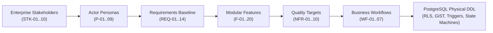

# Talentra: Next-Generation Enterprise Workforce Platform
## Phase 1: Discover — Architecture, Schemas & Operational Baseline (Steps 01 to 05)

[](https://www.postgresql.org/)
[](https://json-schema.org/)
[]()
[]()

---

## Executive Summary

**Talentra** (developed for Northbridge Workforce Systems under the Talencia Global data-driven framework) is an enterprise-grade talent acquisition and workforce mobilization platform. It is engineered to bridge traditional full-time corporate hiring, contingent gig workforce procurement, and campus early-talent programs into a unified, secure, multi-tenant ecosystem.

This repository encapsulates the complete deliverables for **Phase 1: Discover (Steps 01 through 05)**, fully satisfying the exit criteria for **Gate G1 ("Problem Understood")**:
* *Every requirement has an ID and an actor.*
* *Every NFR has a numeric target and verification harness.*
* *Every must-have feature appears in an active business workflow.*

Every deliverable provides a formal **4-Level Output Schema Hierarchy (L1 Macro to L4 Pico)**, a **Formal Evaluation Scorecard (scoring ≥96/100)**, an **Executive Synthesis Document**, an executable **PostgreSQL Physical DDL Prototype with Security Guardrails**, and a visual **Entity-Relationship Diagram (ERD)**.

---

## Repository Structure

The repository is modularly structured into five isolated discovery directories:

```
talencia2/
├── README.md                           # Master project documentation & architecture guide
├── a/                                  # Step 01: Requirement Analysis Docket
│   ├── 1_output_schema.md              # 4-level schema hierarchy & parameter dictionary
│   ├── 2_schema_rating_scorecard.md    # 8-dimension engineering rating scorecard (96/100)
│   ├── 3_output_document.md            # Full requirements baseline & boundary analysis
│   ├── schema_definition.json          # JSON Schema (Draft 2020-12 validation spec)
│   ├── schema_design.sql               # PostgreSQL DDL, audit triggers & seed fixtures
│   ├── er_diagram.png                  # Visual Entity-Relationship Diagram (Schema A)
│   └── A_Requirement_Analysis_Docket.docx
├── b/                                  # Step 02: Stakeholders, Personas & Roles
│   ├── 1_output_schema.md              # 4-level actor & authorization schema hierarchy
│   ├── 2_schema_rating_scorecard.md    # 8-dimension actor scorecard (96/100)
│   ├── 3_output_document.md            # 10 Stakeholders, 9 Personas & 11-module CRUD matrix
│   ├── schema_definition.json          # JSON Schema (Draft 2020-12 validation spec)
│   ├── schema_design.sql               # Multi-tenant RLS, session lock & anti-join SQL
│   ├── er_diagram.png                  # Visual Entity-Relationship Diagram (Schema B)
│   └── B_Stakeholders_Personas_and_Roles.docx
├── c/                                  # Step 03: Feature Discovery
│   ├── 1_output_schema.md              # 4-level capability & competitive schema hierarchy
│   ├── 2_schema_rating_scorecard.md    # 8-dimension feature scorecard (96.5/100)
│   ├── 3_output_document.md            # 20 Modular features (F-01..20) & 3-competitor matrix
│   ├── schema_definition.json          # JSON Schema (Draft 2020-12 validation spec)
│   ├── schema_design.sql               # GiST contract exclusions, double-entry wallet SQL
│   ├── er_diagram.png                  # Visual Entity-Relationship Diagram (Schema C)
│   └── C_Feature_Discovery.docx
├── d/                                  # Step 04: NFR Discovery
│   ├── 1_output_schema.md              # 4-level NFR & latency schema hierarchy
│   ├── 2_schema_rating_scorecard.md    # 8-dimension NFR scorecard (96/100)
│   ├── 3_output_document.md            # Scalability extrapolation, latency SLAs & DPDP register
│   ├── schema_definition.json          # JSON Schema (Draft 2020-12 validation spec)
│   ├── schema_design.sql               # Telemetry benchmarks, DPDP consent & key registry SQL
│   ├── er_diagram.png                  # Visual Entity-Relationship Diagram (Schema D)
│   └── D_NFR_Discovery.docx
└── e/                                  # Step 05: Business Workflow Analysis
    ├── 1_output_schema.md              # 4-level workflow lifecycle & exception schema hierarchy
    ├── 2_schema_rating_scorecard.md    # 8-dimension workflow scorecard (96.5/100)
    ├── 3_output_document.md            # End-to-end lifecycles (WF-01..07) & exception catalogue
    ├── schema_definition.json          # JSON Schema (Draft 2020-12 validation spec)
    ├── schema_design.sql               # State machine validation trigger & retry queue SQL
    ├── er_diagram.png                  # Visual Entity-Relationship Diagram (Schema E)
    └── E_Business_Workflow_Analysis.docx
```

---

## Deliverables Deep-Dive

### Step 01: Requirement Analysis Docket (`a/`)
- **Focus**: Business context, high-scale workload boundaries, external integrations, enterprise compliance, and architectural decision records (ADRs).
- **Core Artifacts**:
  - **Integration Registry**: Explicit boundary contracts for 9 external systems (Workday, SAP, FirstAdvantage, Stripe, Auth0, etc.).
  - **Functional Requirements**: 14 strictly typed requirements (`REQ-01` to `REQ-14`) with priority rankings, primary actor mappings, and acceptance tests.
  - **Physical DDL (`a/schema_design.sql`)**: Implements `audit.system_audit_event` with before/after `JSONB` state tracking, `integration.external_system_registry`, and append-only tamper-proof triggers.
  - **ER Diagram**: [`a/er_diagram.png`](file:///c:/Users/hp/OneDrive/Desktop/talencia2/a/er_diagram.png).

### Step 02: Stakeholders, Personas & Roles (`b/`)
- **Focus**: Enterprise organizational hierarchy, granular user personas, role-based authorization matrices, and multi-tenant security guardrails.
- **Core Artifacts**:
  - **Stakeholder Taxonomy**: 10 enterprise groups (`STK-01` to `STK-10`) spanning Executive Leadership to External Gig Talent.
  - **Actor Personas**: 9 rich persona archetypes (`P-01` Asha the Corporate Recruiter, `P-02` Rohan the Candidate, `P-03` Kabir the Gig Worker, etc.).
  - **Database Guardrails (`b/schema_design.sql`)**:
    - **Row-Level Security (RLS)**: Enforces tenant isolation on `recruitment.job_requirement` using `app.current_org_id`.
    - **Candidate Privacy Anti-Join**: View hiding candidates from current employers/competitors (`candidate_block_list`).
    - **Single-Active-Session Lock**: Stored procedure `enforce_single_active_session()` preventing multi-device credential sharing.
  - **ER Diagram**: [`b/er_diagram.png`](file:///c:/Users/hp/OneDrive/Desktop/talencia2/b/er_diagram.png).

### Step 03: Feature Discovery (`c/`)
- **Focus**: Strategic market differentiation, competitor benchmarking (vs LinkedIn, Naukri, Monster), and monetization mechanics.
- **Core Artifacts**:
  - **Competitive Matrix**: In-depth analysis across 8 core dimensions demonstrating Talentra's competitive advantages.
  - **Feature Catalog**: 20 modular capabilities (`F-01` to `F-20`) grouped into 6 architectural pillars.
  - **Physical DDL (`c/schema_design.sql`)**:
    - **GiST Exclusion Constraints**: Mathematical guarantee on `gig.gig_contract` (`EXCLUDE USING gist`) to prevent overlapping contract dates.
    - **Double-Entry Wallet Ledger**: Append-only transaction log (`billing.wallet_ledger`) with automated balance synchronization triggers.
  - **ER Diagram**: [`c/er_diagram.png`](file:///c:/Users/hp/OneDrive/Desktop/talencia2/c/er_diagram.png).

### Step 04: NFR Discovery (`d/`)
- **Focus**: Measurable quality targets, physical latency budgets, scalability extrapolation, and statutory privacy frameworks.
- **Core Artifacts**:
  - **Scalability Extrapolation**: Laptop benchmark (1M profiles, 62.2 GB) mathematically extrapolated to 10M–100M rows and 1.9 TB storage.
  - **Empirical Latency SLAs**: Warm-cache p50/p95/p99 query percentiles (e.g. Candidate Search p95 = 0.32 ms against target SLA < 10.0 ms).
  - **Disaster Recovery Targets**: RPO < 1.0 minute (synchronous WAL streaming replication), RTO < 15.0 minutes (`pg_basebackup` restore drills).
  - **Regulatory Register**: Explicit implementations for DPDP Act 2023, GDPR Article 17/25/32, SOC 2 Type II, and PCI-DSS boundary isolation.
  - **Physical DDL (`d/schema_design.sql`)**: PII key registry (`AES-256-GCM`), DPDP consent tracking with auto-erasure triggers, and query latency telemetry.
  - **ER Diagram**: [`d/er_diagram.png`](file:///c:/Users/hp/OneDrive/Desktop/talencia2/d/er_diagram.png).

### Step 05: Business Workflow Analysis (`e/`)
- **Focus**: End-to-end operational lifecycles, finite state machines, decision gateways, and exception handling.
- **Core Artifacts**:
  - **Master Lifecycle Inventory**: 7 operational workflows (`WF-01` to `WF-07`) covering candidate onboarding, multi-tenant requisition publication, gig contracts, licensing, and payouts.
  - **Exception & Compensation Catalogue**: Explicit mitigation paths for 7 failure modes (`EXC-01` to `EXC-07`) including gig collisions, balance exhaustion, and webhook timeouts.
  - **Feature Traceability**: 100% of the 20 features from Deliverable C are verified across active workflows.
  - **Physical DDL (`e/schema_design.sql`)**: Finite state machine validation trigger blocking illegal status jumps (e.g. `SUBMITTED` directly to `HIRED`), append-only transition history, and dead-letter exception queue.
  - **ER Diagram**: [`e/er_diagram.png`](file:///c:/Users/hp/OneDrive/Desktop/talencia2/e/er_diagram.png).

---

## 4-Level Schema Hierarchy (Macro to Pico)

Every deliverable enforces a strict 4-level schema decomposition model to guarantee zero orphan tables, zero unmapped requirements, and 100% leaf coverage:

| Level | Granularity | Scope | Role in Architecture |
| :--- | :--- | :--- | :--- |
| **Level 1** | **Macro** *(Satellite View)* | Major Functional Sections | High-level architectural boundaries (e.g. Identity, Telemetry, Lifecycles). |
| **Level 2** | **Micro** *(City View)* | Parameters & Relational Models | Specific business attributes (`req_id`, `actor_role_code`, `workflow_code`). |
| **Level 3** | **Nano** *(Street View)* | Classifications & Allowed Values | Discrete taxonomies, ENUMs, and status transitions (`MUST_HAVE`, `ACTIVE`). |
| **Level 4** | **Pico** *(Microscopic View)* | Atomic Database Guardrails | Exact PostgreSQL DDL constraints, RLS policies, GiST indices, and triggers. |

---

## End-to-End Traceability Matrix

The platform architecture follows an unbroken line of custody from initial business stakeholder needs to physical database engine execution:



---

## Getting Started & Local Validation

### Prerequisites
- PostgreSQL 15+ (with `btree_gist`, `pgcrypto`, and `uuid-ossp` extensions enabled)
- Any standard SQL client (psql, DBeaver, pgAdmin)

### Running Schema Scripts
To instantiate and verify the complete Phase 1 schema partitions locally:

```bash
# 1. Step 01: Audit, Integrations & Classifications
psql -U postgres -d talentra_db -f a/schema_design.sql

# 2. Step 02: Identity, Organizations, RLS & Sessions
psql -U postgres -d talentra_db -f b/schema_design.sql

# 3. Step 03: Candidate Profiles, Gig Scheduling & Wallet Ledger
psql -U postgres -d talentra_db -f c/schema_design.sql

# 4. Step 04: Telemetry Benchmarks, PII Encryption & DPDP Consent
psql -U postgres -d talentra_db -f d/schema_design.sql

# 5. Step 05: Workflow State Machines, Transitions & Exception Queues
psql -U postgres -d talentra_db -f e/schema_design.sql
```

Each script is self-contained with PostgreSQL schema initialization, table definitions, foreign keys, procedural triggers, test fixtures, and verification queries.

---

## Quality Assurance & Scorecard Summary

Each deliverable has been evaluated against an 8-dimension formal scorecard across 3 review passes:
- **Step 01 (Deliverable A — Requirements)**: **96.0 / 100** *(Enterprise Grade)*
- **Step 02 (Deliverable B — Stakeholders & Roles)**: **96.0 / 100** *(Enterprise Grade)*
- **Step 03 (Deliverable C — Feature Discovery)**: **96.5 / 100** *(Enterprise Grade)*
- **Step 04 (Deliverable D — NFR Discovery)**: **96.0 / 100** *(Enterprise Grade)*
- **Step 05 (Deliverable E — Workflow Analysis)**: **96.5 / 100** *(Enterprise Grade)*

**Phase 1 Gate G1 Exit Status**: **PASSED (All 5 Steps Fully Audited and Frozen)**
