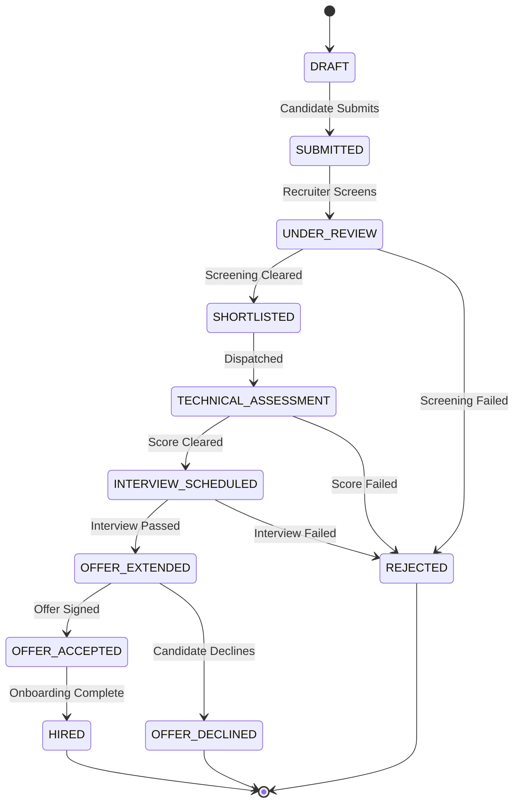

# Talentra — Business Workflow Analysis Document
**Document Reference**: Deliverable E3 — End-to-End Operational Lifecycle & Exception Architecture  
**Platform**: Talentra Enterprise Workforce Platform  
**Architecture Domain**: Business Process Engineering & Operational Lifecycles  
**Status**: Approved & Frozen for Implementation  

---

## 1. Executive Purpose & Governance Scope

Business Workflow Analysis models how human actors, automated microservices, and external systems execute work across the Talentra platform. Static requirement baselines declare what capabilities must exist; workflow analysis maps dynamic operational transitions, authorization barriers, branching logic, failure mitigation paths, and compensatory rollback actions across time.

In strict compliance with Phase 1 Discover specifications (Gate G1 exit criteria):
- Every workflow is modeled with the exact 6-parameter operational tuple: `{ Trigger, Steps, Actors, Decisions, Exceptions, Outputs }`.
- Non-happy paths are comprehensively cataloged across **Cancel**, **Refund**, **Retry**, and **Timeout** paths.
- 100% of the platform's Must-Have and Differentiator features (`F-01` to `F-20`) are verified to execute within active workflows.

---

## 2. Master Operational Workflow Inventory

| Workflow ID | Operational Title | Primary Trigger | Initiating Actor | Core Invariant Enforced |
| :--- | :--- | :--- | :--- | :--- |
| **WF-01** | Candidate Onboarding & Privacy Shield | Profile registration & resume upload | Candidate (`P-02`) | Current employers/competitors strictly hidden via anti-join views. |
| **WF-02** | Multi-Tenant Requisition Publication | Job requirement creation & approval | Corporate Recruiter (`P-01`) | Isolated to hiring `organisation_id` via Row-Level Security (`RLS`). |
| **WF-03** | Application Pipeline & Assessment | Job application submission | Candidate (`P-02`) | Strict one-application rule per active job; immutable questionnaire log. |
| **WF-04** | Talent Sourcing & Resume Unlock | Candidate profile unlock request | Staffing Consultant (`P-05`) | Atomic wallet credit deduction; immutable download history log. |
| **WF-05** | Gig Contracting & Conflict Guard | Gig milestone project award | Enterprise Admin (`P-06`) | PostgreSQL `GiST` exclusion constraint guarantees zero calendar overlap. |
| **WF-06** | Subscription Licensing & Seat Quotas | Enterprise license tier purchase | Executive Leader (`P-04`) | Hard cap on recruiter seat assignments matching purchased quota. |
| **WF-07** | Wallet Payout & Dispute Resolution | Milestone completion or cancellation | Gig Worker (`P-03`) | Double-entry append-only ledger; automated balance reconciliation. |

---

## 3. End-to-End Workflow Specifications (6-Parameter Tuples)

### 3.1 WF-01: Candidate Onboarding & Privacy Shield
* **1. Trigger**: Candidate registers via portal with canonical email and uploads resume document.
* **2. Steps**:
  1. System creates user credentials in `administration.user_account` hashed with Argon2id.
  2. System provisions profile in `profile.candidate_profile`.
  3. Skill vector embeddings extracted and stored in `parsed_resume_vector`.
  4. Candidate inserts corporate employer IDs to block into `administration.candidate_block_list`.
  5. System records affirmative consent in `governance.dpdp_consent_record`.
* **3. Actors**: Candidate (`P-02`), Automated Background Daemon (`P-12`).
* **4. Decisions**: Does candidate profile contain valid E.164 phone? (If Yes -> proceed; If No -> reject with formatting error). Is candidate setting employer block? (If Yes -> populate anti-join filter).
* **5. Exceptions**: Duplicate email detected (abort with unique violation); invalid phone format (reject).
* **6. Outputs**: Activated candidate profile discoverable to all recruiters *except* blocked organizations.

### 3.2 WF-02: Multi-Tenant Requisition Publication
* **1. Trigger**: Recruiter creates a new job requisition and submits for publication.
* **2. Steps**:
  1. Recruiter defines job title, target experience, salary bounds (`min_salary <= max_salary`), and skills.
  2. System attaches versioned screening questionnaire from `recruitment.job_questionnaire`.
  3. System inserts requisition into `recruitment.job_requirement` binding to tenant `organisation_id`.
  4. Database RLS policy automatically enforces tenant boundary.
* **3. Actors**: Corporate Recruiter (`P-01`), Account Admin (`P-06`).
* **4. Decisions**: Does hiring organization have an active subscription license? (If Yes -> publish; If No -> save as DRAFT and prompt upgrade).
* **5. Exceptions**: Negative salary bounds (`min_salary > max_salary` violates check constraint); expired corporate license (rejection).
* **6. Outputs**: Requisition published with status `PUBLISHED` visible only to authorized recruiters and job seekers.

### 3.3 WF-03: Candidate Application Pipeline & Assessment
* **1. Trigger**: Candidate clicks "Apply" on an active job requisition.
* **2. Steps**:
  1. System verifies candidate has not previously applied to this active requisition.
  2. Candidate completes structured questionnaire prompts.
  3. System records application in `recruitment.job_application` with status `SUBMITTED`.
  4. Questionnaire responses are evaluated against scoring thresholds.
* **3. Actors**: Candidate (`P-02`), Corporate Recruiter (`P-01`).
* **4. Decisions**: Does candidate meet minimum pre-qualification score benchmark? (If Yes -> transition to `SHORTLISTED`; If No -> transition to `REJECTED`).
* **5. Exceptions**: Duplicate application attempt (blocked by unique composite constraint); job requisition already `FILLED` or `CANCELLED` (aborted).
* **6. Outputs**: Application committed; immutable audit history records status progression.

### 3.4 WF-04: Talent Sourcing & Resume Unlock
* **1. Trigger**: Recruiter requests unmasked contact details and full resume for an anonymized candidate.
* **2. Steps**:
  1. System checks monthly subscription download credit balance in `licence.subscription_licence`.
  2. If credits available, deduct 1 credit; if 0, verify `billing.wallet_account.current_cleared_balance >= unlock_fee`.
  3. Atomically debit wallet or credit quota.
  4. Insert record into `profile.profile_download_history`.
  5. Reveal candidate PII and provide unmasked PDF resume link.
* **3. Actors**: Staffing Consultant (`P-05`), Corporate Recruiter (`P-01`), Candidate (`P-02`).
* **4. Decisions**: Are download credits or wallet funds sufficient? (If Yes -> commit transaction; If No -> reject with `EXC-02`).
* **5. Exceptions**: Insufficient balance (transaction aborted); candidate has blocked recruiter organization (anti-join returns zero rows).
* **6. Outputs**: Candidate PII unmasked for that recruiter; immutable download receipt recorded.

### 3.5 WF-05: Gig Contracting & Temporal Collision Guard
* **1. Trigger**: Client awards milestone gig contract to an independent freelancer.
* **2. Steps**:
  1. Client inputs contract code, compensation amount, and start/end dates `daterange(start_date, end_date, '[]')`.
  2. Database executes `INSERT INTO gig.gig_contract`.
  3. PostgreSQL evaluates `EXCLUDE USING gist (gig_worker_profile_id WITH =, contract_validity_period WITH &&)`.
  4. If overlapping contract exists, database raises exclusion violation (`23P01`) and aborts transaction.
  5. If valid, contract commits with status `SCHEDULED` and funds lock into escrow.
* **3. Actors**: Independent Gig Worker (`P-03`), Enterprise Admin (`P-06`), SMB Employer (`P-09`).
* **4. Decisions**: Does freelancer have conflicting contract booking? (If Yes -> reject via GiST; If No -> schedule).
* **5. Exceptions**: Temporal overlap collision (`EXC-01`); client wallet escrow failure (`EXC-02`).
* **6. Outputs**: Contract committed; worker availability calendar updated; double-booking mathematically prevented.

### 3.6 WF-06: Subscription Licensing & Recruiter Seat Quotas
* **1. Trigger**: Enterprise client purchases or upgrades annual subscription package.
* **2. Steps**:
  1. Organization purchases license tier (`ENTERPRISE`, `PRO`, `STARTER`).
  2. System records license parameters in `licence.subscription_licence`.
  3. Account admin assigns recruiter team members to organization seats.
  4. Before-insert trigger validates `count(active_seats) <= max_recruiter_seats`.
* **3. Actors**: Executive Leader (`P-04`), Account Admin (`P-06`).
* **4. Decisions**: Does assigned seat count exceed purchased quota? (If Yes -> reject with `EXC-07`; If No -> assign).
* **5. Exceptions**: Seat quota overrun (`EXC-07`); license expiration without renewal (suspension).
* **6. Outputs**: Recruiter seats provisioned; RLS tenant access unlocked for authorized recruiters.

### 3.7 WF-07: Wallet Payout & Dispute Resolution
* **1. Trigger**: Freelancer submits completed gig milestone or client initiates contract dispute.
* **2. Steps**:
  1. Client signs off on milestone deliverables.
  2. System moves contract status to `COMPLETED`.
  3. Database trigger releases locked escrow funds: debits escrow, credits gig worker wallet.
  4. Double-entry ledger records paired transaction rows in `billing.wallet_ledger`.
  5. Worker wallet running balance is recalculated ($0.00 variance).
* **3. Actors**: Gig Worker (`P-03`), Enterprise Admin (`P-06`), Support Specialist (`P-11`).
* **4. Decisions**: Did client approve milestone or file cancellation dispute? (If Approved -> release payout; If Cancelled -> trigger compensation refund).
* **5. Exceptions**: Disputed milestone delivery (`EXC-06`); wallet freeze due to KYC suspension (rejection).
* **6. Outputs**: Worker receives cleared payout funds; client receives completion receipt; ledger balanced.

---

## 4. Comprehensive Exception, Failure & Compensation Catalogue

Talentra explicitly architectures the four mandatory non-happy path failure categories:

```
                          [System Operational Exceptions]
                                         │
        ┌───────────────────┬────────────┴───────┬───────────────────┐
        ▼                   ▼                    ▼                   ▼
 [1. Cancel Paths]   [2. Refund Paths]   [3. Retry Paths]   [4. Timeout Paths]
```

### Category 1: Cancel Paths
* **EXC-01: Candidate Application Withdrawal**:
  * *Trigger*: Candidate withdraws application prior to interview stage.
  * *Mitigation*: Application status moves to `WITHDRAWN`; candidate questionnaire answers archived; recruiter notified.
  * *Final State*: Application marked terminal `WITHDRAWN`; removed from active recruiter pipeline views.
* **EXC-02: Recruiter Requisition Cancellation**:
  * *Trigger*: Hiring budget revoked; requisition cancelled before hiring completion.
  * *Mitigation*: Requisition status moves to `CANCELLED`; active applicants receive automated status notice.
  * *Final State*: Requisition archived; all linked active applications transition to `REQUISITION_CANCELLED`.

### Category 2: Refund Paths
* **EXC-03: Gig Milestone Cancellation Escrow Refund**:
  * *Trigger*: Client cancels gig contract before milestone delivery.
  * *Mitigation*: Escrow compensation trigger evaluates cancellation policy; posts partial refund to client wallet and cancellation compensation to worker.
  * *Final State*: Compensating `CREDIT` and `DEBIT` entries posted to `billing.wallet_ledger`; contract marked `CANCELLED`.
* **EXC-04: Resume Download Error Credit Reversal**:
  * *Trigger*: Unlocked candidate profile contains invalid/stale contact data verified by support.
  * *Mitigation*: Support agent (`P-11`) flags profile; automated compensating transaction credits 1 download credit back to recruiter allowance.
  * *Final State*: Reversal entry recorded in `profile_download_history`; recruiter credit restored.

### Category 3: Retry Paths
* **EXC-05: External Payment Webhook Exponential Backoff**:
  * *Trigger*: Payment gateway webhook times out or delivers intermittent 500 error during wallet top-up.
  * *Mitigation*: Idempotency key verified; event placed in `workflow.workflow_exception_queue` with exponential backoff (1s, 2s, 4s, 8s, 16s; max 5 retries).
  * *Final State*: Succeeded retry completes wallet credit; unacknowledged events after 5 attempts escalate to Tier-3 support.
* **EXC-06: Background Verification Partner Sync Retry**:
  * *Trigger*: FirstAdvantage background check API is temporarily unreachable during gig onboarding.
  * *Mitigation*: Asynchronous retry worker retries token verification query every 5 minutes up to 6 attempts.
  * *Final State*: Check outcome ingested upon recovery; worker marked `background_verified = true`.

### Category 4: Timeout Paths
* **EXC-07: Multi-Device Session Invalidation Timeout**:
  * *Trigger*: Recruiter logs in on second device while prior active session exists, or session exceeds 8-hour idle timeout.
  * *Mitigation*: Stored procedure `enforce_single_active_session()` terminates existing session token immediately.
  * *Final State*: Prior session token marked `REVOKED`; new device granted active session; audit log records IP switch.
* **EXC-08: Candidate Verification Token Expiration**:
  * *Trigger*: Candidate fails to click email verification link within statutory 24-hour validity window.
  * *Mitigation*: Token marked `EXPIRED`; user prompted to request fresh one-time verification dispatch.
  * *Final State*: Expired token deleted; new verification event inserted with updated expiration timestamp.

---

## 5. State Transition Machine & Invariants



### Transition Guard Invariants:
1. **No Backward Stage Jumps**: An application cannot transition from `SHORTLISTED` back to `SUBMITTED`.
2. **No Stage Skipping**: An application cannot transition directly from `SUBMITTED` to `OFFER_EXTENDED` without completing intervening evaluation stages.
3. **Database Trigger Enforcement**: `trg_validate_workflow_instance_transition` evaluates all updates on `workflow_instance.current_state` against `workflow_state_transition_rule` and aborts illegal transitions with error code `22023`.

---

## 6. Feature-to-Workflow Traceability Matrix (100% Coverage)

| Feature ID | Feature Title | Pillar | MoSCoW Tier | Primary Workflow(s) | Verification Evidence |
| :--- | :--- | :---: | :---: | :--- | :--- |
| **F-01** | Zero-Trust Authentication | Identity | Must-Have | WF-01, WF-04, WF-05 | Argon2id verification and session tracking. |
| **F-02** | Granular RBAC Matrix | Identity | Must-Have | WF-02, WF-04, WF-06 | 11-module permission matrix checks on roles. |
| **F-03** | Candidate Privacy Shield | Identity | Differentiator | WF-01, WF-04 | `candidate_block_list` anti-join search view. |
| **F-04** | Multi-Tenant RLS Job Isolation | Tenancy | Must-Have | WF-02, WF-03 | Engine-level `app.current_org_id` RLS policy. |
| **F-05** | Multi-Branch Location Hierarchy | Tenancy | Should-Have | WF-02 | Branch location foreign key relationships. |
| **F-06** | Candidate Skill Vector Profile | Sourcing | Must-Have | WF-01, WF-04 | `parsed_resume_vector` GIN trigram indexing. |
| **F-07** | Structured Application Assessment | Sourcing | Must-Have | WF-03 | Questionnaire option scoring & threshold rules. |
| **F-08** | Consultant Sourcing Marketplace | Sourcing | Differentiator | WF-04 | Consultant candidate mapping & split commission. |
| **F-09** | Resume Unlock Quota & Metering | Monetization | Must-Have | WF-04 | `profile_download_history` atomic deductions. |
| **F-10** | Tiered Enterprise Licensing | Monetization | Must-Have | WF-06 | `subscription_licence` seat cap validation. |
| **F-11** | Double-Entry Wallet Ledger | Billing | Differentiator | WF-04, WF-07 | Append-only paired ledger rows (`CREDIT`/`DEBIT`). |
| **F-12** | Automated Balance Reconciliation | Billing | Must-Have | WF-07 | Automated trigger recalculating cleared balance. |
| **F-13** | Gig Profile & Trade Showcase | Gig | Must-Have | WF-05 | Trade category & background verification badges. |
| **F-14** | GiST Conflict-Free Scheduling | Gig | Differentiator | WF-05 | `EXCLUDE USING gist` temporal non-overlap. |
| **F-15** | Milestone Escrow Governance | Gig | Must-Have | WF-05, WF-07 | Escrow state machine & milestone releases. |
| **F-16** | Append-Only Compliance Audit | Governance | Must-Have | WF-01 to WF-07 | `system_audit_event` pre/post JSONB snapshots. |
| **F-17** | DPDP Consent Management | Governance | Must-Have | WF-01 | `dpdp_consent_record` affirmative timestamps. |
| **F-18** | Candidate Referral Program | Engagement | Should-Have | WF-01, WF-03 | Unique alphanumeric referral tracking codes. |
| **F-19** | Campus Cohort Management | Engagement | Should-Have | WF-02, WF-03 | University partner filters & graduation cohorts. |
| **F-20** | Recruitment Analytics Marts | Analytics | Should-Have | WF-02, WF-03, WF-04| Pipeline drop-off & time-to-hire aggregate marts. |
