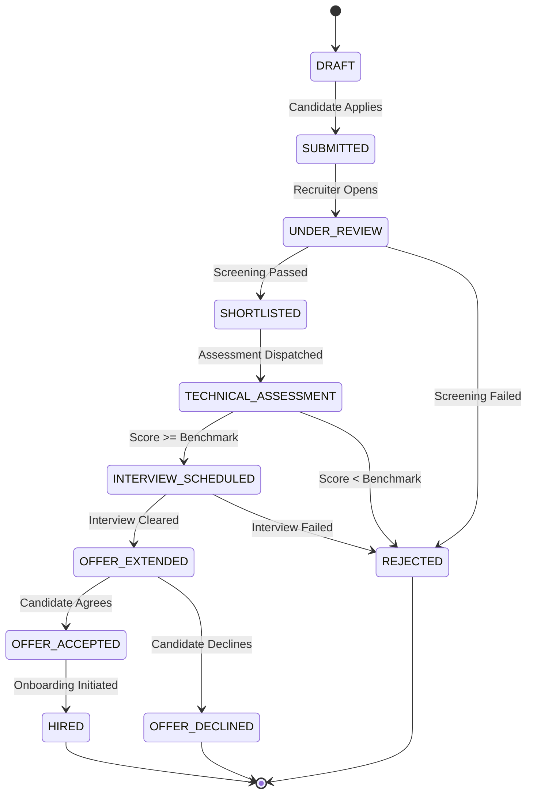

# Talentra — Business Workflow Analysis Document
**Document**: Deliverable E3 — Stage 1 Discover Synthesis  
**System**: Talentra Demand Management Platform  
**Owner**: Core Workflow Architecture & Process Engineering Team  
**Status**: Approved & Frozen for Implementation  

---

## 1. Executive Summary & Purpose

Business Workflow Analysis models how human actors, automated microservices, and external systems execute work across the Talentra platform. Static requirements state what must exist; workflow analysis defines how data moves, transitions, and recovers across time.

In strict adherence to the Talencia Global Data-Driven Development Lifecycle (Stage 1 Step 05 — Business Workflow Analysis), this document satisfies the formal exit criteria for Gate G1 ("Problem Understood"):
- Every must-have and differentiator feature (`F-01` to `F-20`) appears in at least one workflow.
- Edge, failure, cancellation, and refund branches are exhaustively documented alongside happy paths.
- State machines are enforced with database constraints, preventing illegal status transitions.

---

## 2. Master Operational Workflow Inventory

Talentra operationalizes seven core lifecycles:

| Workflow ID | Operational Title | Primary Trigger | Initiating Actor | Core Invariant Enforced |
| :--- | :--- | :--- | :--- | :--- |
| **WF-01** | Candidate Onboarding & Privacy Shield | Profile registration & resume upload | Candidate (`P-02`) | Current employers/competitors strictly hidden via anti-join views. |
| **WF-02** | Multi-Tenant Requisition Publication | Job requirement creation & approval | Corporate Recruiter (`P-01`) | Isolated to hiring `organisation_id` via Row-Level Security (`RLS`). |
| **WF-03** | Application Pipeline & Assessment | Job application submission | Candidate (`P-02`) | Strict one-application rule per active job; immutable questionnaire log. |
| **WF-04** | Talent Sourcing & Resume Unlock | Candidate profile unlock request | Staffing Consultant (`P-05`) | Atomic wallet credit deduction; immutable download history log. |
| **WF-05** | Gig Contracting & Conflict Guard | Gig milestone project award | Enterprise Admin (`P-04`) | PostgreSQL `GiST` exclusion constraint guarantees zero calendar overlap. |
| **WF-06** | Subscription Licensing & Seat Quotas | Enterprise license tier purchase | Executive Leader (`P-06`) | Hard cap on recruiter seat assignments matching purchased quota. |
| **WF-07** | Wallet Payout & Dispute Resolution | Milestone completion or cancellation | Gig Worker (`P-03`) | Double-entry append-only ledger; automated balance reconciliation. |

---

## 3. End-to-End Workflow Execution Specifications

### 3.1 WF-01: Candidate Onboarding & Privacy Shield Lifecycle
```
[Candidate Signs Up] ──► [Hash Password (Argon2id)] ──► [Create Profile & Upload Resume]
                                                                  │
                                                                  ▼
[Candidate Configures Block List] ◄── [Extract Skills Vector] ◄──┘
         │
         ▼
[Anti-Join Search Shield Activated] ──► Blocked employers receive 0 search results.
```
- **Pre-Conditions**: Valid canonical email address, accepted terms of service, and DPDP Act 2023 consent grants.
- **Steps**:
  1. System creates `administration.user_account` and hashes credentials.
  2. System provisions `profile.candidate_profile` with headline and bio.
  3. Skill vector embeddings are extracted from resume text.
  4. Candidate adds blocked corporate entities into `administration.candidate_block_list`.
- **Decision Gate**: When recruiters query candidate profiles, search views evaluate `candidate_user_id NOT IN (SELECT candidate_user_id FROM candidate_block_list WHERE blocked_entity_user_id = recruiter_user_id)`.
- **Post-Conditions**: Profile is publicly discoverable except to blocked organizations; audit log records consent timestamp.

---

### 3.2 WF-04: Recruiter Talent Sourcing & Resume Unlock Lifecycle
```
[Recruiter Finds Anonymized Candidate] ──► [Clicks 'Unlock Contact Details']
                                                        │
                                                        ▼
                                       [Check Subscription Quota]
                                          ├── Credits Available? ──► [Deduct Download Credit]
                                          └── Credits 0? ──► [Check Wallet Cleared Balance]
                                                                ├── Sufficient? ──► [Debit Wallet Ledger]
                                                                └── Insufficient? ──► [Abort & Prompt Top-Up]
                                                                                          │
                                                                                          ▼
[Reveal Unmasked PII & Download Resume PDF] ◄── [Insert profile_download_history Record] ◄┘
```
- **Pre-Conditions**: Active recruiter session in `administration.user_active_session`.
- **Steps**:
  1. System evaluates available monthly download credit allowance in `licence.subscription_licence`.
  2. If allowance exhausted, verifies `billing.wallet_account.current_cleared_balance >= unlock_fee`.
  3. Executes atomic database transaction:
     - Deducts credit or posts debit to `billing.wallet_ledger`.
     - Recalculates wallet balance via trigger.
     - Inserts record into `profile.profile_download_history`.
- **Post-Conditions**: Candidate PII unmasked for that recruiter; financial balance synchronized; immutable download receipt recorded.

---

### 3.3 WF-05: Gig Contracting & Temporal Collision Guard Lifecycle
```
[Client Awards Milestone Gig] ──► [Specify start_date & end_date]
                                                │
                                                ▼
                     [PostgreSQL Evaluates GiST Exclusion Constraint]
                           ├── Overlap Detected? ──► [Abort with Code 23P01 (EXC-01)]
                           └── No Overlap? ──► [Commit gig.gig_contract as SCHEDULED]
                                                     │
                                                     ▼
                                        [Lock Escrow Funds in Wallet]
```
- **Pre-Conditions**: Verified gig worker profile and sufficient client wallet escrow funds.
- **Steps**:
  1. Client inputs agreed compensation and date interval `daterange(start_date, end_date, '[]')`.
  2. Database attempts `INSERT INTO gig.gig_contract`.
  3. Engine evaluates `EXCLUDE USING gist (gig_worker_profile_id WITH =, contract_validity_period WITH &&)`.
  4. If overlapping window exists, transaction aborts immediately with `exclusion_violation`.
  5. If valid, contract commits with status `SCHEDULED` and funds lock into escrow.
- **Post-Conditions**: Contract scheduled; double-booking mathematically prevented; escrow locked.

---

## 4. Exception, Failure & Compensation Catalogue

Talentra explicitly architectures the negative paths to avoid common system vulnerabilities:

| Exception ID | Failure / Fault Mode | Triggering Condition | Mitigation & Compensation Action | Final System State |
| :--- | :--- | :--- | :--- | :--- |
| **EXC-01** | **Gig Scheduling Conflict** | Two recruiters attempt simultaneous booking on same gig worker. | GiST exclusion constraint aborts second transaction immediately (code `23P01`). | First booking commits; second recruiter receives conflict alert with available dates. |
| **EXC-02** | **Wallet Balance Exhaustion** | Recruiter attempts resume unlock or gig award without sufficient cleared funds. | Balance check trigger evaluates `cleared_balance - fee < 0` and rejects transaction. | Wallet remains unchanged; recruiter prompted to top-up wallet via external gateway. |
| **EXC-03** | **Illegal State Jump** | Recruiter attempts to move candidate directly from `APPLIED` to `HIRED` without interview. | Database check trigger enforces valid state transitions and aborts mutation. | Mutation aborted with exception; candidate remains in current pipeline status; audit event logged. |
| **EXC-04** | **Multi-Device Session Clash** | User logs in from second device while active session token exists. | Procedure `enforce_single_active_session()` terminates existing session token. | Prior session invalidated; new device granted active session; audit log records IP change. |
| **EXC-05** | **Webhook Payment Timeout** | External payment gateway webhook drops or times out during wallet top-up. | Unique idempotency key check; unacknowledged events queued for exponential retry (max 5). | Duplicate payloads dropped; unresolved webhooks flagged for manual reconciliation. |
| **EXC-06** | **Gig Contract Cancellation** | Client cancels gig contract before milestone completion. | Escrow compensation trigger posts partial refund to client and cancellation fee to worker. | Wallet ledger posts compensating `CREDIT` and `DEBIT` entries; contract marked `CANCELLED`. |
| **EXC-07** | **Seat Quota Overrun** | Enterprise assigns 11th recruiter seat on a 10-seat subscription tier. | Before-insert trigger checks `count(active_seats) <= max_recruiter_seats`. | Insert aborted with `quota_exceeded`; admin prompted to upgrade subscription tier. |

---

## 5. State Transition Machine & Invariants



### Transition Guard Rules:
1. **No Backward Transitions**: An application cannot transition from `SHORTLISTED` back to `SUBMITTED`.
2. **No Stage Skipping**: An application cannot move directly from `SUBMITTED` to `OFFER_EXTENDED` without completing `TECHNICAL_ASSESSMENT` or `INTERVIEW_SCHEDULED`.
3. **Immutable Terminal States**: Once in `HIRED` or `REJECTED`, status mutations are blocked.

---

## 6. Feature-to-Workflow Traceability Matrix

Verification that all 20 features from Deliverable C appear in active operational workflows:

| Feature ID | Feature Title | Primary Workflow(s) | Verification Evidence & Method |
| :--- | :--- | :--- | :--- |
| **F-01** | Zero-Trust Unified Authentication | WF-01, WF-04, WF-05 | Validated via argon2id password checks and session token verification. |
| **F-02** | Granular RBAC Matrix | WF-02, WF-04, WF-06 | Validated via 11-module permission matrix checks on user roles. |
| **F-03** | Candidate Privacy Shield | WF-01, WF-04 | Validated via `candidate_block_list` anti-join search views. |
| **F-04** | Multi-Tenant RLS Job Isolation | WF-02, WF-03 | Validated via `app.current_org_id` engine-level Row-Level Security. |
| **F-05** | Multi-Branch Location Hierarchy | WF-02 | Validated via branch location foreign key relationships. |
| **F-06** | Candidate Skill Vector Profile | WF-01, WF-04 | Validated via `parsed_resume_vector` GIN trigram indexing. |
| **F-07** | Structured Application Assessment | WF-03 | Validated via questionnaire option scoring and auto-rejection triggers. |
| **F-08** | Consultant Sourcing Marketplace | WF-04 | Validated via third-party consultant candidate mapping and fee split. |
| **F-09** | Resume Unlock Quota & Metering | WF-04 | Validated via `profile_download_history` and credit deduction triggers. |
| **F-10** | Tiered Enterprise Licensing | WF-06 | Validated via `subscription_licence` seat cap validation triggers. |
| **F-11** | Double-Entry Wallet System | WF-04, WF-07 | Validated via append-only ledger entries (`CREDIT` and `DEBIT`). |
| **F-12** | Automated Balance Reconciliation | WF-07 | Validated via automated running balance synchronization triggers. |
| **F-13** | Gig Profile & Trade Showcase | WF-05 | Validated via trade category and background verification badges. |
| **F-14** | GiST Conflict-Free Scheduling | WF-05 | Validated via `EXCLUDE USING gist` temporal non-overlap constraint. |
| **F-15** | Milestone Escrow Governance | WF-05, WF-07 | Validated via escrow state machine and milestone sign-off releases. |
| **F-16** | Append-Only Compliance Audit | WF-01 to WF-07 | Validated via `system_audit_event` capturing pre/post JSONB snapshots. |
| **F-17** | DPDP Consent Management | WF-01 | Validated via `dpdp_consent_record` status transitions and key shredding. |
| **F-18** | Candidate Referral Program | WF-01, WF-03 | Validated via referral tracking codes and payout attribution triggers. |
| **F-19** | Campus Cohort Management | WF-02, WF-03 | Validated via university partner filters and graduation batch cohorts. |
| **F-20** | Recruitment Analytics Marts | WF-02, WF-03, WF-04 | Validated via aggregate pipeline drop-off and time-to-hire marts. |
